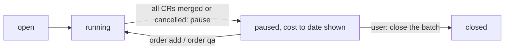

## Summary

A chantier batch had no clear end: the cards said a finished batch was "landed" and could take new work, but the last step sent the user straight to closing it, and the cost was only shown as "not final". Now a batch has three states with one meaning each: running, paused, closed. When every change request is merged or cancelled, the batch is paused and its full cost to date is shown. It is closed only when the user says so.

## Deliverables

The lifecycle, stated once in the concepts card and followed by every other card, the CLI, the board and the docs:

The command and the stored words change:

| Before | After |
| --- | --- |
| `chantier land` | `chantier pause` (no alias) |
| `status: "open"` / `"landed"`, key `landed` | `status: "running"` / `"paused"`, key `paused` |
| cost "not final", two lines printed | full cost summary printed, ending with a "to date" line |
| `order slots --note 0` called a pause | called a hold |
| board section "Landed (n of m)" | "Merged (n of m)" |

## Changes

- CLI: `land` becomes `pause` and prints the cost table; the state words, messages, `STATUS.md` (`# <folder>: paused`, `## Paused`, `(to date)`) and the board follow.
- A helper in `state.py` reads an old `batch.json` (`landed` as paused, `open` as running) and the next write stores the new words, so a batch started before this change keeps working.
- Cards: new "Batch lifecycle" entry in `concepts.md`; the Chief of Staff and Foreman cards, `SKILL.md`, host references and docs say "paused", "the pause" and "hold" consistently, and closing is the user's later word.
- Diagrams and docs updated together with their text files; scenario and eval kit follow the new words, with a new step for the old-words read.

## Impacts

Users see a paused batch with its cost at the end of a batch, in Foreman and in direct mode, and the board folds a paused batch with its cost. Scripts calling `chantier land` must call `pause`. No visual change beyond the board labels and the diagrams.

## Blast radius

Grade: 2. It renames a command and stored state words across the CLI, the board and the cards. Old batches are read through a helper; a `git revert` restores the old words, but a batch rewritten with the new words would then need `paused` read back as `landed`.

## Test plan

- [x] New or changed tests (they fail on the previous code): board tests updated, scenario steps updated plus a new old-words step
- [x] Local gates: `just check` (32 passed), `just scenario` passed at the pushed head
- [ ] Evidence: no visual change to show beyond the diagrams in `docs/`
- [x] Review
- [ ] CI green

## Autonomous decisions

- The simple lifecycle diagram's last stage is named MERGE, not PAUSE: it shows the user merging a PR (a CR step), not the batch pause.
- The empty dashboard text "No open batch." became "No batch.", so "open" is no longer a state word.

## Internal references

CR-149 batch-lifecycle (batch-08).
