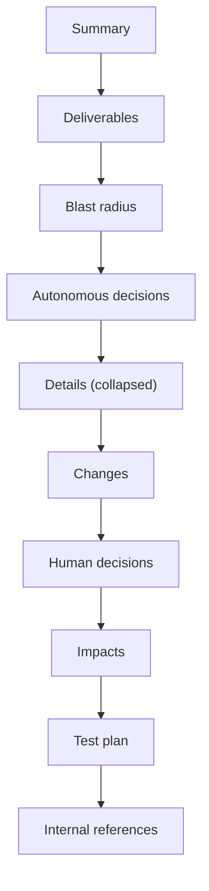

## Summary

A reviewer should judge a PR from its description in 30 seconds. The default PR description now keeps visible only what that takes (why, deliverables, risk, autonomous decisions) and folds the rest into one collapsed "Details" block. A new folded section shows what the user decided during the grill.

## Deliverables

The description's new layout:

Choices that matter:

- Autonomous decisions stay visible, right after Blast radius, so each one is reviewed.
- Before/after screenshots of a visible change are Deliverables' main visual, outside the fold.
- Deliverables also shows the impactful choices: aesthetics and behaviour for a UI, the architecture choices, the targets set for a rework.
- Human decisions is omitted, never written "None", when the change had no grill or the grill held no decision that shapes it.
- A project's own PR template or PR rules still rank above this default.

## Blast radius

- **1**: documentation, agent cards and a scenario stand-in only; a plain `git revert` restores the previous layout.

Grade: 1

## Autonomous decisions

None.

Details

## Changes

- `pr-template.md`: rules, template block and audit list follow the new layout; new Human decisions rule and audit items; the fold item in the audit.
- `worker.md`: the PR-description check also reads the grill's answers for the Human decisions audit item.
- `driver.md`: the evidence goes in Deliverables.
- `docs/use-cases.md`: the pull-request paragraph lists the new layout.
- `scenario/run_scenario.py`: the stand-in body follows the new layout.

## Human decisions

- Visible: Summary, Deliverables, Blast radius, Autonomous decisions; everything else in one fold.
- The checker keeps auditing every section in order, plus the fold.
- Human decisions lists only the grill's decisions that shape the change, and the checker verifies nothing is dropped or invented.
- A change with no grill omits Human decisions.

## Impacts

No visual change in the product; PR descriptions written from now on use the new layout. Descriptions of PRs already open are not rewritten.

## Test plan

- [x] New or changed tests: No behaviour change in the CLI
- [x] Local gates: `just check`, `just scenario`
- [x] Evidence: this description is itself the sample of the new layout (verified by reading its Markdown); no rendered screenshot was captured
- [x] Review
- [x] CI green

## Internal references

- CR-155 pr-details-fold

