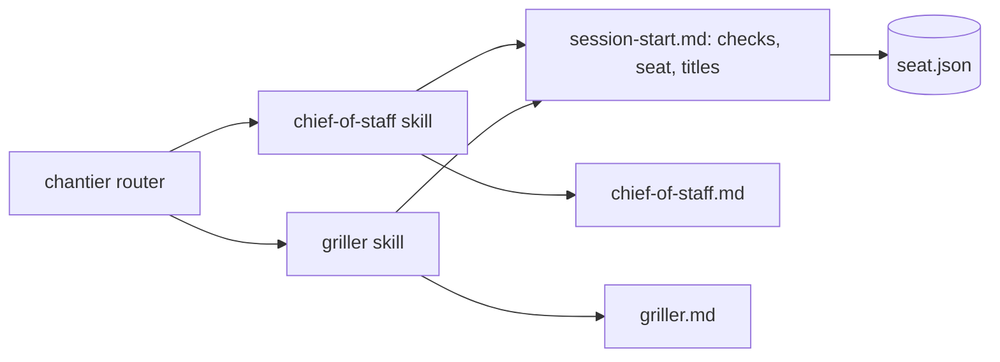

## Summary

Several chantier sessions can now work on one repository: one Chief of Staff, the only session that opens and runs batches, and any number of Grillers that refine and specify the inbox and backlog beside it, with no nested sessions (simpler in remote). Each session announces its role at once and renames itself, and a session that would be blocked later (a linked worktree) says so in its first message.

## Deliverables

Three entries now start a role:

| Entry | Role |
| --- | --- |
| `/chantier:chief-of-staff [direct]` | Chief of Staff (direct mode with `direct` or the user's word) |
| `/chantier:griller` | Griller |
| `/chantier:chantier` | router: asks which role |

The Chief of Staff's seat is a small CLI-kept file:

```text
chantier seat                      -> seat none | seat <session> env <env> title "<t>" link <l>
chantier seat take <s> --env .. --title .. --link ..   (exit 2 if held; --over <s> on the user's word)
chantier seat leave <s>
```



Choices: the seat records no date (the host says whether a session is alive); a hand-over never moves a running Driver; the CLI refuses only a silent take-over of the seat, the cards forbid the rest to a Griller.

## Blast radius

Grade: 2. The skill layout and the CLI's cost and close paths change; the seat is read by no other command, so a revert restores the previous behaviour.

## Autonomous decisions

None.

<details>
<summary>Details</summary>

## Changes

- Two thin skills, `chief-of-staff` and `griller`; `chantier` becomes the router; the Copilot manifest lists all three; the version script covers the new files; the board pane opens for `chantier` and `chief-of-staff` only.
- New cards `session-start.md` (start checks, seat, role, titles, first-turn introduction) and `griller.md`; `chief-of-staff.md` gains "Handing the seat over", the mode rule and the new titles; `foreman.md`, `routing.md`, `concepts.md`, `spec-writer.md` and `init.md` follow.
- Host references: Claude Code (tools, classes of session, sessions of one repository, two "For you" blocks) and Copilot, each line marked proved, documented or unproved.
- CLI: `seat` command; the batch records the list of Chief of Staff transcripts, used by cost and the close check.
- Docs: README, CONTRIBUTING, tutorial and use cases.

## Human decisions

- The second role is a Griller; the Chief of Staff keeps the last word on batches, in direct mode too.
- No claim or lock on a CR: Grillers work from the files and re-read them before acting.
- A Griller in a linked worktree opens no PR; it sends its planning files to the Chief of Staff.
- A hand-over never stops or moves a running piece of work; the seat moves only on the new session's explicit acknowledgement.
- Direct mode is chosen by `/chantier:chief-of-staff direct` or the user's word; it is proposed only where no Foreman can start.
- No CLI refusal of `open`, `order` or `close` from a session outside the seat.

## Impacts

No visual change.

## Test plan

- [x] New or changed tests: structure tests for the three skills and for `seat`; board pane test; scenario section on the hand-over, pricing two Chief of Staff sessions at pause and close
- [x] Local gates: `just check` and `just scenario` (both forges)
- [x] Evidence: `seat` take, refused take, `--over`, `leave` and a hand-over on a direct batch run in temporary repositories (verified); host trials (sessions, fork, liveness, rename, messages, remote flow) are not proved and stay marked unproved
- [x] Review
- [x] CI green

## Internal references

CR-153 multi-session-chief-of-staff (batch 09).

</details>
