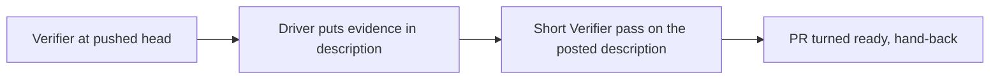

## Summary

A pull request's description was posted broken and nobody noticed: on a recent PR it lost every line break after the Driver added the Verifier's evidence, and the Inspector had only checked the draft file, not the posted text. The Verifier now also checks the description as it is posted on the forge.

## Deliverables

The Verifier's rule, in the Verifier section of `worker.md`, gains one claim with two points:

| Point | The posted description must be |
| --- | --- |
| Clean | rendered properly: line breaks, sections, the fold, images that resolve |
| Consistent | matching the diff at the pushed head: no claimed change missing, no delivered change unmentioned |

A description that fails either point is `NOT VERIFIED`, like any other failed claim.

The end of a CR Driver's run (`driver.md`) changes order so the check sees the final text:

## Blast radius

Grade: 1

Two instruction files change; a `git revert` restores the previous behaviour. Cost: one short extra Verifier pass per CR.

## Autonomous decisions

- Took the recommended option (a short Verifier pass after the Driver's last description edit) rather than letting the Verifier edit the description: the Verifier never edits, and the Driver keeps the forge.
- Left the Verifier's agent files unchanged: the rule lives in the card, and their bodies point to it.
- Kept the wording short and left how the Verifier reads the description to the agents, as asked.

Details

## Changes

- `skills/chantier/references/worker.md`: the Verifier's posted-description claim (clean, consistent).
- `skills/chantier/references/driver.md`: a short Verifier pass on the posted description, after the evidence edit and before the PR is turned ready.

## Human decisions

- Keep the rule simple: the Verifier checks that the description is clean and, above all, consistent with what the PR delivers; no detail on how.

## Impacts

No visual change. Drivers run one more short Verifier pass at the end of a CR.

## Test plan

- [x] New or changed tests: No behaviour change in the CLI (cards only)
- [x] Local gates: `just check` and `just scenario` pass
- [ ] Evidence: none, the change is a card rule
- [ ] Review
- [ ] CI green

## Internal references

CR-157 verifier-checks-pr-description (batch-09).

