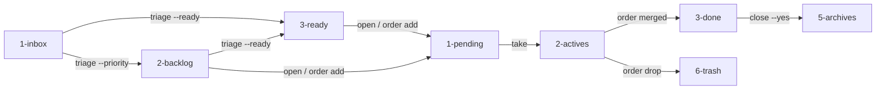

## Summary

Chantier's changes folder (the planning tree of a project) now matches the user's planning surface: changes wait in `3-ready` for the next batch, the current batch lives in `4-batch/` with three states, merged changes go to `5-archives` and dropped ones to `6-trash`. Before, a change sat in `3-requests/batch-<n>/` whatever its state, so the folder said nothing about where it stood. An existing tree is converted in place by the CLI at the first command after the update; there is no migration command.

## Deliverables

The new tree, and the folder that follows each status:

```text
<changes folder>/
├── 1-inbox/<slug>/                  filed, not prioritized
├── 2-backlog/P1…P4/<slug>/          prioritized
├── 3-ready/<slug>/                  waiting for the next batch (specified or automatable)
├── 4-batch/
│   ├── batch.json, events.jsonl, brief.md, .lock, STATUS.md, STATUS.json   local files of the batch
│   ├── 1-pending/<n>-<slug>/        in the batch, not started
│   ├── 2-actives/<n>-<slug>/        taken for work: working, ready to merge or blocked
│   └── 3-done/<n>-<slug>/           merged, until `close`
├── 5-archives/<YYMMDD-HHMM>-<n>-<slug>/   merged, after `close` (merge time, UTC)
└── 6-trash/…                        dropped on the user's word
```



- `chantier triage <folder> --ready` puts a change in `3-ready` on the user's word, with or without a specification (the change is then worked from the request alone); `--priority Pn` brings it back.
- `open` and `order add` also take from `3-ready`; a `3-ready` change with no specification is recorded with its request as the specification.
- `close --yes` moves each `3-done` change to `5-archives/<merge time>-<n>-<slug>`, then deletes the batch's own files; `init` creates the eight empty folders.
- The index is now `STATUS.md` and `STATUS.json` at the root of the changes folder (schema 3, board updated), the batch page is in `4-batch/`.
- Five diagrams are redrawn for the new tree (a sixth names no folder and is unchanged); their PNG renders are below.

The folder life of a change, redrawn:


The change lifecycle, with the new `triage --ready` step:


## Blast radius

Grade: 3

It changes every path the CLI, the cards, the board and the evals know, and converts an existing tree in place. The conversion is renames only, under the locks, rolled back on a failure; a revert of the PR plus renaming the folders back restores the old tree.

## Autonomous decisions

- The conversion runs from any command (at the repository lookup), not from a dedicated one, so no command sees an old tree.
- A bare `3-requests/` is not a trigger: a working change keeps its old folder until it moves, so the trigger is `4-archives/`, `5-trash/` or a batch file still in `3-requests/`.
- An existing empty target folder (`5-archives/`, `6-trash/`) is replaced; a non-empty one exits 2 naming both folders, nothing moved.
- The old `.lock` is not renamed (it cannot be on Windows while held); a new one is created in `4-batch/`.
- The batch id is read from `batch.json`, never from a folder name.
- A change with no recorded merge time is archived with the close time as its stamp.
- A release change requeued after its release is already in `2-actives`: a second `take` does not move it.
- `close` looks only at `1-pending` and `2-actives`, and also deletes the Demo's `demo/`.
- On the diagrams, the arrow into `3-ready` is labelled "waiting for the next batch" and the old "ready" arrow label became "set a priority", to keep the folder and the status apart. `how-chantier-works-simple-foreman.svg` names no folder, so it is unchanged.
- No release-notes entry: the project writes notes at release time from the log.

<details>
<summary>Details</summary>

## Changes

- `state.py`, `lifecycle.py`, `commands.py`, `rails.py`, `cli.py`: new stage layout, folder follows status (`take`, `order merged`, `order drop`, `cancel`, release hand-back), `triage --ready`, `3-ready` in `abandon` and `open`, `close` into `5-archives`, in-place conversion of an old tree.
- `status.py`: schema 3, index at the root, `3-ready` first in the backlog table, `3-done` first in the merged list.
- Board (`hooks/register.tsx`, types, tests): reads the new index and shows `3-ready`.
- Cards, README, CONTRIBUTING, docs and five SVGs with their text companions follow; `evals/kit/audit.py` and the runbooks read the new paths.
- Tests: the init test covers the eight folders; the scenario moves its checks and adds `changes_tree` and `old_tree` steps.

## Human decisions

- Chantier adopts the planning surface's tree in both modes; this change does the in-project mode.
- A running batch's own files stay local; only the result is shared.
- Change folders keep chantier's number; the tracker's issue number is not adopted.
- No migration command: the CLI converts an old tree itself.
- `3-ready` holds changes waiting for the next batch, on the user's word, with or without a specification, with no priority kept.
- A merged change stays in `3-done` until `close`; a dropped one goes to `6-trash` at once.
- The diagrams are redrawn in this change.

## Impacts

Users see the new folders, `triage --ready`, and a one-line message at the first command on an old tree. Developers read the index at `STATUS.json` at the root of the changes folder (schema 3). The attached renders show the redrawn diagrams.

## Test plan

- [x] New or changed tests (they fail on the previous code)
- [x] Local gates: `just check` (36 passed), `just scenario` (379/379 on both forges); the board test (`claude plugin test .`) could not be run locally
- [x] Evidence: the diagram renders in Deliverables; one `status` on a copy of a real tree converts it (50 archives, 11 dropped, every recorded path exists)
- [ ] Review
- [x] CI green

## Internal references

CR-158 changes-tree-v2. Investigation: `work/investigation.md`; diagram check: `work/check_svgs.py`, `work/check-svgs-output.txt`.

</details>
