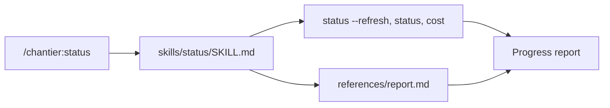

## Summary

The progress and completion reports have a fixed shape the user approved, but it lived inside a
roughly 500-line instruction card. After a context compaction, the assistant kept only a summary of
that card and answered "status" in free text. This PR moves the report format into a short card of
its own and adds a `/chantier:status` command that reads only that card and prints the report.

## Deliverables

- A new card, `skills/chantier/references/report.md`, holds the whole report format: icons and
  legend, the progress report, the completion report, the cost table and `cost --explain`, the tips
  line, "MR" or "PR" by remote, naming a change by its number and slug, and `status --refresh`
  with no epoch before a report. The long card keeps a one-line pointer in each place.
- A new command, `/chantier:status` (`skills/status/SKILL.md`), thin like the other entry skills:



- With nothing running it says so in one line and shows the backlog count from the index
  `STATUS.md`. It changes nothing: no order, no heartbeat, no epoch.
- Choice: no CLI `status --report` (out of scope by decision).
- Before: no such command. After, on a real run, the command writes this (header, legend, table
  with the icons copied from the status file, cost table, "For you", tip):

```text
Run 09 (direct mode): 1 of 4 slots in use, 6 changes of 7 done, $39.00 spent of $50.

⚪ not started or dropped · 🟡 working · 🟠 waiting · 🔵 to review · 🔴 blocked · ✅ merged

| Change                 | Subject                      | State               | PR     | Cost  |
| a changes-tree rework  | the changes tree, version 2  | ✅ merged           | PR #95 | $8.33 |
| the status command     | the /chantier:status command | 🟡 working (CI 2/3) | PR #96 | $2.41 |
  (other rows left out here)

| Line                   | Cost                          |
| the run                | $39.003 over 1129 model calls |
  (other cost lines left out here)

**For you:** nothing.

💡 Type `/chantier:status` for this table at once, ...
```

## Blast radius

Grade: 1. Documentation cards, one new skill and its registration; no CLI behaviour changes. A
plain `git revert` restores the previous card.

## Autonomous decisions

- The tips text in `report.md` is a copy of the report-specific part; the general tips bullet stays
  in the long card because it applies beyond reports.
- Links from `report.md` to other cards were replaced by inline definitions (a change's name, a
  ready PR) so the status command reads that one card alone; a pointer to a preflight check, which
  is not a report rule, was dropped.
- The progress and completion reports are laid out as bulleted lists, sentences unchanged.
- The status text output draws no icons, so the command reads each change's icon and label from the
  status file that `status --refresh` has just written.

<details>
<summary>Details</summary>

## Changes

- New `report.md` card and `skills/status/SKILL.md`.
- The long coordinator card: the Reports, Status, chain, Cost and Offer bullets point to
  `report.md`.
- The router skill's description names the new command.
- Registered the skill and the card: `scripts/version.py`, `.github/plugin/plugin.json`, the
  structure tests; listed in README, CONTRIBUTING, the tutorial and both host references.

## Human decisions

- A small, simple `/chantier:status` command instead of reloading the main skill, which would
  replay the introduction and reread about 500 lines each time.
- The report format moves to its own short card, which the command reads alone.
- No CLI `status --report` in this change.

## Impacts

No change to existing output; a new command that prints the approved report shape on demand.
The sample above shows it.

## Test plan

- [x] New or changed tests (they fail on the previous code): the structure tests list the new skill and card
- [x] Local gates: `just check` (36 passed), `just scenario` (379/379 on GitHub and GitLab)
- [x] Evidence: the report above, from a real run; the nothing-running path on a fresh repository
- [x] Review
- [x] CI green

## Internal references

CR-159 status-command, batch-09. Evidence files, not uploaded:
`.agents/changes/4-batch/2-actives/159-status-command/work/verifier/evidence/progress-report.md`,
`status-cost-raw.txt`, `no-active.txt`, and `work/verifier/verify.md`.

</details>
