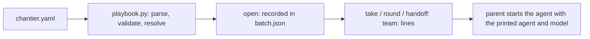

## Summary

Until now the only configuration was the `chantier` section of `AGENTS.md`, which cannot pick the model a role runs, name a user's own agent for a role without ambiguity, or list the skills and tools a role needs. This adds an optional `chantier.yaml` at the project's root, parsed, validated and resolved by the CLI (never by an agent). With no `chantier.yaml`, chantier runs exactly as before.

## Deliverables

A new command prints what each role will run, with the exact value to pass:

```text
$ chantier playbook
playbook: chantier.yaml, valid, host claude
coder: agent=rust-coder model=opus (claude-opus-5-5, Claude Opus 5.5) skills=jira
cr-driver: agent=my-driver model=(its file's)
inspector: agent=chantier:inspector model=(its file's)
```



- Choices: a strict YAML subset read with the standard library (no dependency); model names resolved by a per-host table, an unknown or ambiguous name is refused, never guessed; a host that cannot set a model at start refuses (Copilot, unproved); a running batch keeps the playbook it opened with; a missing required skill or tool is warned, never replaced by a workaround.

Claude Code start values (aliases the host takes): `opus` = claude-opus-5-5, `sonnet` = claude-sonnet-5-5, `haiku` = claude-haiku-5-5.

## Blast radius

**2**: a new CLI command, a preflight check for `chantier.yaml` and a `batch.json` key, plus amended cards. Without a `chantier.yaml` nothing changes; revert is possible, and a batch opened by the new version holds a `playbook` key the old one ignores.

## Autonomous decisions

- Claude Code's start value is the alias (`opus`, `sonnet`, `haiku`): a trial showed the alias runs the matching model.
- `preflight` prints in full, so the new check does not cut its verdict line.
- A model name matches a contiguous run of whole dash-separated parts of an identifier.
- The open design questions took the recommended answers (file at the repository's root, unknown model refused, no agent-existence check, agents per role only in `chantier.yaml`, plugin agents' tools unchanged, Foreman's model out of scope).

<details><summary>Details</summary>

## Changes

- New `playbook` module and command; `open` records the resolved playbook; `take`, `round`, `handoff` print `team:` lines; preflight gets a `chantier.yaml` check (and prints in full).
- Cards, host references, skills, README and docs describe `chantier.yaml`; the "only configuration" sentence is amended everywhere.
- Structure tests: agent-file models resolve in the table; the table has no duplicates. New playbook steps in the scenario.

## Human decisions

- The fine configuration lives in a dedicated optional `chantier.yaml` at the project's root, not in `AGENTS.md`; this amends the "only configuration" rule.
- Missing required skill or tool: warn and continue, without a look-alike.
- Models are resolved by the CLI, and the parent passes them exactly as printed.
- An unknown model is refused until a release adds it; no warning for a configured agent that is not found; agents per role move to `chantier.yaml`.

## Impacts

No visible change without a `chantier.yaml`. Claude Code takes a model alias at an agent's start (tried: `haiku` ran `claude-haiku-5-5`).

## Test plan

- [x] `just check` passes (Linux, macOS, Windows in CI)
- [x] `just scenario` passes, with the new playbook steps
- [x] Parser refusals carry their line numbers; `open` moves nothing on an invalid file

## Internal references

CR-169, batch-09; `.agents/changes/4-batch/2-actives/169-playbook-config/`

</details>
