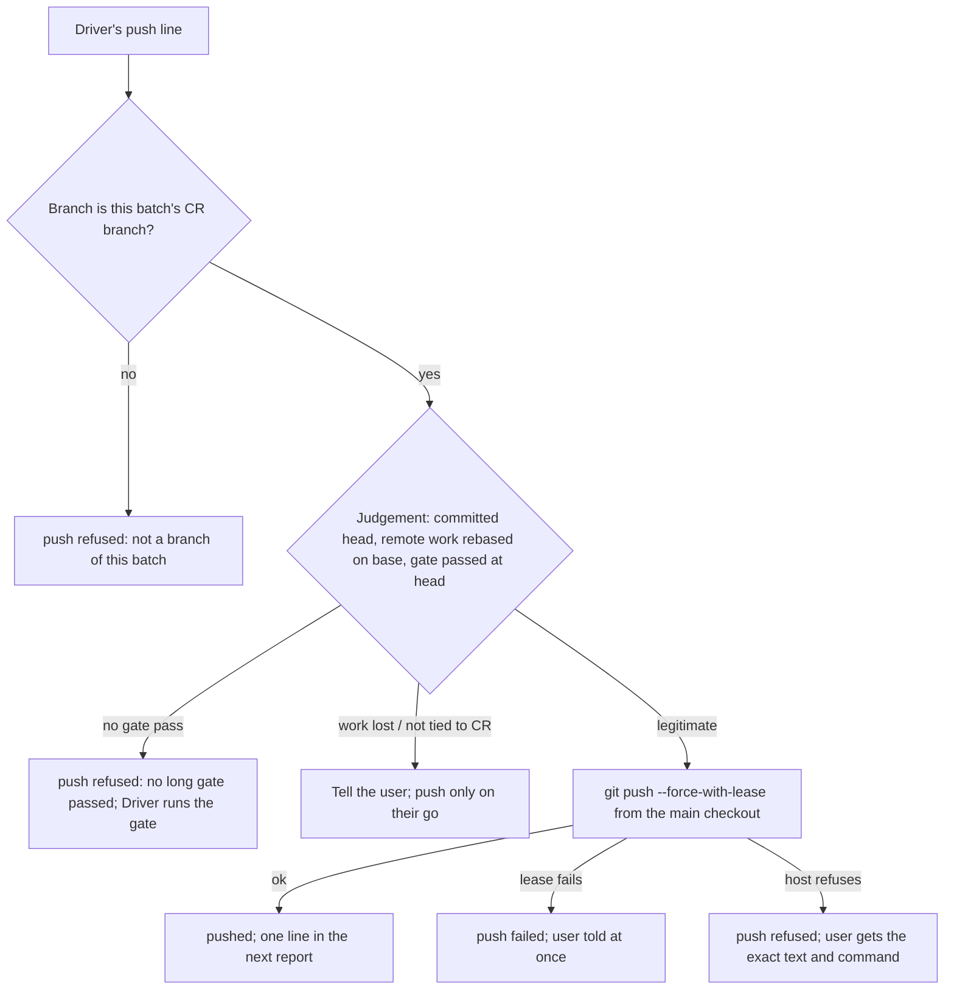

## Summary

When the host refuses a Driver's force push (Claude Code's auto-mode classifier blocks destructive git in subagents), the route ended with the Chief of Staff asking the user, although the push is the Chief of Staff's own to run. The cards now say plainly that the push is not a question for the user: the Chief of Staff judges it and runs it, and asks only when the push looks wrong or cannot be made.

## Deliverables

The Chief of Staff's handling of a refused force push, as the card now orders it:

Choices made:
- Legitimacy is judged on what the Chief of Staff reads, not on a fixed list.
- A missing gate pass is the Driver's slip: it is sent back, the user is not asked.
- A pushed branch is reported in the next report, not asked beforehand.

**UNVERIFIED:** the route itself has not run on a host that refuses a push since this change; this PR only changes the cards.

## Blast radius

Grade: 1. Text in five reference cards, no code, CLI or permission change; a `git revert` restores the previous behaviour.

## Autonomous decisions

- A missing gate pass at the local head is sent back to the Driver rather than asked to the user: the Driver's card already makes the gate pass before any push.
- A failed lease is told to the user at once with no wait; a refused own push shows the exact command so the user can run it.

Details

## Changes

- `chief-of-staff.md`: "A refused force push" rewritten as six steps (branch check, judgement, push, not legitimate, failed lease, own push refused); direct mode says the push is judged and run without asking the user.
- `driver.md`, `foreman.md`: the Chief of Staff judges and may ask the user first; the Driver and Foreman keep waiting.
- `hosts/claude-code.md`: the cause and the proof by use (2026-11-11).
- `status-layout.md`: one line in the next report for a push run for a Driver.

## Human decisions

- The Chief of Staff judges whether the push is legitimate and pushes automatically; it asks the user only when it thinks the push is not right or it cannot push.
- The rule is encoded in the cards, so every user gets it; no per-session agreement.
- The card says plainly that the push is not a question for the user.

## Impacts

No visual change. Chief of Staff, Foreman and Driver sessions follow the new rule from the next session.

## Test plan

- [x] No behaviour change in code: cards only
- [x] Local gates at `3c42f90`: `just check` passed, `just scenario` passed
- [x] Evidence: read-through of the cards at `3c42f90`
- [x] Review: approved at `3c42f90`
- [x] Verified at `3c42f90` (the rest carried from `026e88c`: the move only added one clause and rewrapped lines)
- [x] CI green at `3c42f90`

## Internal references

CR-170 force-push-judgement; batch-09.

