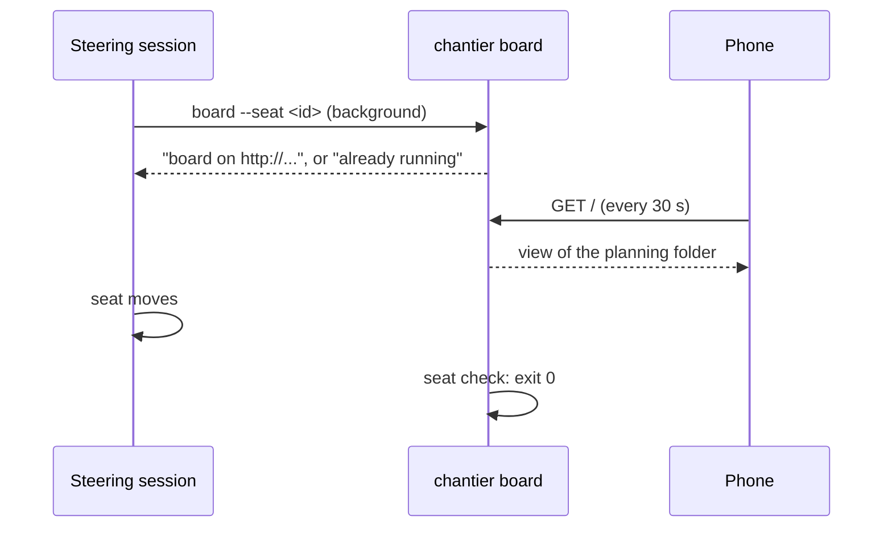

## Summary

In remote (Remote Control on a phone) the CR board pane does not show, so the only way to know where a batch stands is to ask for a status. This adds `chantier board`, a small read-only web page served by the CLI that a phone can open over the user's private network (for instance Tailscale). It shows the batch, its CRs, the inbox and the backlog of the project's planning folder, in the project or on an external planning surface, with no setup.

## Deliverables

- A new CLI command, `chantier board [--host] [--port] [--seat]`, in a new module `board.py`. It serves `/` (the page, self-refreshing every 30 s), `/api/status` (JSON) and `/file?p=<path>` (a file or folder inside the planning folder only). Any other method answers 405, any path outside the planning folder answers 404.
- Read only: it writes no file and takes no lock; `Repo.find` gets a `readonly` parameter that skips the `.gitignore` completion and old-tree conversion.
- It computes its view with the same functions that write the STATUS files, so the page says what the next `STATUS.json` would say.
- Default address `127.0.0.1:8765`; `chantier.yaml` gains an optional `board:` key (`host`, `port`), validated with line numbers like `roles`.

```yaml
board:
  host: 0.0.0.0   # or the machine's Tailscale address
  port: 8765
```

- Lifetime: the session that steers the project starts it in the background right after it takes the seat; it stops by itself when the seat moves, and a board already running for the project is reused.



- Evidence: a live run at 936fb2f (start line, /, /api/status, /file, 404 and 405 cases, reuse, stop with the seat, no file written) is in work/verifier/evidence/after.txt; text only, no screenshot. Opening the board from a phone over Tailscale is UNVERIFIED (by hand).

- Hardening: no-store, nosniff and a no-script CSP on every response, HTML escaping everywhere, no request log.

## Blast radius

Grade: 2

A new command and a new `chantier.yaml` key; shared code touched is `Repo.find` (one optional parameter), `playbook.load`, and the session-start and steering cards. A revert removes the board; nothing else depends on it.

## Autonomous decisions

- None.

<details>
<summary>Details</summary>

## Changes

- `board.py` (new), `cli.py` (command wiring), `state.py` (`Repo.find(readonly=)`), `playbook.py` (`board` key).
- The session-start and steering cards and both host references: starting the board, reading its first lines, unproved host rows with trials.
- `AGENTS.md`, `CONTRIBUTING.md`, `README.md`, module docstrings: the CLI-scope exception, bounded (reads only, writes no file, standard library only, knows no role).
- `scenario/run_scenario.py`: a `remote_board` step.

## Human decisions

- The board is a small web server reached through the user's private network, with no authentication (a risk the user accepts).
- Read only: to act, the user talks to the steering session.
- Listening on all interfaces is allowed on the user's word; the default is `127.0.0.1`.
- It ships as a `chantier board` CLI command, and AGENTS.md names it as a bounded exception.
- The session that steers the project starts it with its session and it stops when the seat moves.

## Impacts

New command and an optional configuration key; nothing changes for projects that ignore them.

## Test plan

- [x] New or changed tests: the scenario step `remote_board` (`just scenario` passes at 936fb2f)
- [x] Local gates: `just check` passes at 936fb2f
- [x] Evidence: before, `chantier board` is rejected at the base (04ed67b); after, a live run at 936fb2f serves `/`, `/api/status` and `/file` read only (kept in `work/verifier/evidence/`, text only)
- [x] Review: Inspector APPROVE at 30b02b5 plus the round-3 tree (committed as 372aef1, rebased as 936fb2f)
- [x] Verified: VERIFIED at 936fb2f; opening the board from a phone over Tailscale is UNVERIFIED (by hand, the user's trial)
- [x] CI green: just check x3 and just scenario at 936fb2f

## Internal references

- CR-182 remote-board

</details>
