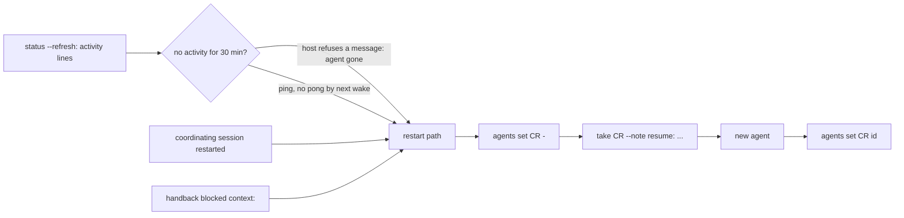

## Summary

In chantier, a background agent drives each change request to its pull request. When such an agent
died (the desktop app cut, a host crash, its context exhausted), nothing flagged it: in a recent
run four of them died with the app and only a person noticing that no file had changed for 40
minutes revealed it, and one that ran out of context handed back "not ready, restart me", a case
no card named. This PR lets the coordinating session see a dead agent within one or two
heartbeats and restart it from the change request's recorded state, without counting it as a new attempt and without an extra place in the parallel limit.

## Deliverables

The CLI states facts and refuses an ambiguous restart; the coordinating session's card judges
death. Before, it read one line (`longest silent Driver <cr> <n> min`, quoted output), blind during a code pass or
a gate. Now `status --refresh` prints one line per working change request (and for a recorded
stack-wide agent and each running QA check):

```
activity CR-104 12 min
activity CR-105 gate running
activity CR-106 not measured
activity CR-107 31 min (session-level)
```



Choices made:

- The CLI never says "dead" and holds no threshold; the 30-minute suspect rule and the two proofs
  of death (the host refuses a message to the agent, or a ping gets no pong by the next wake) live
  in the card, which a project's own rules outrank.
- `take` (the command that starts an agent on a change request) on one whose agent id is still recorded is refused (exit 2, naming `agents
  set <cr> -`), and `take` on a working one needs `--note`: two agents on one change request can
  no longer happen by accident. An accepted restart keeps its place in the parallel limit, is not counted as a new attempt, and the
  budget still applies (exit 5).
- `status` flags, in the literal words "no Driver recorded", a working change request with no agent id.
- New hand-back reason (`handback` is the command an agent ends with) `handback <cr> blocked context: <where it stopped, what is next>`: a fresh
  agent is started at once, with no ask to the user's assistant; a second one with nothing new
  since is an ask. The existing "ended twice" rule counts only silent ends of the agent itself.
- On a host with no per-agent record the line is session-level and says so; an unreadable record
  is "not measured", never a guess. A running long gate counts as activity.

## Blast radius

Grade: 2

The CLI's `take` and `status --refresh` change behaviour, and several cards change. A caller that
retook a working change request without `agents set <cr> -` first is now refused. Revert is a
plain `git revert`; no data format changes.

## Autonomous decisions

- The exact wording of the activity line and of the `restart` mark on the `take` event were left
  open by the specification, within the words it fixes; the implementation chose them.
- The scenario's scripted agent-death step runs `agents set <cr> -` first, as the new restart
  path requires.

<details>
<summary>Details</summary>

## Changes

- `commands.py`: `_activity` builds the per-request lines (last event, session records of the
  request's agents and their workers, `gate running` from the long-gate lock); `_refresh` prints
  them in place of the old line; `status` flags "no Driver recorded"; `take` logs a restart and
  notes it; `handback` recognises `context:`.
- `rails.py`: `check_take` refuses a working change request without `--note` and any with an agent
  recorded.
- `costs.py`: reads the per-agent session records; `cli.py`: help texts.
- The documentation cards (listed under Internal references): the suspect rule, proofs of
  death, restart path, the `context:` reason, the exit-2 cases and the recovery sentence.
- `scenario/run_scenario.py`: the affected steps follow, and new checks cover each acceptance
  point.

## Human decisions

- Death is judged by the coordinating session's card, never by the CLI, and the CLI never
  restarts an agent by itself.
- The threshold is one heartbeat interval (30 minutes) without activity, kept in the card and not
  in `chantier.yaml`; the 3-hour "alive but not moving" stop stays.
- After an app restart or when a new coordinating session takes over, every working change
  request, stack-wide agent and running QA check with an agent id is restarted at once, without waiting for a ping.
- Worktree file times are not a liveness signal.

## Impacts

The coordinating session sees each working change request's activity at every wake and restarts a
lost agent from its recorded state; agents have a named way to hand back when their context ends.
No visual change.

## Test plan

- [x] New or changed tests (they fail on the previous code): scenario checks for the activity
  lines, `not measured`, the `take` refusals, the restart with the parallel limit full and with the budget
  spent, and the `context:` hand-back
- [x] Local gates at `404bd51`: `just check` (45 passed), `just scenario` (github and gitlab, all checks passed)
- [x] Evidence: no visible change; the scenario transcript at `404bd51` is the proof
- [x] Review: approved at `79cc74a`; carried to `404bd51` (rebase, context-only changes in two merged hunks)
- [x] Verified at `404bd51` (earlier proofs at `79cc74a`, judged again for the rebase); not testable here: a coordinating session following the cards
- [x] CI green at `404bd51`

## Internal references

- CR-185 driver-liveness (replaces CR-183, same work, branch started from its approved head
  79cc74a); roles: Driver, Foreman, Chief of Staff; the batch-11 retro
- Cards changed: `foreman.md`, `driver.md`, `concepts.md`, `chief-of-staff.md` (under `skills/chantier/references/`)
- Specification and answers: `.agents/changes/4-batch/2-actives/185-driver-liveness/`

</details>


