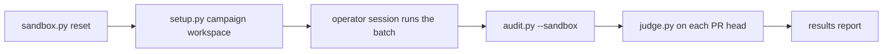

## Summary

Real eval campaigns used to take fresh work on this repository's `main` of the day, so two runs never measured the same thing and their pull requests were gone the next day. They now run on a frozen sandbox project (shelf, https://github.com/gsemet/chantier-eval-sandbox): the same recorded commit, the same already-specified changes, hidden tests that judge each pull request's head, and a report that names the chantier version and commit, the sandbox's base, the campaign, the mode and the models. Every pull request a run opens carries the run's number, date and campaign in its title. A new campaign, `full`, runs two batches end to end, releases included, with the operator playing the user.

## Deliverables

- 13 frozen changes (11 features, 2 releases) in `evals/kit/sandbox-crs/`, and 11 hidden test files in `evals/kit/sandbox-judge/` that are never copied into a workspace or pushed to the sandbox.
- `evals/kit/judge.py`: runs the hidden tests and the project's suite on a pull request's head in a clean clone (exit 0 pass, 1 fail, 4 not run), and judges a release (tag, versions, release check, GitHub release).
- `evals/kit/setup.py`: four sandbox campaigns (`full`, `real-foreman`, `real-direct`, `copilot`), preconditions, run number and title prefix, a run record next to the workspace; `claude-planted` is unchanged.
- `evals/kit/audit.py --sandbox` (replaces `--real`): a "The run" table, the checks, a "The judge" table, the cost.
- Runbooks for each campaign and the docs (`evals/README.md`, `evals/SCORECARD.md`, `CONTRIBUTING.md`, `README.md`).

Hidden tests, quoted from runs on a scratch copy of the sandbox (full output in the evidence files):

| Hidden tests | on the base | on its reference solution |
| --- | --- | --- |
| 11 feature files | every file fails | every file passes, project suite green |
| batch 1 combined (9 features) | - | 47 hidden passed, suite 84 passed |
| batch 1 and 2 combined (11 features) | - | 57 hidden passed, suite 97 passed |

The release judge against today's sandbox prints `fail` (no tag `v0.2.0`); on a scratch repository with a release commit tagged `v0.2.0` it passes and prints `not run: not the sandbox` for the GitHub part. The audit on made-up heads prints `pass`, `fail` and `not run` rows and exits 1.

## Blast radius

Grade: 1. New files under `evals/kit/` and the eval docs; the existing staged campaign keeps its behaviour. Nothing here touches the plugin, the cards, the CLI or the scenario. A `git revert` restores the previous kit. No campaign was run and nothing was written on the sandbox.

## Autonomous decisions

- The uppercase-scheme URL case of the duplicate-url hidden test asserts only the 400, because the sandbox's base already rejects such a URL (**UNVERIFIED:** observed by the author of the tests, not separately proved).
- The hand-back words checked by the audit's J24 include `context:` (the CLI accepts it); the scorecard lists the same ten words.
- The judge resolves `origin/<ref>` before `<ref>`, and exits 2 on a usage error (4 means only "not run").
- A fix CR gets a "not run (judged with its release)" row; CRs merged by an earlier batch are read from the workspace's archives.
- `setup.py` prints `--mode <stack|parallel|series>` for the quick campaigns, `--mode parallel` for `full`, and none for `copilot`.
- In the `full` runbook, a release commit must include `uv.lock` when the version bump changes it, because the sandbox's `RELEASING.md` does not say so (a finding for the sandbox's owner).
- The audit's staged branch (`claude-planted`) keeps reading the release tag from the campaign's bare origin.

Details

## Changes

- `evals/kit/sandbox-crs/<slug>/`: request, intent, answers and specification of each frozen change; `sandbox-judge/<slug>/test_judge_*.py`: the hidden tests.
- `evals/kit/judge.py`, `setup.py`, `audit.py`; one structure test in `skills/chantier/scripts/cli/tests/test_structure.py` checking that each campaign's changes have their frozen files and hidden tests.
- Runbooks: `evals/full/RUNBOOK.md` (new), `real-foreman`, `real-direct`, `copilot`; `claude-planted` loses its `--real`-era steps.

## Human decisions

- The sandbox is public, `main` unprotected, and the only force push on it is the kit's `reset --yes`.
- Merged pull requests may stay on the sandbox; every title carries the run number, date and campaign.
- `full` runs two batches with four slots in Foreman mode and no human step beyond one `ping` line past the host's message limit; the quick campaigns take the same five changes in every mode.
- The judge's hidden tests are kept in the kit and never pushed to the sandbox.

## Impacts

No visual change. Maintainers get reproducible campaigns, a judged report and a `full` campaign to run before a release.

## Test plan

- [x] New or changed tests (they fail on the previous code): the structure test; the 11 hidden files fail on the base (verified at 4e111ac)
- [x] Local gates at `4e111ac`: `just check` passes
- [x] Evidence at `4e111ac`: judge, release judge, workspace and audit runs (evidence files); `sandbox.py reset` (plan) was not rerun by the Verifier, setup's own base survey passed instead
- [x] Review: approved at `4e111ac`
- [x] Verified at `4e111ac`
- [x] CI green at `4e111ac`

## Internal references

- CR-189 reproducible-evals; evidence in its `evidence/` folder (02-judge.txt to 05-audit.txt)
- No paid campaign, merge or release on the sandbox was run in this change.

