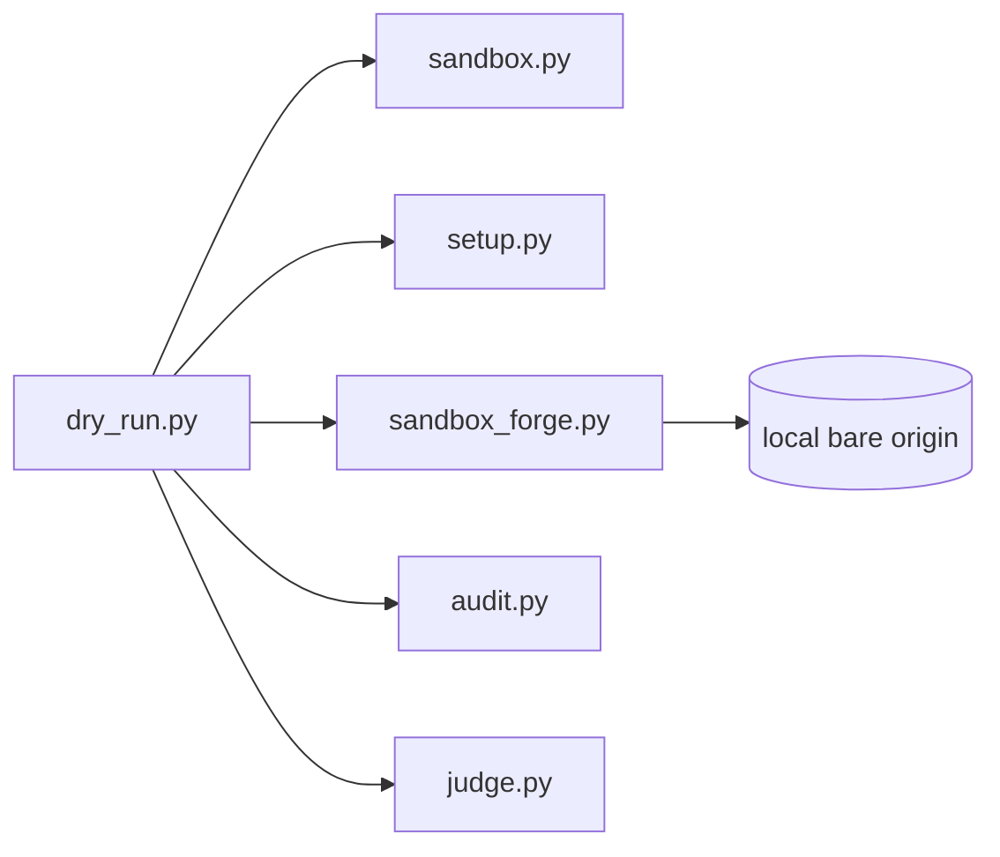

## Summary

Four blockers of the `full` eval campaign got past the review of the previous eval-kit change, because each piece (the judge, the setup, the audit) was checked alone and nobody ran them together. This PR gives the kit a dry run: one campaign played end to end on a local sandbox, with no model call and no write to GitHub. It covers the reset, the setup, a staged batch (one feature CR and a release), then the audit and the judge on that result. It passes on a run that follows the rules and, for each planted fault, fails and names the criterion.

## Deliverables

The dry run, `just eval-dry-run`, plays six cases:

| Case | Fault planted | Expected failure |
| --- | --- | --- |
| `clean` | none | audit exit 0, judge pass |
| `stray-merge` | a prefixed PR merged outside the batch | `FAIL [C12]` naming it; the release PR is not counted as stray |
| `reset-leftover` | a branch and a tag pushed back after the reset | setup exits 2 "the sandbox is not at its base"; passes after `reset --yes` |
| `merge-refused` | merge of a red, a pending, an unprefixed PR | `refused: ...; nothing merged` |
| `stale-lock` | release bumps the version but not `uv.lock` | CI `FAILURE`, merge refused, `FAIL [J5]`, judge release row `fail` |
| `force-tag-push` | a Driver runs a forced tag push (`--force`, `-f`) | audit `FAIL [J4]`; the plain tag push still passes |

Choices: the dry run rebinds `sandbox.URL` in its own process only (no new argument or variable for users); the fake `gh` is separate from `forge.py`; a stale `uv.lock` is now a judge `fail`, not `not run`; the dry run stays a separate recipe with its own CI job because it takes longer than 10 seconds (about 2 minutes on the author's machine); it reaches no remote by construction (a local bare origin and a fake `gh`); its `uv lock --offline` reads the registry from uv's cache, so the CI job warms that cache first (`uv lock --refresh --dry-run` in the sandbox, which writes nothing).

## Blast radius

Grade: 1. Eval kit, docs and one CI job only; the CLI, the cards and the scenario do not change. A `git revert` restores the previous kit.

## Autonomous decisions

- `delete-item` is the staged feature CR (the specification's default), with its reference solution in `evals/kit/dry-run/`.
- The audit's J4 check no longer flags pushing a release tag by name as a force push (the release procedure does it).
- The staged transcripts carry a minimal usage stub, because the CLI refuses a transcript with no priced call; it is staged data, not a model call.

Details

## Changes

- `evals/kit/dry_run.py`, `evals/kit/sandbox_forge.py`, `evals/kit/dry-run/`: the dry run, the fake `gh`, the reference solution.
- `.gitattributes`: `evals/kit/dry-run/*.patch` is checked out with LF so `git apply` works in a Windows checkout; the dry run also applies an LF copy of the patch.
- `sandbox.py`, `setup.py`, `audit.py`, `judge.py`: `gh` resolved with `shutil.which` (finds `gh.cmd` on Windows); `remote_refs` no longer binds the URL at definition; the judge reports a stale `uv.lock` as `fail`.
- `test_structure.py`: each frozen release CR names `uv.lock` in its Files list.
- `justfile`, `.github/workflows/ci.yml`: `eval-dry-run` recipe and CI job (with an online step that warms the uv cache before the run).
- `evals/README.md` ("Changing the kit"), `CONTRIBUTING.md`.

## Impacts

No visual change. Contributors changing `evals/kit/` run `just eval-dry-run`.

## Test plan

- [x] New or changed tests (they fail on the previous code): structure assertion, the six dry-run cases
- [x] Local gates at `4feeab7`: `just check`, `just eval-dry-run`
- [x] Evidence: dry run output at `4feeab7`; run against the previous kit (d72df44) failing on the three named criteria
- [x] Review: approved at `4feeab7`
- [x] Verified at `4feeab7`
- [x] CI green at `4feeab7`

## Internal references

CR-191 eval-kit-end-to-end-dry-run, batch-14.

