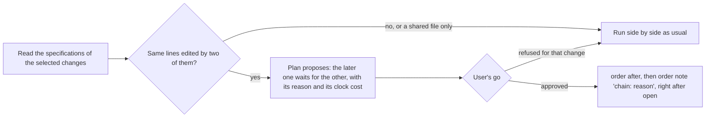

## Summary

In a parallel batch, every merge sends each other open pull request back for a rebase, a long gate, CI and a new verification. With n requests open that is about n²/2 passes. This change does two things: it measures what those passes cost from what earlier parallel runs recorded, and it lets the plan avoid the rebases that would conflict anyway. When two changes selected for a parallel batch edit the same lines (one shared table, one template block), the plan now proposes that the second waits for the first, with its reason. The user approves or refuses each wait at the go.

## Deliverables

The plan's new proposal, as the cards now describe it:

- The rule is one wording in every card: same lines, not the same file; proposed in the plan with its reason; approved at the go and refusable per change; recorded with the existing `order after` and `order note "chain: ..."` pair. The CLI does not change, and `depends.json` stays for a change that needs another's result.
- A working change rebases once before its next push, however many rebase notes came. The measure showed the need: in an earlier parallel run one working change rebased twice between two pushes, each with its own long gate.
- Every ready or blocked PR is still rebased after each merge, in parallel and stack mode alike, so it merges without a merge commit. That is unchanged on the user's word.
- The measure is under Internal references ("Cost of the rebase passes"): it counts 11 re-gated passes in one earlier run (10 of them long gates, about 126 minutes of scenario runtime) and 6 in another; no dollar figure is recorded per pass, so none is given.

No merge order is proposed. Among pull requests that overlap, each merge moves the others whatever the order, and the user merges when and what they want. The saving is in not starting side by side the changes that edit the same lines, so the second one starts on the first one's work instead of conflicting with it at each merge.

## Blast radius

Grade: 1

Cards and docs wording only (the plan, the chain wording of `foreman.md`, the rebase sentence of `driver.md`); no code, no CLI change. A plain `git revert` restores the previous behaviour.

## Autonomous decisions

- The measure is placed under Internal references, not in Deliverables, because its rows name the changes and paths of earlier batches, which the PR template keeps out of the visible sections.
- The rebase sentence of `driver.md` and the Parallel wording of `foreman.md` were changed because the measure shows a working change rebased twice between two pushes in an earlier parallel run (rows in Internal references); a second case there was a ready change taken back.
- A "Source" column was added to the measure table so each row names its record.
- A figure no record gives is written "not recorded"; the earlier run's event log no longer exists, and one pass has no merge named.

Details

## Changes

- `skills/chantier/references/chief-of-staff.md`: the "A batch is parallel unless" paragraph states the same-lines rule and its cost; "Starting a batch" step 2 names the two changes, the file, the lines and the reason in the plan line; step 3 records each approved wait right after `open`; the "A chain" bullet also covers a chain the plan proposed.
- `skills/chantier/references/foreman.md`: chain bullet reason aligned; Parallel bullet says a working change rebases once before its next push.
- `skills/chantier/references/driver.md`: one rebase onto the latest default branch, however many rebase notes came since the last push.
- `skills/chantier/references/concepts.md`, `skills/chantier/references/status-layout.md`, `docs/use-cases-foreman.md`: the chain wording follows.

## Human decisions

- Every open PR is still rebased after each merge; a PR the merge did not touch is not left as it is.
- The plan may propose a wait for two changes that edit the same lines, only if the reason is well explained; the user approves or refuses it per change at the go.
- No merge order is advised in reports.

## Impacts

No visual change. A user reading a batch plan may now see a proposed wait with its reason and its clock cost.

## Test plan

- [x] New or changed tests: No behaviour change (cards and docs wording)
- [x] Local gates at `99672f1`: `just check` (pass), `just scenario` (pass)
- [x] Evidence: none beyond the wording read check of the cards, at `99672f1` (no visual change)
- [x] Review: approved at `99672f1` (after a move review of the restack)
- [x] Verified at `99672f1`
- [x] CI green at `99672f1`

## Internal references

CR-211 parallel-rebase-cost (batch-15). Sources: `.agents/changes/5-archives/` (batch-11 CRs 174 to 185 and the retro of CR-185), `evals/results/real-direct-2026-11-12-run1.md`, the run's workspace archive. The cost table below is the Driver's own work from those records; its working file is `work/04-measure.md` in the CR folder.

### Cost of the rebase passes

Paths: `A11` = `.agents/changes/5-archives/`; `AE` = `C:/Users/gaeta/Projets/chantier-eval/real-direct-2026-11-12/.agents/changes/5-archives/`
(the run's workspace archive, outside this repository). Times are UTC from each `STATUS.json` step
(`at`). Gate log names are local time (UTC+1 on 2026-11-11, checked: CR-178's log `161947` = its 15:19:44Z
round note); a log's end is its file time. "Compute" = the scenario runtime printed in the log, github +
gitlab; "wall" = log start to end, queue wait for another CR's gate included. "Not recorded" = no file says.
A "pass" = a CR rebased onto a merge, long gate re-run. Source column added to the spec's four columns.

No `events.jsonl` of batch-11 exists (`4-batch/events.jsonl` holds batch-15 only, from 2026-11-12T21:39Z).
No dollar figure is recorded per pass anywhere: dollars are the CR's whole `cost_usd` (all rounds), with its pass count.

#### batch-11 (parallel, 11 merges; CR-183 cancelled, replaced by CR-185)

| Merge | Sent back (state then) | Patch changed by the rebase | Pass cost | Source |
| --- | --- | --- | --- | --- |
| CR-175 release-driver-diagram, 11-11 15:38Z (PR 111) | no re-gated pass. CR-180 (working) rebased to 9cb4cc7 at 15:41Z before its first gate; CR-174's pass A counted on the next row | CR-180: not recorded | no gate re-run; agents not recorded; $ not recorded | A11/*180*/STATUS.json (Round 2 note) |
| CR-178 version-pr-rendered-notes, 15:44Z (PR 112) | CR-174 pass A, onto CR-175+CR-178, head 7c1797a (working: shipped draft 15:52, never handed back until 18:25). CR-179 (working) rebased to c1a59cd at 15:48Z before its first gate | 174: yes in A or B (driver.md conflict, conflict-resolver, Inspector PASS; which pass not recorded). 179: not recorded | A: gate 12.4 min compute (373.2+373.4 s), 16.1 wall (15:54:30-16:10:37, waited for CR-177's gate); agents for A and B together: 1 conflict-resolver, 1 Inspector, 0 Verifier; $ not recorded | A11/*174*/STATUS.json (note 16:40:26Z), work/gates/20261111-165430.log |
| CR-177 foreman-sonnet-300k, 16:07Z (PR 114) | CR-174 pass B, head 904c79c (working; second rebase before the same push, 16:40Z). CR-181 (working) rebased clean to 6590219 at 16:32Z before its first gate | 174: see A (one of A, B yes, other not recorded). 181: no (clean) | B: gate 12.5 min compute (377.1+374.6), 20.2 wall (16:15:49-16:36:00, waited for CR-180); agents: counted under A; $ not recorded | A11/*174*/STATUS.json, work/gates/20261111-171549.log; A11/*181*/STATUS.json (r3 note) |
| CR-180 tracker-reports-and-draft-prs, 16:40Z (PR 115) | CR-174 pass C, head 2e9b88c (working until 18:25). CR-179 pass, head e8d079d, onto the merges since c1a59cd (this one and CR-177) (working, shipped 16:49Z, ready 18:19Z). CR-182 (working) rebased clean to 30b02b5 at 17:44Z before its first gate | 174 C: not recorded. 179: not recorded (note names no conflict). 182: no (clean) | 174 C: gate 10.5 min compute (315.7+312.8), 39.1 wall (17:41:29-18:20:35, waited for CR-181); one earlier attempt 16:41:09-16:55:40 (github only 391.6 s, no result recorded); 1 Verifier. 179: 10.6 compute (316.1+321.8), 28.2 wall (17:41:25-18:09:39); 1 Verifier. $ not recorded | A11/*174*/work/gates/20261111-184129.log and -174109.log; A11/*179*/work/gates/20261111-184125.log, STATUS.json; A11/*182*/STATUS.json |
| (same head, no rebase) | CR-181 gate re-run twice at 6590219 (18:09:49Z, 18:30:48Z), reason not recorded | n/a | 18:09: just check only (9 s); 18:30: scenario 10.2 min compute, 20.6 wall. Not counted as passes | A11/*181*/work/gates/20261111-185611.log, -191010.log |
| CR-174 worker-write-guard-redesign, 19:04:43Z (PR 113) | CR-181 pass, head 562eb03 (ready since 18:31Z). CR-176 pass, head 21bb33e (ready since 18:52Z). CR-182 pass, head a94a027 (working, verifying). One rebase each for this merge and the next (CR-179, one second later) | 181: yes (one doc conflict in status-layout.md resolved, Inspector PASS; in one of its two rebases). 176: no (clean, range-diff identical). 182: no (clean, retro line; the CR's note silent) | 181: 10.6 compute (318.5+320.0), 24.0 wall (19:06:20-19:30:19, waited for CR-182); 176: just check only (9 s), 13.7 wall, 1 Verifier; 182: 13.7 compute (410.6+409.3), 13.7 wall, 1 Verifier; 181 agents with its next pass: see CR-176 row; $ not recorded | A11/*181*/STATUS.json (19:34:22Z note), work/gates/20261111-200620.log; A11/*176*/STATUS.json (19:21:39Z), work/gates/20261111-200554.log; A11/*182*/STATUS.json (19:30:24Z), work/gates/20261111-200548.log |
| CR-179 retro-kept-at-close, 19:04:44Z (PR 116) | same passes as the row above (one rebase for both merges) | see above | see above (not counted twice) | same |
| CR-176 evals-redesign, 19:30:35Z (PR 118) | CR-181 pass, head 2f04cf6 (second rebase before the same push, 19:34Z). CR-182 pass counted on the next row | 181: not recorded (rebase "brought evals/docs only"; no conflict named) | 181: 10.6 compute (317.4+318.2), 10.6 wall (19:37:25-19:48:01); 1 Verifier; 181's 1 conflict-resolver + 1 Inspector are for its two passes together; $ not recorded | A11/*181*/work/gates/20261111-203725.log, STATUS.json |
| CR-181 cost-unknown-model, 19:49:38Z (PR 117) | CR-182 pass, head 936fb2f, onto this merge and CR-176 (ready 19:30:24Z, PR turned draft 19:52Z) | yes (README.md and playbook.py conflicts, conflict-resolver, Inspector APPROVED) | 13.7 compute (412.3+411.4), 13.7 wall (19:52:01-20:05:45); 1 conflict-resolver, 1 Inspector, 2 Verifiers; $ not recorded | A11/*182*/STATUS.json (19:52:00Z), work/gates/20261111-205201.log |
| CR-182 remote-board, 20:33:05Z (PR 119) | none (no PR open; CR-184 started 20:56Z) | n/a | 0 | A11/*184*/STATUS.json |
| merge not recorded (no batch CR merged between 20:33Z and 22:37Z) | CR-184 pass, head 1f269b2 (working), after its gate at eb08201 | no (clean or context-only, per retro) | 15.7 compute (472.1+468.7), 19.9 wall (21:54:14-22:14:09, waited for CR-183's gate); 3 Verifiers (VERIFIED, NOT VERIFIED, VERIFIED); $ not recorded | A11/*184*/STATUS.json, work/gates/20261111-225414.log; A11/*185*/retro.md line 29 |
| CR-184 gate-proof-cli-fixes, 22:37:16Z (PR 121) | CR-185 pass, head 404bd51 (working; Verified at 79cc74a before) | no (conflicts in run_scenario.py and concepts.md resolved mechanically, range-diff context-only) | 15.8 compute (473.4+473.7), 16.0 wall (22:39:21-22:55:20); 1 Verifier (23:07Z); no conflict-resolver recorded; $ not recorded | A11/*185*/STATUS.json (22:39:16Z), work/gates/20261111-233921.log, retro.md |
| CR-185 driver-liveness, 23:09:06Z (PR 122) | none | n/a | 0 | A11/*185*/STATUS.json |

**batch-11 totals.** Passes: 11 (CR-174 x3, CR-181 x2, CR-182 x2, CR-179, CR-176, CR-184, CR-185). Patch not
changed: 4 (176, 182 a94a027, 184, 185). Changed: 3 (one of 174's A/B, one of 181's two, 182 936fb2f). Not recorded: 4.
Gate: 126.2 min compute (7,570 s of scenario runtime, github+gitlab), 215 min wall including waits for other
CRs' gates; left out: CR-174's unfinished attempt (6.5 min), CR-181's two same-head re-runs (about 10 min), every
`just check`/`just mod`. Agents recorded in those passes: 17 (11 Verifiers, 3 conflict-resolvers, 3 Inspectors,
0 Coders). Dollars: not recorded per pass; whole-CR `cost_usd` of the 7 CRs that took passes: 174 $4.82 (3 passes),
179 $1.73 (1), 181 $4.13 (2), 176 $3.24 (1), 182 $3.57 (2), 184 $2.39 (1), 185 $0.34 (1) = $20.22, not the pass cost.
Four more rebases ran before a CR's first gate (180, 179, 181, 182): no re-gate, no cost recorded.
Retro (A11/*185*/retro.md lines 14, 29): "went back to Drivers", "about 13 minutes of the long gate each time".

#### real-direct run 1 (parallel, 5 merges; gate = the sandbox's fast gate, 1-2 s per log)

| Merge | Sent back (state then) | Patch changed by the rebase | Pass cost | Source |
| --- | --- | --- | --- | --- |
| CR-103 status-filter, 19:48:04Z (PR 1) | CR-102 (ready; `take --note "rebase: CR-103 merged"`), gate 61e2fad. CR-101 (working), gate d552320 at 19:49:47Z | 102: no (clean, report). 101: not recorded (no rebase note) | 102: 1 s gate, 19:48:04-19:50:18 to hand-back (2.2 min), 2 Verifiers. 101: 1 s gate, 1 Verifier. $ not recorded | AE/*102*/STATUS.json, work/gates/20261112-204835.log; AE/*101*/STATUS.json, work/gates/20261112-204946.log; report "What happened" |
| CR-102 edit-item, 19:50:40Z (PR 3) | CR-101 (working), gate 570baac. CR-104 (working) rebased onto 6773a4b before its first gate | 101: yes (item.html conflict, conflict-resolver, Inspector APPROVE). 104: yes (app.py conflict, conflict-resolver, Inspector APPROVE) | 101: 2 s gate, 3.9 min to hand-back (19:54:36), 3 Verifiers. 104: no re-gate, 1 conflict-resolver, 1 Inspector. $ not recorded | AE/*101*/STATUS.json (19:51:55Z), work/gates/20261112-205139.log; AE/*104*/STATUS.json (19:51:48Z) |
| CR-104 json-api, 19:54:43Z (PR 4) | CR-105 (working, 2 Verifiers in), gate dd62412. CR-101 (ready since 19:54:36Z, taken back), gate 79a58d1 | 105: yes (README conflict, conflict-resolver, Inspector pass). 101: yes (README conflict hand-resolved; added a BOM, removed in round 3) | 105: 1 s gate, 4.4 min to hand-back (19:59:05), 3 Verifiers (2 NOT VERIFIED), 1 conflict-resolver, 1 Inspector. 101: 1 s gate, 5.1 min to last verdict (19:59:48), 1 Coder (round 3), 1 conflict-resolver, 1 Inspector, 3 Verifiers. $ not recorded | AE/*105*/STATUS.json (19:56:10Z), work/gates/20261112-205552.log; AE/*101*/STATUS.json (round 3), work/gates/20261112-205635.log |
| CR-105 stats-page, 19:59:32Z (PR 5) | CR-101 (working), gate 4558b2f | yes (README conflict, conflict-resolver, Inspector APPROVE) | 1 s gate, 4.1 min to hand-back (20:03:35), 3 Verifiers, 1 conflict-resolver, 1 Inspector. $ not recorded | AE/*101*/STATUS.json (20:00:58Z), work/gates/20261112-210048.log |
| CR-101 delete-item, 20:03:59Z (PR 2) | none | n/a | 0 | AE/*101*/STATUS.json |

**run 1 totals.** Passes: 6 (CR-101 x4, CR-102, CR-105); CR-104's rebase before its first gate is outside the count.
Patch not changed: 1 (CR-102). Changed: 4. Not recorded: 1 (CR-101 after CR-103). Gate: about 7 s in all.
Agents in the 6 passes: 24 (15 Verifiers, 4 Inspectors, 4 conflict-resolvers, 1 Coder), plus CR-104's 1
conflict-resolver and 1 Inspector (the run's 5 conflict-resolvers in all, as the report says).
Dollars: not recorded per pass; whole-CR cost: CR-101 $3.32 (4 passes, 3 rounds), CR-105 $1.40 (1), CR-102 $1.35 (1)
= $6.07 of $9.22 at the audit (`cost --by cr`, report "Numbers"; archived `cost_usd` 3.3194, 1.3965, 1.3536).
Retro (AE/*101*/retro.md, report finding 9): "CR-101 cost $3.32 of the $9.63", three rebases with a conflict-resolver
each; this table finds four re-gated passes (CR-103's merge left no rebase note).

#### Section 2 trigger (rebased more than once between two pushes because several `rebase:` notes came)

**Yes, in batch-11; no in run 1.**
- CR-174: pushed 15:52:44Z, next pushed 16:40:26Z; between, pass A (CR-175/CR-178) and pass B (CR-177), two gates
  (7c1797a, 904c79c), CR-177's merge (16:07:14Z) landing during A's gate; its own note: "rebased twice (CR-175/178, then CR-177)".
- CR-181: pushed 17:55:48Z, next pushed 19:34:22Z; between, 562eb03 (CR-174+CR-179, 19:04Z) and 2f04cf6 (CR-176, 19:30Z);
  its own note: "rebased twice onto origin/main (CR-174, CR-179, CR-176)": three notes, two rebases.
- Run 1: every CR rebased once per push (CR-101: five pushes, one rebase for each of four merges).
Caveat: the notes came minutes to hours apart, so the first rebase was needed in neither case before the second merge
landed; CR-174's was still a full wasted gate (16 min wall). Which of the two states ("working" vs "ready, taken back")
CR-181 was in at the first note is `ready`, taken back; CR-174 stayed working.

