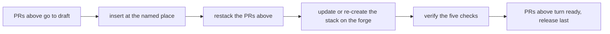

## Summary

In stack mode every PR above the bottom one as a draft, to be merged bottom-up with a restack after each merge: the user saw many drafts and no stack. This change makes a stack what it should be: one native stack on the forge (GitHub stacked PRs), every PR ready, the release PR on top, merged in one action from the top PR so the release commit lands last.

It also encodes how to insert a change into an already ready stack, and makes every agent start right the first time: each agent's description now shows the first line its prompt must start with, and a refusal names that line and says a new start is needed.

## Deliverables

A new `forge-stack` command makes and checks the stack, and the cards, docs and diagrams describe the one-merge flow and the insertion use case.

```text
$ chantier forge-stack create
stack #155 <top PR link> (PRs bottom to top: #142 #139 ... #154)
$ chantier forge-stack show
(exit 0: open, every PR in order, none a draft, the release on top)
```

Insertion into a ready stack, in this order:



Choices made:

- GitHub only; GitLab keeps today's behaviour.
- The `gh stack` extension is recommended; the CLI command is used only when the user declined it, never as a silent fallback.
- The check of a ready stack is the same everywhere: open, every PR of the batch in order, none a draft, the release PR on top.
- The GitHub API offers no way the command could use to add a PR to a stack or dissolve one, so a stack that must change is re-created by the means the batch names; a second create over already stacked PRs returns the forge's own refusal.

## Blast radius

Grade: 2. Cards, both hosts' agent files, the CLI (one new command) and docs change together; a plain revert restores the previous behaviour, and the new command is only called when a stack batch asks for it.

## Autonomous decisions

- The command is named `forge-stack` (`create`, `show`), kept apart from the existing `stack`, which orders CRs.
- The printed link is the top PR's, because the stacks API returns no stack URL.
- `show` prefers an open stack when several overlap the batch's PRs.
- The lifecycle diagrams say "one forge stack" without "restack": the longer wording overflows the box.
- Agent descriptions are YAML single-quoted, since they now contain a colon.

<details>
<summary>Details</summary>

## Changes

- Cards: the shared concepts (ready stack, stack mode, first line of every agent, new refusal), the stack-making and insertion steps, the batch-steering and user-facing cards (hard rule on the first line, extension recommendation, stack batch, insertion), and routing.
- Agents: the 12 agents on both hosts end their description with the first line to use; each body's refusal names it.
- CLI: `forge_stack.py` and its help line.
- Scenario: a fake `gh api` for the stacks endpoint and new steps (create, refusals, show checks, GitLab refusal, insertion order).
- Docs and diagrams: batch modes, lifecycle, release diagram, README, contributing, use cases, release process.

## Human decisions

- A stack means a stack the user merges in one go; "ready" means checked on the forge.
- When the user asks for a stack, the `gh stack` extension is recommended; if declined, the CLI command over the REST API is used.
- To insert a change, the PRs above go back to draft first; the release stays on top and updates its notes.
- GitHub only for now.

## Impacts

Stack batches end in one stack to merge instead of drafts to merge one by one; a refused agent start tells exactly how to start again. Diagrams show the new flow.

## Test plan

- [x] New or changed tests: structure test on descriptions and refusals; scenario steps for forge-stack (at 548e0f7)
- [x] Local gates at `548e0f7`: `just check` (58 tests), `just scenario` (github 649/649, gitlab 637/637)
- [x] Evidence: scenario transcripts at `548e0f7` (kept in the work folder)
- [x] Review: approved at `548e0f7`
- [x] Verified at `548e0f7`
- [x] CI green at `548e0f7` (5 checks)

## Internal references

- CR-213 stack-merges-in-one-go (batch-15), stacked below the version PR.

</details>
