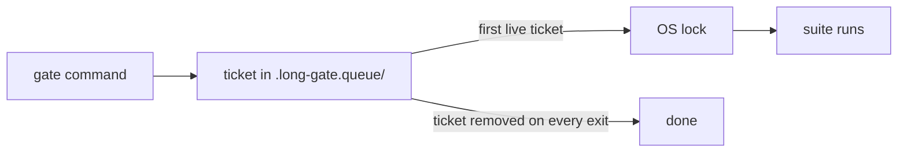

## Summary

With several Drivers sharing one long gate, a gate that waited more than an hour was refused with the name of the holder seen when its wait began, long finished, while the lock was live and held by another change. Drivers read it as a stale lock and lost an hour each. Long gates now queue first-come, first-served, and the only refusal left is for one gate that holds the lock (or whose suite runs on) for over an hour, naming the gate alive at that moment.

## Deliverables

Gate arrival order and the new waiting line:

```text
waiting for the long gate of CR-A pid 111; queued ahead: CR-B
```



- Tickets are sortable by arrival; a ticket whose process is gone is skipped and deleted.
- The one-hour limit is unchanged, now counted per holder.

## Blast radius

Grade: 1. Local to the `gate` command's lock; the lock file format and `gate --stop` are unchanged. A `git revert` restores the previous behaviour.

## Autonomous decisions

- First-come queue with no limit on the queue, one hour kept per holder: a limit sized on slots would still refuse a healthy long queue.

## Known gaps

None.

<details>
<summary>Details</summary>

## Changes

- `commands.py`: `_LongGateLock` queues with tickets; per-holder hour; refusals name the live holder.
- `state.py`: `.long-gate.queue/` ignored.
- `cli.py`, `driver.md`, `concepts.md`, `docs/gates.md`: wording.
- `scenario/run_scenario.py`: arrival-order and stale-ticket checks.

## Impacts

Gates run in arrival order; no visual change.

## Test plan

- [x] New or changed tests: scenario checks for arrival order and a killed waiter's ticket (at `0c4838f`)
- [x] Local gates at `0c4838f`: `just check` and `just scenario` pass
- [x] Evidence: refusal wording proved with a lowered limit on a local copy, not committed (at `0c4838f`)
- [x] Review: approved at `0c4838f` (carried from the round's review)
- [x] Verified at `0c4838f`
- [x] CI green at `0c4838f`: `gh pr checks 162`, five checks pass

## Internal references

CR-219 gate-queue-limit

</details>
