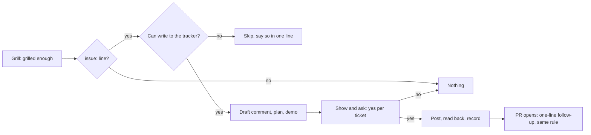

## Summary

When a change comes from a ticket opened by someone else, its reporter currently learns nothing until the PR. This drafts a short comment, a plan and, when it makes sense, a demo page at the end of the grill, shows them to the user, and posts them on the ticket (GitHub, GitLab or Jira) only on the user's explicit yes for that ticket. When the PR opens, a one-line follow-up with its link is proposed under the same rule, and the PR names the ticket in its own section.

## Deliverables

The ticket-summary flow, from the cards (the Chief of Staff is chantier's planning session with the user; the Griller is its short grilling session):

- `chief-of-staff.md`: a nine-step "Ticket summary" block replaces "Tracker comments"; PR follow-up; widened "Never" lines.
- `griller.md`: the Griller writes the three drafts and never posts.
- `pr-template.md`: a `## Issues References` section right after Summary (left out with no source ticket), default `Closes #<n>` / `Closes <KEY>-<n>`, so the issue closes at the merge; audit items 1, 2 and 9 follow.
- `ticket-summary-example.md` (new): a short reference built on the same shape.
- Docs: `docs/cr-lifecycle-texts.md`, `docs/cr-lifecycle.svg`, `docs/use-cases.md`.
- Eval: `evals/ticket-summary/RUNBOOK.md` and a row in `evals/README.md`.

## Blast radius

The cards and docs change what the Chief of Staff and the Griller do on a ticket-sourced change; no CLI, agent, hook or type changes. A `git revert` restores the previous behaviour.

Grade: 1

## Autonomous decisions

- The example's PR section uses `Closes #336`, not a bare `#336`, to match the closing-verb decision.
- The eval runbook has the operator set the sandbox up by hand rather than extending the kit's setup script, to keep the change to cards, docs and the runbook.

## Known gaps

- The `ticket-summary` eval is written but not run yet; it runs after the merge.
- Posting on a ticket is unproved on every tracker (GitHub issue artifacts are a preview feature; `glab` and a Jira tool are not installed here): the cards mark each route unproved with its trial, which that eval settles.
- The eval kit's setup script does not know the new campaign, so the operator sets it up by hand; extending it is a possible follow-up.

Details

## Changes

- Cards: `chief-of-staff.md`, `griller.md`, `concepts.md`, `pr-template.md`, `driver.md`, and the new `ticket-summary-example.md`.
- Docs: `docs/cr-lifecycle-texts.md`, `docs/cr-lifecycle.svg`, `docs/use-cases.md`.
- Eval kit: `evals/ticket-summary/RUNBOOK.md`, `evals/README.md`.

## Human decisions

- A plan and a demo are posted with the comment, not text only.
- A one-line follow-up with the PR link is proposed when the PR opens.
- The reference moves into an Issues References section with a closing verb, so the issue closes at the merge.
- A tracker chantier cannot reach is skipped with a one-line note, not handed to the user as text.

## Impacts

A user with a ticket-sourced change is asked once per ticket before anything is posted. No other visible change.

## Test plan

- [x] New or changed tests: No behaviour change, cards and docs only
- [x] Local gates at `5498f0a`: `just check` and `just scenario` pass
- [x] Evidence: text checks of the cards at `5498f0a` (all required texts present, the removed ones gone), no visual change
- [x] Review: approved at `6e6c43c`, carried from `6e6c43c` over a clean rebase to `5498f0a`
- [x] Verified at `5498f0a`
- [x] CI green at `5498f0a`: `gh pr checks 164`, all five checks pass

## Internal references

CR-220 ticket-summary-on-source (batch-16).

