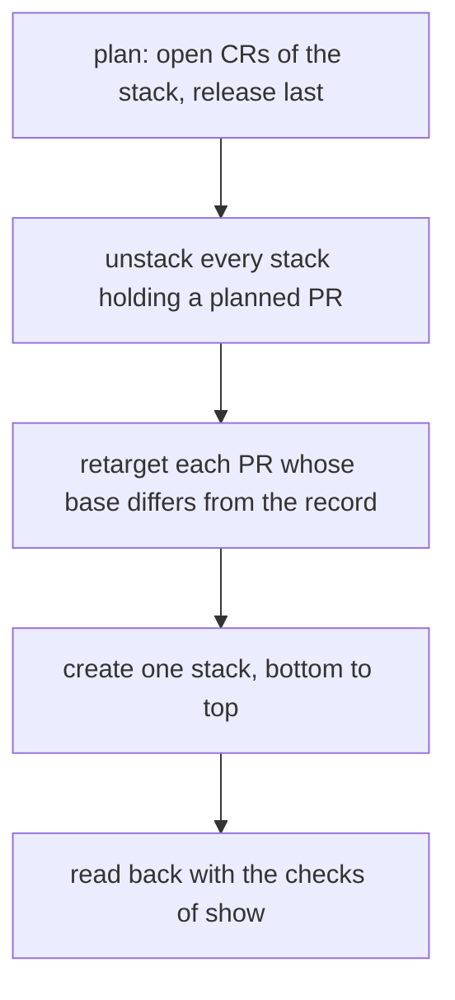

## Summary

Once a stack of PRs is ready, inserting a change, restacking what remains after a merge and keeping the record right were manual, refused, or left the record wrong. This PR makes the stack workable after it is ready: one command rebuilds the native GitHub stack from the record, the record follows the stack's order, the agent that maintains the stack reads it without a write, `ship` names PR body lines whose SHA a restack made stale, and one merge action by the user leads to at most one restack.

## Deliverables

New `forge-stack` action and the read-only `stack` form:

```text
$CHANTIER forge-stack rebuild      # unstack, retarget PR bases, create one stack, read it back
$CHANTIER stack                    # no CR: prints the stack as it stands, writes nothing
```



Choices: one `rebuild` path covers insertion, reorder and partial merge (the forge only appends on top); a PR's base cannot change while stacked, so `rebuild` dissolves first; `rebuild` is idempotent and exits 4 with the forge's exact text on a refusal.

## Blast radius

Grade: 2. CLI behaviour of `stack`, `ship`, `forge-stack` and the stack workflow's reference cards change; a `git revert` restores the previous behaviour.

## Gaps

- In `forge-stack rebuild`, a stack still open after 5 unstack tries exits 2 and does not list what was done (the spec says exit 4 with what was done); the run is idempotent, so a rerun is safe.
- The batch-15 base case was not reproduced on the old code before `_stack_base` changed; the scenario now covers it.
- `ship`'s stale-SHA scan also reads all-digit tokens; it only lists a token that resolves to a commit outside the head's ancestry, as an `off:` line.

## Autonomous decisions

- `stack` (the recorded order) sets a stacked CR's base, even when it has an `after`, because the order already refuses a CR below its dependencies.
- `rebuild` only, no `insert` action and no use of the forge's append endpoint.

<details>
<summary>Details</summary>

## Changes

- `forge_stack.py`: `rebuild`, corrected docstring (the four endpoints and the base rule).
- `commands.py`: `_stack_base` follows the stack place; `stack` with no CR shares `_stack_lines` with `take stack`; `ship` lists stale SHAs of `work/pr-body.md`; `order after` message.
- Reference cards: the stack workflow now uses `forge-stack rebuild`, `take stack` is not run by the agent that maintains the stack, and one merge action leads to one restack.
- Scenario: `fake_gh.py` unstack and pulls endpoints; new checks in `run_scenario.py`; `scenario/README.md`.

## Impacts

No visual change. Whoever maintains a stack uses `forge-stack rebuild` once a first stack exists.

## Test plan

- [ ] New or changed tests (they fail on the previous code): scenario checks for rebuild (insertion, partial merge, refusal then rerun, refusals), stack base, `stack` with no CR, `ship` stale lines, `order after`
- [ ] Local gates at `edd8202`: `just check`, `just scenario`
- [ ] Evidence: none beyond the scenario
- [ ] Review: approved at `edd8202`
- [ ] Verified at `edd8202`
- [ ] CI green at `edd8202`

## Internal references

CR-215 stack-after-ready.

</details>
