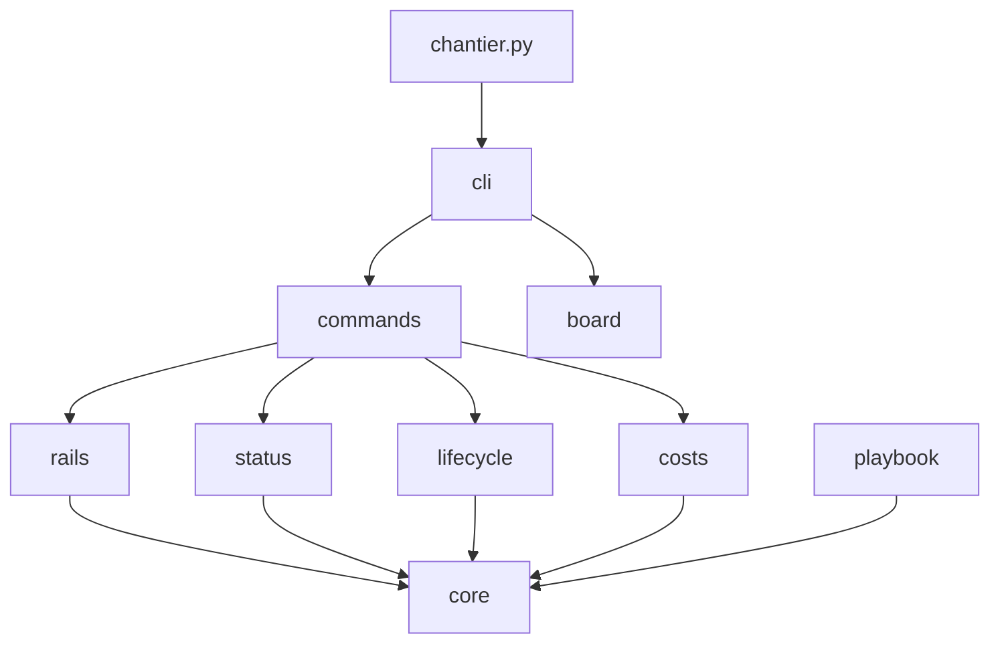

## Summary

The CLI was a handful of very large modules (`commands.py`, `state.py`, `status.py`, `rails.py`) with hand-written JSON, YAML and process handling, and no static checks. This PR splits it into layered packages, declares its three third-party libraries through PEP 723 inline metadata (so `uv run --script` needs no setup and no install step), reads the JSON records through pydantic models, and holds the code to ruff and `mypy --strict`. Its behaviour and outputs are unchanged.

## Deliverables

The CLI now has one direction of dependency, from the entry point down to the core:

| | before | after |
|---|---|---|
| Layout | `commands.py`, `state.py`, `status.py`, `board.py` (each well over 400 lines) | `core/`, `lifecycle/`, `status/`, `commands/`, `board/`, `costs/`, `playbook/`, no file over 400 lines, no function over 50 lines |
| Dependencies | none declared, hand-written YAML subset, process and record code | PEP 723 block in `chantier.py` (`pydantic`, `ruamel.yaml`, `psutil`) with a lock file |
| Records | `dict[str, Any]` read with `.get(...)` | pydantic v2 models (`core/records.py`), `extra="allow"`, written with `exclude_unset` |
| Checks | none | `just lint`: `ruff format --check`, `ruff check`, `mypy --strict`, `uv lock --script --check`; ruff 0 findings, mypy 0 errors in 77 files |

Targets set: a file at most 400 lines, a function at most 50, complexity at most 10, at most 5 arguments, 12 branches, 6 returns, nesting at most 3, line length 100. `tests/test_code_targets.py` fails when a file or a function exceeds them.

## Blast radius

Grade: 3. Every command of the CLI was moved, and the three libraries replace code that parsed `chantier.yaml`, read the records and stopped processes. A revert of the PR restores the previous CLI; the scenario (695 checks on GitHub, 676 on GitLab) and the eval dry run pass unchanged.

## Autonomous decisions

- `chantier.yaml` errors keep their words and lines; an "empty value" error the old parser could never raise is not reproduced.
- Three function signatures changed to meet the five-argument limit (`session_costs`, `usage`, `cr_view`); their callers and tests are updated.
- `release ... published` with no grant recorded now fails with a `ChantierError` where it raised a `KeyError`.
- A few guards were added while typing (a non-GitHub PR link refused in `forge_stack`, `None` accepted by two word helpers).
- The archived batch record (`batch-NN.json`) and the views' output shapes stay plain dictionaries, as the next section says.

## Known gaps

- The archive record `5-archives/batches/batch-NN.json` (`core/batch_records.py`, `history.py`) is still read and built as `dict[str, Any]`; it is not in the specification's list of records.
- The views (`cr_view`, `batch_view`, `dashboard_view`) and the board data still return dictionaries, because they are the shape of `STATUS.json`; they read the models.
- `parse_grant` still returns a dictionary, applied to the model attribute by attribute.
- The error wording of `chantier.yaml` for an unclosed flow list or quote now comes from the YAML library (the file, line and exit code are unchanged).
- **UNVERIFIED:** start-up timings, a cold-cache first run and a run on Python 3.11 were not measured, and the `cancel` and `gate --stop` process stops were not run by hand on each system; the scenario covers part of them.
- The local gates ran on Windows only; Linux and macOS run in CI.

Details

## Changes

- `skills/chantier/scripts/cli/chantier.py`: PEP 723 block, `chantier.py.lock`, a launcher of a few lines.
- `core/records.py`: the models for `batch.json` (settings, CR entries, orders, asks, claims), an event line, `seat.json`, `.long-gate.run`, `restored.json`; old words `landed`/`open` migrated by a validator.
- `playbook/yaml_subset.py` on `ruamel.yaml` events; `procs.py` on `psutil`.
- Modules split by layer; `rails.py` and `commands/orders.py` each split in two; long functions cut into helpers.
- CR-224's batch history (`history.py`, `backfill.py`, the archive record) moved into the new layout (`core/batch_records.py`, `lifecycle/backfill.py`, `commands/close_archive.py`).
- `tests/` split by subject, typed; `justfile` gets `lint`; `check` runs lint, tests and release notes; docs (`AGENTS.md`, `CONTRIBUTING.md`, `README.md`) describe the layout and standards.

## Impacts

Contributors: new layout, `just lint`, PEP 723 dependencies. Users: no visible change.

## Test plan

- [ ] New or changed tests: `test_code_targets.py` (sizes, dependencies), the split structure tests
- [x] Local gates at `5f7c9ae`: `just check` pass, `just scenario` pass (GitHub 695/695, GitLab 676/676); `just eval-dry-run` 7 of 7 cases, run on the previous head and carried
- [ ] Evidence: before at `2d9a2aa`, after at `5f7c9ae`
- [x] Review: approved at `5f7c9ae` (carried from `6acd776` plus the round's tree)
- [x] Verified at `5f7c9ae`
- [ ] CI green at `5f7c9ae`

## Internal references

CR-221 python-inline-deps.

