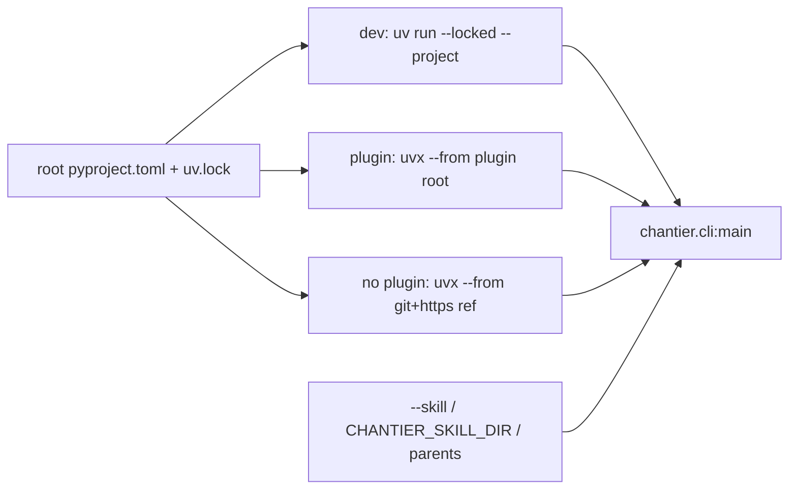

## Summary

The CLI could be launched only as a PEP 723 script, and its package was declared in three places (the script's inline block, a nested `pyproject.toml`, two lockfiles). This PR gives it one declaration and one way to run: a `pyproject.toml` and a `uv.lock` at the repository's root, and `uv` as the only launcher. In chantier's own checkout the skill runs the local code, live, fetching nothing; installed as a plugin it runs `uvx` from the plugin's own folder, so the cards and the CLI always come from the same commit.

## Deliverables

Before and after, what `$CHANTIER` means:

| | Before | After |
| --- | --- | --- |
| Declaration | `chantier.py` inline block, `cli/pyproject.toml`, `chantier.py.lock`, `cli/uv.lock` | root `pyproject.toml` and root `uv.lock` |
| Chantier's own checkout (a `.git` at the plugin root) | `uv run --script ".../chantier.py"` | `uv run --locked --project "<plugin root>" chantier` |
| Installed plugin | `uv run --script ".../chantier.py"` | `uvx --from "<plugin root>" chantier --skill "<skill folder>"` |
| No plugin, no agent (a planning surface's board) | not possible | `uvx --from git+https://github.com/gsemet/chantier@v<version> chantier --project <folder> board` |

Warm time of `chantier --version`, median of 10 runs on Windows at e54e299 (carried to f108421, same patch): 492 ms in the dev form, 403 ms in the plugin form.

Choices made: the three direct dependencies are pinned exactly (`==`, the versions the lock holds), because `uvx` ignores `uv.lock`; `--locked` in dev mode, so the main checkout's lock is never rewritten; the source stays under `skills/chantier/scripts/cli/src/`; `session_usage.py` keeps its own inline block as a separate tool.

## Blast radius

Grade: 2. Every call of the CLI changes form (skills, cards, allow rules, the `cli:` fact line, the eval kit and the justfile). Revert restores the script launch; users who allowed the old `uv run --script *chantier.py *` rule get the preflight warning naming the new rules.

## Autonomous decisions

- The allow rule for the plugin form is `uvx --from * chantier *` (a git ref no longer applies once plugin mode runs from the plugin folder).
- `scenario/run_scenario.py` has one line more than the `cli:` check: the Copilot cost check calls `costs.session_usage_script()`, which replaces the removed constant.
- The four `SKILL.md` carry no hard-coded ref, so `scripts/version.py` only targets the root `pyproject.toml` and `uv.lock`.
- The `git+https://github.com/gsemet/chantier@v<version>` example in the docs is a placeholder for the launch with no plugin; it points at a tag that carries the root `pyproject.toml` only after the next release is tagged, so a release after this change makes it work.

## Known gaps

- `uvx` keys a local folder on its `pyproject.toml`, not on the source tree: in a plugin copy, a source edit with the same path and the same version keeps running the old code. A plugin update that changes the version (a new `<version>/` folder and a new `pyproject.toml`) is picked up, as measured. Chantier's own checkout runs in dev mode and is live, so it is not affected.
- The `git+https` board example in the docs works from a tag only once a release with the root `pyproject.toml` is tagged (it was served from the branch's commit SHA).
- **UNVERIFIED:** a cold-cache run (empty `UV_CACHE_DIR`) is not measured.
- Not proven: whether a Copilot plugin install keeps a `.git` (it would then run in dev mode), and whether Claude Code's auto mode classifies `uvx` and `uv run --project` as package-manager runs.
- Users who allowed the old `uv run --script *chantier.py *` rule must allow the two new rules; the preflight warning names them and the release notes should say so.

Details

## Changes

- Root `pyproject.toml` (hatchling, wheel of the `chantier` package, ruff, mypy and pytest configuration moved there) and `uv.lock`; the script entry point, its lock, and the nested project files are deleted.
- `plugin_files.skill_dir()` reads `--skill`, then `CHANTIER_SKILL_DIR`, then the parents; `cli_command` returns the dev or plugin form by the `.git` test; `--skill` is a global option; `costs/copilot.py` finds `session_usage.py` through `skill_dir()`.
- `commands/permissions.py` samples and `hosts/claude-code.md` carry both allow rules.
- The four `SKILL.md`, `concepts.md`, `chief-of-staff.md`, `AGENTS.md`, `CONTRIBUTING.md`, `README.md`, `docs/boards.md`, `evals/README.md` follow.
- `justfile`, `scenario/run_scenario.py` and the eval kit (`setup.py`, `audit.py`, `dry_run.py`) use the new forms; `scripts/version.py` targets the root files.
- Tests: the dependency test checks the root project; a new test checks `cli_command` in both modes against each `SKILL.md`.

## Human decisions

- One way to run the CLI, with its versions aligned: no second launch method.
- The package is declared once, in a root `pyproject.toml`.
- In chantier's own checkout the skill runs the local code, live, and fetches nothing.
- Installed as a plugin, the CLI runs with `uvx --from` the plugin's own folder (no git ref, no network), so the cards and the CLI come from the same commit; a git ref serves only a launch with no agent.

## Impacts

No visual change. Contributors run `uv run --locked` from the root; plugin users need only `uv`.

## Test plan

- [x] New or changed tests (`test_code_targets.py`, `test_plugin_files.py`)
- [x] Local gates at `f108421`: `just check`, `just scenario` (695/695 GitHub, 676/676 GitLab), mypy `--strict` for linux, darwin and win32
- [x] Evidence at `f108421` (carried from `e54e299`, patch id unchanged; the dev-mode `--version` re-run at `f108421`): dev mode live and offline with the lock unchanged; plugin form on a copy with no `.git`, and the one-line error without `--skill`; board served (HTTP 200) from the `git+https` form at the commit SHA; `version.py set` on a scratch copy
- [x] Review: approved at `3ce2f8f`, committed as `e54e299`, carried from `e54e299` over a clean rebase (head `f108421`)
- [x] Verified at `f108421` (move pass; claims carried from `e54e299`)
- [x] CI green at `e54e299`: `gh pr checks 171` shows check (ubuntu, macos, windows), eval-dry-run and scenario passing

## Internal references

- CR-237 root-pyproject-launch

