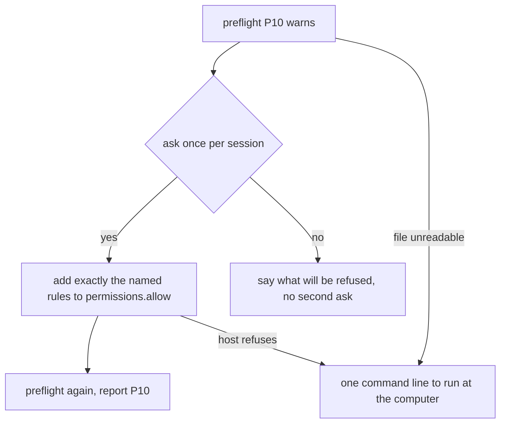

## Summary

When the user's Claude Code settings lack the allow rules chantier's agents need, the Chief of Staff (the session that talks to the user) only showed a block to paste, and the warning was easy to miss. A batch then stalled on refused force pushes. Now the Chief of Staff asks once per session whether to add the missing rules to `~/.claude/settings.json`, adds exactly those on the yes, and runs preflight again. When the host refuses that edit (typically under Remote Control), the user gets one command line to run at their computer. `init` runs the same checks and, for each missing piece, asks and fixes it (it installs `gh`, `glab` and the `gh stack` extension on the user's yes, else gives the commands). The two release rules (`gh release create`, `glab release create`) leave the recommended set: a release's publication stays asked by the host, by design.

## Deliverables

The recommended set shrinks by four rules (the Bash and PowerShell forms of two commands), and the P10 counts follow:

| Project | Rules P10 checks before | after |
| --- | --- | --- |
| GitHub, project rules name `gh release create` | 16 | 14 |
| GitLab | 12 or 13 (13 when the rules name `glab release create`) | 12 |

The user-facing flow, in the cards:

The two command-line templates (Windows PowerShell 5.1, POSIX shell) were each run on scratch home folders, in three cases (file absent, file with other keys, file already holding some of the rules), twice each: every run gave valid JSON, UTF-8 with no byte-order mark, no duplicate, nothing removed, and `preflight` read it back as `P10 ok`. The outputs are in the CR's evidence folder (see Internal references). The POSIX template was run with Git for Windows' bash only, not on Linux or macOS.

Choices: no new CLI command and no CLI write (the CLI keeps to the planning folder); the only settings write is the allow rules P10 named, in the user's own `~/.claude/settings.json`, on the user's yes; no deny, ask or other key, and no project settings file.

## Blast radius

Grade: **2**. Cards, docs and the recommended list change, plus a scenario check; the CLI's only change is removing two rows and the code that added them. Revert restores the old cards and the 16-rule set.

## Autonomous decisions

- `hosts/claude-code.md` line on the PR monitor said chantier "never writes the user's settings"; it was reworded to match the new exception, so the card does not contradict itself.
- The gh stack detection in `permissions.py` was left alone: a sibling change owns it.

## Known gaps

- No real-session proof yet: the Chief of Staff's question, the write on the yes and the refused-edit path are agent behaviour, proven only in a real Claude Code session.
- The POSIX template was run only with Git for Windows' bash, not on Linux or macOS.
- The PowerShell template rewrites `~/.claude/settings.json` as compact JSON, and `<` or `'` in other values come back as `\u` escapes (same JSON); the POSIX one needs `uv` (already required).
- Expect conflicts at restack with the sibling change that also touches `permissions.py`, `hosts/claude-code.md` and `scenario/run_scenario.py`.

Details

## Changes

- `permissions.py`: release rows and groups removed from `SAMPLES` and `_sample_groups`, with the project-rules reading that only served them.
- `hosts/claude-code.md`: Configuration exception, who reads P10, table and JSON block without the release rules, "no release rule, by design", and "Allow rules to add" rewritten as the fallback with both templates.
- `chief-of-staff.md`: the P10 question (yes, no, refused edit, unreadable file), the Forge permissions text and step 1 of starting a batch; `session-start.md`; `driver.md` (publication step); `init.md` (the tour's checks, tool installs on the yes).
- `AGENTS.md`, `CONTRIBUTING.md`, `README.md` (Install step and init row), `docs/use-cases.md`, `docs/tutorial-claude-code.md`.
- Tests: two assertions in the existing P10 tests; one scenario check that the P10 warning names no release rule.

## Impacts

No visual change. Users get asked instead of shown a block; developers see a 14-rule P10 on GitHub.

## Test plan

- [x] New or changed tests (assertions in the two existing P10 tests)
- [x] Local gates at the pre-restack head: long gate `just check` and `just scenario` (github 696/696, gitlab 677/677) passed; mypy --strict passed for linux, darwin and win32
- [x] Evidence: template runs at the pre-restack head, see Deliverables
- [x] Review: approved at the pre-restack head (the pass of the round, on the same diff)
- [ ] Verified at `9d44a00` (restack onto main; pending)
- [ ] CI green at `9d44a00` (restack onto main; pending)

## Internal references

CR-238 allow-rules-ask. Evidence: `.agents/changes/4-batch/2-actives/238-allow-rules-ask/evidence/` (template outputs), `work/r1.md`.

