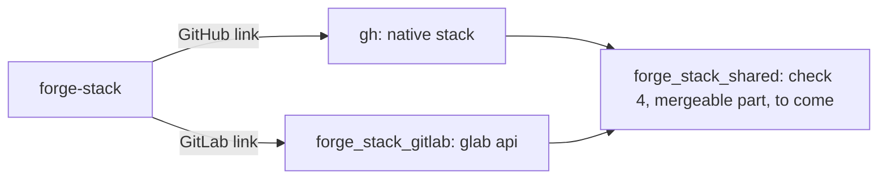

## Summary

A stack of changes could be made, grown and checked on GitHub, but not on GitLab: `forge-stack` refused any link that was not a GitHub pull request, so the five "stack ready" checks could not run on a merge request chain, and the cards said a GitLab stack was only a loose chain with no definition of "ready". This PR gives GitLab the same behaviour as GitHub: the stack is the chain of merge requests (MRs) that `forge-stack` makes and checks, ready MRs below and drafts on top, with the same five checks and the same "partial stack mergeable below <commit>" line.

## Deliverables

On GitLab the stack is the chain of MRs, each targeting the one below, the first on the default branch. GitLab has no one-action merge, so the user merges one MR at a time from the bottom; an MR merged in the middle folds into the one below it.

| Command | GitHub | GitLab |
| --- | --- | --- |
| `show` | five checks on the native stack | five checks on the chain (state, targets, drafts, release on top) |
| `create` | `gh stack` form | retarget each MR off the record's base, bottom first, then read back |
| `rebuild` | unstack, retarget, create | retarget only (nothing to unstack) |
| `--stack N` | allowed | refused: `--stack is GitHub only` |

The forge is read from the shape of the link, never from the host. Every GitLab form is marked unproved in the cards: it is checked only against the scenario's fake `glab`.

## Blast radius

Grade: 2. `forge-stack` is restructured into three modules (GitHub path unchanged in behaviour) and four cards change. A `git revert` restores the previous behaviour; GitLab stacks would go back to the loose chain.

## Autonomous decisions

- Open MRs on a branch are listed with `--method GET -f state=... -f target_branch=...` and paged until a short page, rather than a query string in the path, because the scenario's Windows `.cmd` wrapper breaks on `&`.
- A foreign MR that targets the release's branch gives a single `check 5` line (check 2 skips the release's branch).
- `create` on GitLab reads the chain back after printing the chain line, so it can exit 2 with a check line; GitHub's `create` reads nothing back.

## Known gaps

- The GitLab path of `forge-stack` and the GitLab cards are not run against a real GitLab (unproved, as agreed): the forms stay marked "unproved" until a real run, done later.
- The GitLab documentation pages the design relies on (merge requests API, merge trains, MR dependencies) were not re-read online while coding; the shapes follow the public docs as known.
- The README, `docs/` and diagram sentences about GitLab stacks are left to a documentation follow-up.
- No local long gate: the user waived it for this batch, GitHub CI green at 758fe10 replaces it.
- No screenshot is due: the board pane is unchanged.

Details

## Changes

- `forge_stack.py` (309 lines): forge read from the link, `GITHUB_ONLY` removed, a link of neither shape refused with `is neither`, dispatch to the GitLab path.
- `forge_stack_gitlab.py` (new): the `glab api` helper (URL-encoded project path, `--hostname` off gitlab.com), the five checks on the chain, `show`, and `make` shared by `create` and `rebuild`.
- `forge_stack_shared.py` (new): check 4, the mergeable part, its commit and the `to come:` line, shared by both forges.
- Cards `driver.md`, `foreman.md`, `chief-of-staff.md`, `concepts.md`: the GitLab chain, the folded middle merge, merge trains and auto-merge, rebuild as a retarget.
- `scenario/fake_glab.py`, `scenario/run_scenario.py` (section 13a), `scenario/README.md`: the MR read, the open-MR list, the retarget (and a refusal), and the GitLab steps.

## Human decisions

- GitLab behaves as GitHub: the same ready stack, the same checks, any MR mergeable at any moment (bottom or middle), the rest retargeted and restacked silently.
- A middle MR merged into the branch below is recorded merged at once; nothing blocks a middle merge.
- `glab stack` (experimental) and GitLab's MR dependencies are not used.
- No real GitLab run now: the forms stay unproved until a later real run.

## Impacts

No visual change. A GitLab project can now run `forge-stack create|rebuild|show`.

## Test plan

- [x] New or changed tests (they fail on the previous code): scenario section 13a, GitLab and GitHub (the GitLab leg passes in CI at 758fe10)
- [x] Local gates (carried from the pre-restack head; mypy and pytest re-run at 758fe10): `just check` (and mypy --strict on linux, darwin, win32); `just scenario` not run locally, waived (see Known gaps)
- [ ] Evidence: none beyond the scenario
- [x] Review: approved at the pre-restack head, carried to 758fe10 (patch unchanged, one card paragraph merged; see the restack note)
- [x] Verified at 758fe10
- [x] CI green at 758fe10: `gh pr checks 182`, all five jobs pass

## Internal references

- CR-245 gitlab-stack-delivery; on top of CR-244 stack-grows-from-bottom.

