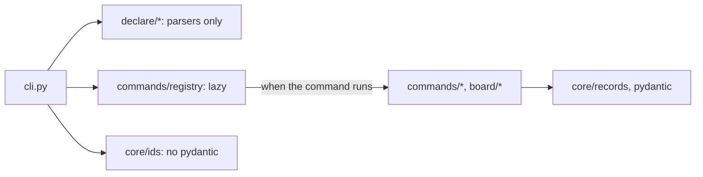

## Summary

Since the CLI declared its dependencies, every `chantier` command imported pydantic and every command module at start, so `--version` took about 700 ms and a long gate lost about 55 %. This PR makes the start-up import only the standard library and chantier's light modules, and loads a command's handler (and its libraries) only when that command runs. A structure test guards it.

## Deliverables

Median of 10 warm runs of `python -m chantier` in an empty git project, Windows 11, one sitting (base = the branch this PR sits on, `c8dc8e4`; old = `2d9a2aa`, before the dependencies). `status`, `take` and `order` are the three commands the scenario calls most (59, 59 and 147 calls); `order` with no argument stops at a usage error, so it measures the start-up alone, and `take CR-1 --batch b` stands for the handler path:

| Command | old `2d9a2aa` | base `c8dc8e4` | head |
| --- | --- | --- | --- |
| `--version` | 416 ms | 697 ms | 244 ms |
| `--help` | 412 ms | 708 ms | 243 ms |
| `order` (usage error) | 410 ms | 696 ms | 248 ms |
| `status` | 453 ms | 744 ms | 579 ms |
| `take CR-1 --batch b` | 467 ms | 746 ms | 620 ms |
| `rules` | 463 ms | 725 ms | 552 ms |

- Floor: a bare interpreter costs 33 ms, `from pydantic import BaseModel` 348 ms, and importing the record models (`chantier.core.records`) 401 ms. Commands that read a record keep reading it through those models, so they pay that floor; on `status`, `python -X importtime` shows `core.records` at 199 ms and pydantic at 67 ms of cumulative time, against the cli module's own 62 ms.
- `uv run --locked --project <root> chantier --version` takes 286 ms against 263 ms direct (about 23 ms for uv); `status` through it takes 639 ms against 579 ms direct (about 60 ms). The launch is unchanged.

- `defer_build=True` on the record models is kept: about 20-30 ms (about 5 %) on `status` and `rules` in four alternating runs.

## Blast radius

Grade: 2. Every command's entry changed (parsers moved, handlers resolved by name). `--help` of the root and of all 32 commands, a usage error, an unknown command and no command are byte for byte identical at base and head. Rollback is a revert.

## Autonomous decisions

- `normalize_cr` and `normalize_batch` moved to `core/ids.py` and are not re-exported from `core/records.py`; callers import the new module.
- The parsers moved from 16 command modules into `declare/` modules (the specification left the form to the implementation).
- The `register` of the driver and intake families are split in two functions to keep every function under 50 lines.

## Known gaps

- The agent launch was measured for `--version` and `status`, not for the other commands.
- Commands that read a record (`status`, `take`, `rules`) sit about 30 % above `2d9a2aa` and 150-220 ms above the models' import floor (401 ms) and are not within 10 % of `2d9a2aa`. A later pass made the cost, hashing and file-copy imports lazy; the rest is the CLI start (about 95 ms over a bare interpreter: argparse, the playbook reader, the parsers), the first model validation (about 8 ms of plugin loading) and `status` printing spend. The specification allows the pydantic floor, not this margin.

Details

## Changes

- `chantier/declare/` (16 light modules): the parsers, moved out of the command modules unchanged; a handler is named `module:function` and imported by `commands/registry` when it runs.
- `core/ids.py`: `normalize_cr`, `normalize_batch`, no third-party import. `core/repo.py` imports the record reader inside its functions; `plugin_files.py` imports `CrEntry` only for typing.
- `core/records.py`: `defer_build=True`.
- `tests/test_code_targets.py`: one test starts a fresh interpreter on `--version` and `--help` and fails naming any module that is neither standard library nor `chantier`. With `import pydantic` added to `cli.py` it fails naming pydantic.
- `CONTRIBUTING.md`: one sentence under Code standards.

## Human decisions

- The target is the start-up before the dependencies were declared, within about 10 %, keeping the dependencies and the pydantic records (not as fast as possible).
- A structure test on the start-up imports guards it, rather than a time threshold in the checks.
- Commands that read a record import what they need when they run, at worst at the pydantic import floor; the launch through uv is measured and left as it is.

## Impacts

No visual change. Every command starts faster; a later eager import of a library fails `just check`.

## Test plan

- [x] New or changed tests: the start-up import test; with `import pydantic` added to `cli.py` it fails naming pydantic (`b1ce396`)
- [x] Local gates at `b1ce396`: `just check` (68 tests, ruff, mypy strict on linux/darwin/win32) and `just scenario` on both forges (GitHub 719/719 in 968 s, GitLab 700/700 in 949 s; the scenario has grown and ran beside other jobs, so these durations are reported, not judged)
- [x] Evidence: timings above at `b1ce396`, base `c8dc8e4`, old `2d9a2aa`; an independent re-run gave `--version` 240 ms and `--help` 240 ms against 411 and 412 ms at `2d9a2aa`, and `status` 628 ms, `rules` 553 ms, `take` 600 ms against 473, 455, 471 ms (about 30 % above)
- [x] Review: approved at `b1ce396`
- [x] Verified at `b1ce396`
- [x] CI green at `b1ce396`: `just check` on the three systems, `just eval-dry-run` and `just scenario` pass
## Internal references

- CR-247 cli-startup-time; measurements and help diffs under its `work/` folder.

