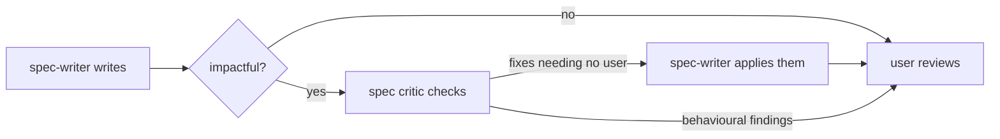

## Summary

A Change Specification is written from a grill, and nothing checked it against the request's spirit or the rest of the software: an unproved claim about a host slipped through one specification and only the user caught it. This adds a **spec critic** (🧐): a fresh, read-only agent that reads the request, the user's answers, the specification and the repository, and reports gaps with the request's intent, inconsistencies with the rest of the software, and unproved claims about the real world. It runs once, on the change requests (CRs) the person who grills judges impactful, before the specification is final.

## Deliverables

The step in the specification loop (new, between the spec-writer and the user's review):

- A new role `spec-critic` with a card (`skills/chantier/references/spec-critic.md`) and one agent file per host with identical bodies (`agents/spec-critic.md`, `com.github.copilot/agents/chantier-spec-critic.agent.md`). Read-only tools (no Write, no Edit), Opus 5.5 by default, Fable on the user's request.
- The restatement before "grilled enough?" ends with one line, `critic: yes, <why>` or `critic: no, <why>`; the user can ask for or cancel the critic in a free answer.
- Findings go to whoever grills: fixes that need no user are applied by one spec-writer run first, behavioural findings become questions, and the user sees one summary line (for example "10 findings, 6 fixed without you, 4 questions"), not the full report.
- Its calls count on the cost line `grill and specifications with the user`, outside any batch's budget, as the spec-writer's do.
- Six diagrams and the docs show the step with 🧐; `cr-folder-lifecycle` is unchanged (the critic writes no file).

## Blast radius

Grade: 2

Cards, two new agent files, the first-lines output of `chantier playbook` and the cost code's role match change; the critic is opt-in by judgement and a revert restores the previous flow, but the cards and the cost line must be reverted together.

## Autonomous decisions

- The grill part of the Chief of Staff's card is written against its current text, since the pending rewrite of the grill question format is not merged in this PR's base; the question format is referred to generically.
- The helper that recognised only spec-writers is renamed to say it covers both specification agents.
- The diagrams' layouts were placed by coordinates and checked in the markup.

## Known gaps

- The long gate was not run locally (the user waived it for this change); GitHub CI at the head replaces it.
- No rendered view of the changed SVGs was checked by eye.
- The critic's real behaviour (a run on an impactful specification, and a run on Fable) is unproved until the first such CR is grilled after the merge.
- The Chief of Staff card may need a one-line touch-up once the pending rewrite of the grill question format merges.

Details

## Changes

- New: `skills/chantier/references/spec-critic.md`, `agents/spec-critic.md`, `com.github.copilot/agents/chantier-spec-critic.agent.md`.
- Cards: `chief-of-staff.md` (Say table, roles lists, restatement critic line, criterion, the step, release and fix specifications, direct mode, cost), `griller.md`, `spec-writer.md` (fixes in its input, a report of applied fixes), `concepts.md`, `routing.md`, `init.md`, `pr-template.md`, `status-layout.md`, `hosts/claude-code.md`, `hosts/copilot.md`.
- CLI: `playbook` with no batch prints the Chief of Staff's subagent first lines from the agent files; the cost code (`costs/sessions.py`, `costs/transcripts.py`, `commands/cost/sessions.py`) treats the critic as grill work and the grill line counts both kinds; `AGENTS.md` names this as a clause of the "CLI knows no role" rule.
- Tests and scenario: `test_plugin_files.py`, `test_costs.py`, `scenario/run_scenario.py`.
- Docs and diagrams: `cr-lifecycle`, `cr-lifecycle-simple`, `how-chantier-works` (and its two simple variants) with their texts, `use-cases`, `use-cases-direct`, `tutorial-claude-code`, `agents-and-models`, `costs`, `README`, `CONTRIBUTING`.

## Human decisions

- The critic runs on CRs judged impactful, whatever their subject or priority; not on every specification.
- One pass per specification; again only if the user's new answers change behaviour.
- The user sees the questions and one summary line, not the full report; the full list stays in the critic's reply.
- The person who grills says in the restatement whether it runs, and the user can ask for it or cancel it.
- Opus 5.5 by default, Fable on request; its cost sits on the grill line.
- The icon is 🧐.

## Impacts

Contributors who grill see a new restatement line and, on impactful CRs, one extra step. The `chantier playbook` output gains a line; the grill cost line names spec critics. Diagrams gain the critic.

## Test plan

- [x] New or changed tests (they fail on the previous code): plugin-file and cost tests cover the critic
- [x] Local gates at `adae202` (carried to `c203a70` over a clean rebase): `just check` (71 tests pass); `mypy --strict` for linux, darwin and win32 clean (judged at `eb1b2e4`, carried over a rebase)
- [ ] Evidence: none beyond the tests and the diagrams
- [x] Review: approved at `adae202` (rebase with conflicts), carried to `c203a70` over a clean rebase; the rest of the patch approved at `eb1b2e4`
- [x] Verified at `c203a70` (claims outside the rebase's conflicts carried from `eb1b2e4`)
- [x] CI green at `c203a70` (`gh pr checks 193`: just check on Linux, macOS and Windows, eval-dry-run and scenario all pass)

## Internal references

CR-251 spec-critic. Builds on CR-250 grill-question-format (not merged in this base). Specification: `.agents/changes/4-batch/2-actives/251-spec-critic/03-change-spec.md`.

