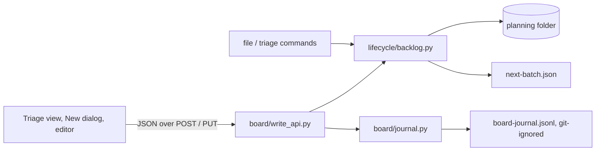

## Summary

The remote board could only read the backlog. Now the user can handle it from the board, on a phone or a PC: a Triage view shows the inbox, the priorities P1 to P4 and `3-ready` as post-its that can be dragged (or selected and sent from a bottom bar), grouped, labelled and filtered by label; a "New" button files an idea; a backlog Markdown file can be edited in the file panel; and "The next batch is ready" leaves a marker. Every change is written at once through the same functions the `file` and `triage` commands run, with a toast. A journal lists what the board wrote since the user last said "rescan" to the Chief of Staff; the board never messages the Chief of Staff and never touches a running batch.

## Deliverables

- Triage view (first after Home, hidden on "All projects"): post-it columns tinted by grill state, drag and drop, a selection bar (also by keyboard), groups with undo, label filter, the next-batch indicator and the journal button and panel.
- "+ New" in the header and in the Kanban Intake column (a native dialog; a slug field appears when the folder exists), a Home tile "Written by the board", English and French words.
- `chantier triage <item> --inbox` moves an item back to the inbox.
- Write routes (`POST backlog/new|move|labels|group|ungroup|next-batch`, `PUT backlog/file`, `GET journal`, `POST journal/rescan`), guarded by the key, the origin and a JSON content type (403 and 415 otherwise); an item is found only in the inbox, P1 to P4 or `3-ready`.
- The Markdown edit sends the SHA-256 of the text as loaded and gets a 409 if the file changed; CRLF line endings are kept.
- Screenshots of Triage, Kanban, Home and the New dialog on PC (1400x860) and phone (375x812) are kept in the PR's work files (see Internal references), taken at an earlier head of this branch (before the group-drag and selection fixes); there is no before image, since the views are new. The forge CLI in use cannot attach them.

## Blast radius

Grade: 2. The board server gains write routes and the backlog code is shared by the commands and the server. A `git revert` restores the read-only board; the only new files in a project are the git-ignored journal and the committed `next-batch.json`.

## Autonomous decisions

- `PUT` is allowed for the file write, the one verb the specification names; a non-JSON write body gets 415 and a bad key or origin 403.
- The label and group setters of the summaries commands were extracted into plain functions so the server calls them in process.
- A post-it is a focusable group, not a button, so its "open" button is not nested in another button.

## Known gaps

- Not done: the side-by-side comparison with the design prototype, a drag-and-drop check on Firefox, a two-device check (a move on the phone showing on the PC) and the check that a board write is committed by the surface's autosync.
- Not exercised in a browser: the label-filter pruning of the selection, the back/forward guard of an open editor, the editor save and the label dialog (their HTTP routes were exercised live).
- The New dialog shows its slug field and hint while the text is still empty; a small glitch left for a later change.
- `triage --inbox` prints the item's full path (`triaged .agents/changes/1-inbox/<name>`), as the other targets do, not the shorter form the specification quotes.
- No local long gate: the batch's waiver applies; GitHub CI is the proof.
- The screenshots are not attached to the description (the forge CLI cannot upload them).

Details

## Changes

- Python: `lifecycle/backlog.py`, `lifecycle/filing.py`, `summaries/edit.py`, `board/journal.py`, `board/write_api.py`; guard, routes, state, files and fingerprint of the board; `triage --inbox`.
- Web: `views/triage.js`, `triage/*`, `labels/*`, `journal/*`, `edit/*`, `api/backlog.js`, `ui/toast.js`, `ui/dialog.js`, `core/api.js` (`send`), `core/router.js` (a leave guard), CSS files and English and French words.
- Cards and docs: the "rescan" row, `triage --inbox` and the `3-ready` marker in the concepts, `docs/boards.md`; the scenario's board and `triage --inbox` steps.

## Human decisions

- Editing from the board is limited to the backlog (inbox, P1 to P4, `3-ready`): changing a priority is moving the folder, and nothing touches a running batch.
- Every change is written at once through the commands' own code; nothing is queued for the Chief of Staff, who is told "rescan" by the user.
- "Next batch ready" is a marker with the user's time and list, not a computed state.
- The page ships in English and French, from one word file per language.

## Impacts

The board gets a Triage view, a "+ New" button and an editor; the screenshots show Triage, Kanban, Home and the New dialog.

## Test plan

- [x] New or changed tests (they fail on the previous code): scenario steps for `triage --inbox` and the board write routes, and the structure test of the board modules
- [x] Local gates at `439b383`: `just check` passes (ruff, mypy strict on three platforms, Biome, 71 tests); the board scenario passed locally on both forges (840 and 818 checks) before the last fixes
- [x] Evidence at `439b383`: live write routes, a real Chromium drag of posts and of a group handle, no console error
- [x] Review: approved at `439b383`
- [x] Verified at `439b383`
- [x] CI green at `439b383`: 5 of 5 checks pass

## Internal references

CR-226 board-backlog-edit. Screenshots: `work/evidence/r2-*.png` in the CR folder.

