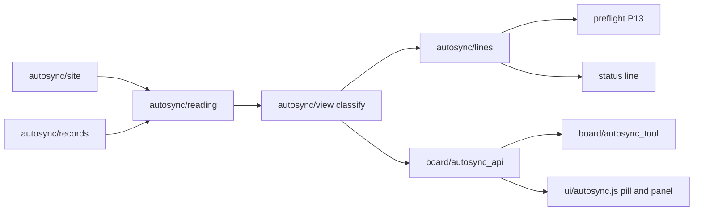

## Summary

With an external planning surface, a session had to commit and push the surface by hand after each step. That costs turns, is easy to forget, and leaves the surface behind while several sessions write in it. A surface can ship its own autosync (`scripts/ai-autosync-git.py` with `.agents/guidelines/autosync.guidelines.md`). This PR makes chantier use it instead of owning one: the sessions that write in the surface join its group, the CLI checks the group read-only, and the board joins it while it runs and shows its state in a pill with a panel.

## Deliverables

- A read-only `autosync` package: it detects a surface that names an autosync, reads its state files (never writing or deleting), and classifies them into four states, one pure function used by the CLI and the board.

| State | When | Pill |
| --- | --- | --- |
| approval | status `approval_required` with an incident | orange |
| blocked | disabled with a `blocked:` reason | red, with the reason |
| stopped | disabled otherwise | grey |
| active | not disabled | green |

- The board server joins the group at a fresh start (`join . --owner-pid <server pid> --harness generic --session-id chantier-board`), so its own backlog writes are committed and pushed with no agent session open. `board/autosync_tool.py` is the only code that starts the tool, from a fixed argv table, with no shell.
- `GET /api/autosync` rides on `/api/board`; `POST /api/autosync/start|stop|approve` are refused with 409 when the state does not allow them (no start while blocked, approve only for the incident shown now).
- The pill at the sidebar foot and the dot beside the phone project picker, with a panel (leader, participants, last push, start or stop, the incident and its "approve" button), in English and French.
- Choices: chantier owns no autosync; approvals are the user's click, never an agent's; a blocked group is the Chief of Staff's (the session that steers the project) to integrate (no force push) and restart; no autosync, no pill.

## Blast radius

Grade: 2. Several features share code (preflight, status, the board server and page, five cards, the scenario). Everything the CLI adds is read-only and warn-only; the board's start/stop/approve only run when the user clicks, and the one run that needs no click is the join at a fresh board start. A `git revert` restores the previous behaviour.

## Autonomous decisions

- The pill is built as pure markup functions plus store flags in the board's existing frame (`ui/autosync.js`, `ui/autosync-events.js`, `ui/autosync-tick.js`), not as a separate `mountAutosync` module, because the board paints through one frame function and delegates events.
- A state folder that does not exist yet is classified `stopped` with `no_group` set.
- A surface that names the guidelines but lacks the script gets the preflight warning and no status line.
- The board keeps the "last push" time in memory, since the tool records none.

## Known gaps

- No screenshot comparison against the prototype's views (PC and phone) yet, and the real autosync tool was not run end to end (Git LFS is not installed on the verifying machine); the scenario's fake tool covers the board and CLI paths.
- The detached join is only run on Windows locally; Linux and macOS rely on CI.
- The new card text was not exercised by a real Foreman.
- No local long gate (waived for this batch); CI is the proof.

Details

## Changes

- `skills/chantier/scripts/cli/src/chantier/autosync/` (`site`, `records`, `reading`, `view`, `lines`): new, read-only.
- `commands/preflight.py` (check P13, warn-only) and `commands/batch_status.py` (one line after the batch line).
- `board/autosync_tool.py`, `board/autosync_api.py`, `board/command.py`, `board/routes.py`, `board/context.py`: join, routes, actions.
- `board/web`: `ui/autosync.js`, `ui/autosync-events.js`, `ui/autosync-tick.js`, `css/autosync.css`, colour tokens, `en`/`fr` words, store and refresh wiring (index.html, js/core/api.js, js/main.js).
- Cards `concepts.md`, `session-start.md`, `chief-of-staff.md`, `foreman.md`, `griller.md`; `docs/planning-modes.md`; `AGENTS.md` (the server runs the surface's start, stop and approve on the user's click, and commits nothing itself); `scenario/` (a fake tool and new steps).

## Human decisions

- The project owns no autosync; the planning surface's own autosync is used.
- Approvals (staged changes, a found secret) are the user's click on the board or their own command, never an agent's.
- A blocked group is fixed by the Chief of Staff (integrate, no force push, then restart); the board has no restart button.
- No autosync, no pill: a surface without one, or an in-project planning folder, shows nothing.
- The page is English by default and French, from one word file per language.

## Impacts

Users of an external surface get a synced surface with no manual commits and a visible state. A project with an in-project planning folder sees no change.

## Test plan

- [x] New or changed tests (`tests/test_autosync.py`, scenario steps)
- [x] Local gates at `e4c67aa`: ruff, mypy --strict (linux, darwin, win32), pytest, biome, `uv lock --check`
- [ ] Evidence: none yet
- [x] Review: approved at `e4c67aa` (re-inspected after the rebase onto the stack below)
- [x] Verified at `e4c67aa` (checks, reduced scenario step; real tool and prototype comparison not proved)
- [x] CI green at `e4c67aa` (gh pr checks 195: check on three systems, scenario, eval-dry-run all pass)

## Internal references

CR-227 surface-autosync.

