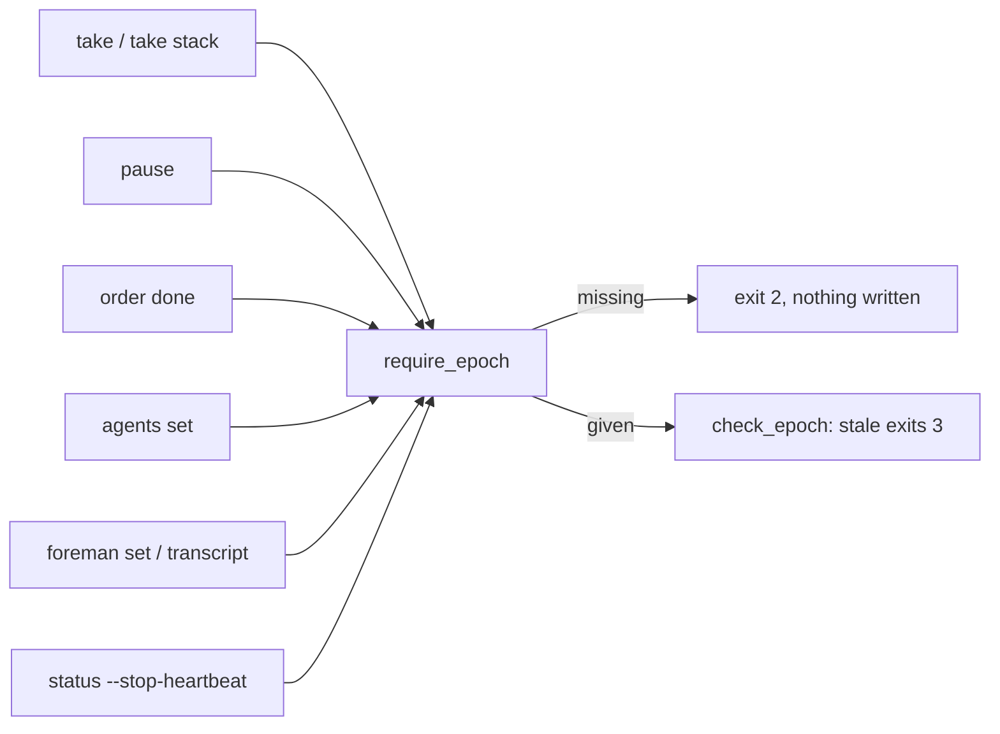

Stacked on #207.

## Summary

A steering session's command that changes a batch must say which Foreman it comes from. Until now `take`, `pause`, `order done`, `agents set` and `foreman transcript` accepted a call with no `--epoch`, so a stale or confused session that forgot the flag slipped past the stale-Foreman check and acted on a batch another Foreman now runs. Every steering command now refuses a call with no `--epoch` (exit 2) before anything is written; only reading the status goes without it. Messages shown to the user call the number "Foreman n°<k>", never "epoch" (the flag keeps its name).

## Deliverables

One helper, `require_epoch`, sits next to `check_epoch` and each steering handler calls it first:

Before and after, with no `--epoch`:

| Command | Before | After |
|---|---|---|
| `take`, `agents set`, `order done`, `pause`, `foreman transcript` | accepted | exit 2 |
| `foreman set`, `status --stop-heartbeat` | exit 1 | exit 2 |
| `status`, `status --refresh`, `order merged`, `order add --fix-for` | accepted | unchanged (the Chief of Staff's own forms, or a read) |

Refusal text, in the style of `cancel`'s: `take <cr> --epoch <n>: the steering session's command; <n> is your number as Foreman of the batch (Foreman n°<n>)`. The stale-Foreman refusal now reads `Foreman n°<k> of <batch> ... now at Foreman n°<m>; stop now` (exit 3 unchanged). The cards that list the steering commands add `gate <cr> --first`, give every example its `--epoch <n>`, and state the user-facing wording.

## Blast radius

Grade: 2. Shared CLI handlers and the cards every Foreman and Chief of Staff reads change; a revert restores the old behaviour, but a Foreman copying an old example without `--epoch` is now refused.

## Autonomous decisions

- `order merged` and `order add --fix-for` keep their form without `--epoch`, as the specification states: that form is the Chief of Staff's order, which the CLI cannot tell from a steering session's.
- A steering command on a batch no Foreman has claimed still accepts `--epoch 0`, as the specification leaves it.
- `cancel` and `gate --first` keep their own refusals rather than moving to the helper.
- The new refusal check is a parametrized pytest (it proves `batch.json` and the events are byte-identical), not a scenario step; the scenario README's coverage contract carries its `(test:)` marker. The exceptions (`status --refresh`, `order merged` without the flag) are carried by existing scenario steps only.

## Known gaps

- None

Details

## Changes

- `core/batch.py`: `require_epoch`, the Foreman-number wording of `check_epoch`.
- `commands/driver.py`, `closing.py`, `orders.py`, `batch_status.py`, `seat.py`: the steering handlers call it first; messages reworded; `registry.py` and `declare/batch_status.py` help texts.
- Cards: `foreman.md`, `chief-of-staff.md`, `concepts.md`.
- `seat.py`: the claim and the transcript paths are split so each takes its own refusal.
- CLI hints that told a Foreman to run a bare `pause`, `agents set`, `order done`, `take stack` or `foreman transcript` now name `--epoch <n>`.
- Scenario calls carry the batch's current number; a pytest covers the refusals; the scenario README's coverage contract names it.

## Human decisions

- Every Foreman steering command refuses a call with no `--epoch` (exit 2); only the status read goes without it. To the user the number is the Foreman's number within its batch, never the word epoch; the flag's name stays.

## Impacts

A forgotten `--epoch` is refused at once with a message naming the command's form. No visual change.

## Test plan

- [x] New or changed tests (they fail on the previous code): a parametrized refusal test and the updated scenario calls
- [x] Local gates at `c5e2498`: `just check` pass, long gate (`just scenario`, `just eval-dry-run`) pass
- [x] Evidence at `c5e2498`: the parametrized pytest proves, on a scratch batch, `take <cr>` without `--epoch` exits 2 with the message above and `batch.json` and `events.jsonl` hash the same before and after; no screenshot needed (no visual change)
- [x] Review: approved at `c5e2498`
- [x] Verified at `c5e2498`
- [x] CI green at `c5e2498`

## Internal references

CR-255 epoch-required-everywhere; work files in the CR folder (`work/r1.md`, `work/r2.md`, `work/verify.md`).

