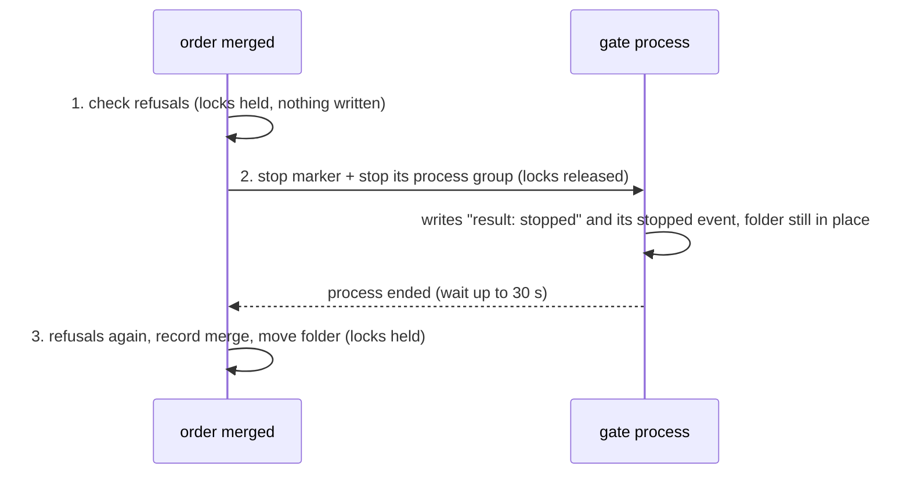

## Summary

When a change request is recorded as merged while its long gate is still running, the CLI stopped the gate and moved the change's folder at once. The stopped gate then woke up, found its log folder gone and crashed with a `FileNotFoundError` (and on Windows could hit os error 32, a folder moved while a process still held it). This made the scenario's gates check flaky. `order merged` now stops the gate, waits for its process to end, and only then records the merge and moves the folder.

## Deliverables

`order merged <cr>` runs in three steps; the wait happens outside the locks because the stopped gate needs the batch lock to log its own `stopped` event.

- Past 30 s without the gate ending, `order merged` exits 2, records nothing and moves nothing; the message names the CR and the gate's pid, and the order is run again once the gate has ended. The gate process is never killed.
- Exactly one `stopped` gate event per stopped run; output lines keep their place.
- The scenario's gates check now asserts the gate has ended when the order returns, with no traceback, exit 4, the right last log line and one `stopped` event.

## Blast radius

Grade: 1. Local to the `order merged` path and the stop helpers; a plain `git revert` restores the previous behaviour.

## Autonomous decisions

- The new code lives in a new module `commands/orders_merged.py` and the shared refusals in `check_merged`, to keep `order()` and `orders_apply.py` under their size limits.

## Known gaps

- None

Details

## Changes

- `commands/orders_merged.py` (new): the stop-and-wait step before the locked record-and-move.
- `commands/gate_run.py`: `ask_stop` factored out of `stop_gate`; `stop_and_wait` and `stopped_line` added.
- `procs.py`: `wait_gone` polls until a process has ended.
- `commands/orders_apply.py`, `commands/orders.py`: `check_merged` shared by the check and the record steps; `order()` calls the new step.
- `scenario/run_scenario.py`: gates check E4 and the earlier `order merged` check strengthened.
- `tests/test_gate_refusals.py`: one fast refusal test for a gate that ignores its stop.

## Human decisions

- The wait is bounded at 30 seconds; past it the order refuses, records nothing and moves nothing, naming the gate's pid.
- The fix is ordering only: no try/except in the gate and no log outside the change's folder.

## Impacts

No visual change. `order merged` may take up to a few seconds longer when a gate runs; otherwise output is unchanged.

## Test plan

- [ ] New or changed tests (they fail on the previous code): refusal test in `test_gate_refusals.py`; scenario E4
- [x] Local gates at `b0cd5fd`: `just check` and `just test` pass; `just scenario` passes
- [x] Evidence: the refusal test passes at `b0cd5fd` and cannot run on `afd42be` (the new module is absent there); no before/after visual
- [x] Review: approved at `b0cd5fd`
- [x] Verified at `b0cd5fd`
- [x] CI green at `b0cd5fd`

## Internal references

- CR-268 order-merged-gate-race; spec `.agents/changes/4-batch/2-actives/268-gate-race-on-merge/03-change-spec.md`; coder note `work/r1.md`.

