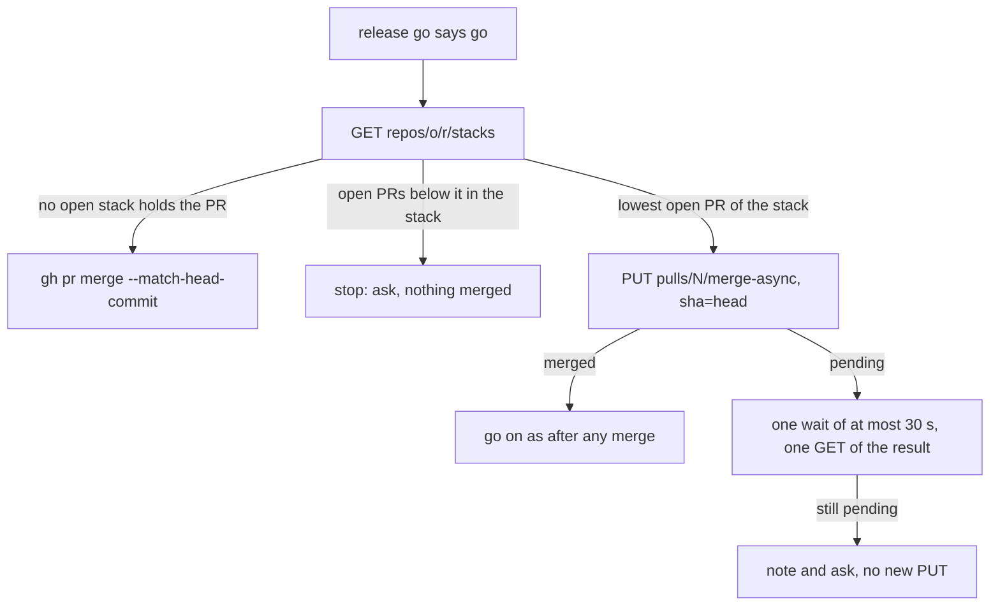

## Summary

When chantier merges a PR itself (a release PR or a fix PR, under the user's grant), GitHub refuses `gh pr merge` for any PR that is part of a native GitHub stack ("must be merged using the asynchronous merge REST API"). The cards and the allow rules only named `gh pr merge`, so a granted merge in a stack batch hit that refusal. This PR gives the cards and the allow rules the route that works: read the PR's stack, merge normally when it is in none, stop when open PRs sit below it, and otherwise merge through GitHub's asynchronous merge.

## Deliverables

The route, as `foreman.md` now writes it (GitHub only; `glab mr merge` and the user's own merges are unchanged):

New allow rules (offered only under a grant, never in the pasteable block), for the release and fixes capabilities on GitHub:

| Sample | Rule |
| --- | --- |
| `gh api -X GET repos/o/r/stacks -F per_page=100` | `gh api -X GET repos/*/stacks*` |
| `gh api -X PUT repos/o/r/pulls/12/merge-async ...` | `gh api -X PUT repos/*/pulls/*/merge-async*` |
| `gh api -X GET repos/o/r/pulls/12/merge-async/<uuid>` | `gh api -X GET repos/*/pulls/*/merge-async/*` |

Choices: an asynchronous merge takes every open PR below the target, so the route never merges a PR with open PRs below it; rule 8 ("no sleep, no polling loop") gets a second named exception, one bounded wait of at most 30 s after a `pending` answer, once per merge.

Proof by use: the two API calls themselves (`PUT .../merge-async` with `merge_method=rebase`, `merge_action=direct_merge`, `sha=`, then `GET .../merge-async/<uuid>`) merged the five stacked PRs of an earlier real stack run in the eval sandbox, one at a time from the bottom, run by the operator through the eval kit (`evals/kit/sandbox.py merge`).

## Blast radius

Grade: 1. Cards, a host table, three allow-rule samples and their tests; a `git revert` restores the previous text and rules. Nothing in the CLI runs these commands.

## Autonomous decisions

- The route's text lives once, in a "Merging on GitHub" part of `foreman.md`; the Chief of Staff's card, `concepts.md` and the host card refer to it rather than repeat it.

## Known gaps

- The route has not been run by an agent under the host's permission check (allow rules and auto mode's classifier on `gh api -X PUT ...merge-async`), and a `pending` answer handled by the bounded wait has not been seen: the cards mark the route unproved by an agent, Copilot included, until a stack eval with a release grant proves it.
- The asynchronous merge has no harmless trial form, so the host card names "P10's rule check only".

Details

## Changes

- `skills/chantier/references/foreman.md`: the route (steps 1 to 4) and its unproved mark.
- `skills/chantier/references/concepts.md`: the "Words" sentence on native stacks and rule 8's second exception.
- `skills/chantier/references/chief-of-staff.md`: the grant's merge refers to the route.
- `skills/chantier/references/hosts/claude-code.md`: the "A release on its own" and "Fixes on a grant" rows, and the Auto mode list of commands with no harmless form.
- `skills/chantier/scripts/cli/src/chantier/commands/permissions.py`: three samples per capability.
- `skills/chantier/scripts/cli/tests/test_cli_runs.py` and `scenario/run_scenario.py`: the P10 release and fixes warnings name the merge-async rule; the pasteable block holds none of the new rules.

## Human decisions

- The bounded wait after a `pending` answer (at most 30 s, once) is accepted as an exception to the no-sleep rule.
- No live trial now: the route ships marked unproved by an agent.

## Impacts

No visual change. A grant's allow-rule offer (preflight P10) lists three more rules.

## Test plan

- [x] New or changed tests (they fail on the previous code): the table test, the pasteable-block assertion and the P10 release and fixes warnings, at `37fa140`
- [x] Local gates at `37fa140`: `just check` pass (190 tests)
- [x] Evidence: none, no visible change
- [x] Review: approved at `37fa140`
- [x] Verified at `37fa140`
- [x] CI green at `37fa140`: five jobs pass, `just scenario (ubuntu-latest)` included

## Internal references

- CR-281 stack-merge (planning folder: specification and answers).

