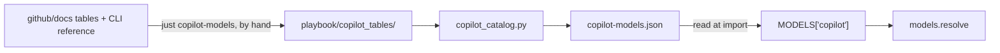

## Summary

chantier's list of the models GitHub Copilot offers was written by hand and went stale. It is now built from GitHub's own tables (`github/docs`, `data/tables/copilot/`) and the Copilot CLI reference's "Supported models", copied into the repository and refreshed by one command run by hand (`just copilot-models`). The CLI itself never goes to the network. Each model's identifier comes from its display name by one rule (the one copilot-session-usage uses); where GitHub's sources disagree, the refresh says so and refuses nothing.

## Deliverables

The refresh turns GitHub's copy into the catalog the CLI reads:



The catalog holds 30 models at `github/docs` commit `84bdf4c88dcbd2402b0a2b3ab537c5a104e23a6a`. The refresh's output, as run for this PR (identifier, display name, release status, CLI, App, plans, in the CLI reference, then the differences and the agent files' lines):

```text
commit: 84bdf4c88dcbd2402b0a2b3ab537c5a104e23a6a (github/docs)
claude-fable-5 | Claude Fable 5 | GA | cli True | app None | plans pro_plus,max,business,enterprise | in CLI reference False
claude-fable-5.1 | Claude Fable 5.1 | GA | cli True | app None | plans pro_plus,max,business,enterprise | in CLI reference False
claude-fable-5.2 | Claude Fable 5.2 | GA | cli True | app None | plans pro_plus,max,business,enterprise | in CLI reference False
claude-haiku-4.5 | Claude Haiku 4.5 | GA | cli True | app True | plans pro,pro_plus,max,business,enterprise | in CLI reference True
claude-haiku-5.5 | Claude Haiku 5.5 | GA | cli True | app None | plans pro,pro_plus,max,business,enterprise | in CLI reference True
claude-opus-4.8 | Claude Opus 4.8 | GA | cli True | app True | plans pro_plus,max,business,enterprise | in CLI reference False
claude-opus-4.8-(fast-mode) | Claude Opus 4.8 (fast mode) | GA | cli True | app None | plans pro_plus,max,business,enterprise | in CLI reference False
claude-opus-5 | Claude Opus 5 | GA | cli True | app True | plans pro_plus,max,business,enterprise | in CLI reference False
claude-opus-5.5 | Claude Opus 5.5 | GA | cli True | app True | plans pro_plus,max,business,enterprise | in CLI reference True
claude-sonnet-4.6 | Claude Sonnet 4.6 | GA | cli True | app None | plans pro,pro_plus | in CLI reference False
claude-sonnet-5 | Claude Sonnet 5 | GA | cli True | app True | plans pro,pro_plus,max,business,enterprise | in CLI reference False
claude-sonnet-5.5 | Claude Sonnet 5.5 | GA | cli True | app True | plans pro,pro_plus,max,business,enterprise | in CLI reference True
gemini-3.8-flash | Gemini 3.8 Flash | GA | cli True | app True | plans pro,pro_plus,max,business,enterprise | in CLI reference True
gemini-4-argon | Gemini 4 Argon | GA | cli True | app None | plans pro_plus,max,business,enterprise | in CLI reference False
gemini-4-carbon | Gemini 4 Carbon | GA | cli True | app None | plans pro_plus,max,business,enterprise | in CLI reference False
gemini-4-hydrogen | Gemini 4 Hydrogen | GA | cli True | app None | plans pro,pro_plus,max,business,enterprise | in CLI reference False
gpt-5.3-codex | GPT-5.3-Codex | GA | cli True | app None | plans pro,pro_plus,max,business,enterprise | in CLI reference True
gpt-5.6-luna | GPT-5.6 Luna | GA | cli True | app True | plans pro,pro_plus,max,business,enterprise | in CLI reference False
gpt-5.6-sol | GPT-5.6 Sol | GA | cli True | app True | plans pro_plus,max,business,enterprise | in CLI reference False
gpt-5.6-terra | GPT-5.6 Terra | GA | cli True | app True | plans pro,pro_plus,max,business,enterprise | in CLI reference False
gpt-6-astra | GPT-6 Astra | GA | cli True | app True | plans pro_plus,max,business,enterprise | in CLI reference True
gpt-6-luna | GPT-6 Luna | GA | cli True | app True | plans pro,pro_plus,max,business,enterprise | in CLI reference True
gpt-6-sol | GPT-6 Sol | GA | cli True | app True | plans pro_plus,max,business,enterprise | in CLI reference False
gpt-6.1-sol | GPT-6.1 Sol | GA | cli True | app True | plans pro_plus,max,business,enterprise | in CLI reference True
gpt-6.1-terra | GPT-6.1 Terra | GA | cli True | app None | plans pro,pro_plus,max,business,enterprise | in CLI reference True
grok-4.5 | Grok 4.5 | GA | cli True | app None | plans pro,pro_plus,max,business,enterprise | in CLI reference False
grok-4.6 | Grok 4.6 | GA | cli True | app None | plans pro,pro_plus,max,business,enterprise | in CLI reference False
grok-4.7 | Grok 4.7 | GA | cli True | app None | plans pro,pro_plus,max,business,enterprise | in CLI reference False
kimi-k3 | Kimi K3 | GA | cli True | app None | plans pro,pro_plus,max,business,enterprise | in CLI reference False
mai-code-1.1-flash | MAI-Code-1.1-Flash | GA | cli True | app True | plans pro,pro_plus,max,business,enterprise | in CLI reference False
differences:
  claude-fable-5: in the tables, not in the CLI reference's Supported models
  claude-fable-5.1: in the tables, not in the CLI reference's Supported models
  claude-fable-5.2: in the tables, not in the CLI reference's Supported models
  claude-opus-4.8: in the tables, not in the CLI reference's Supported models
  claude-opus-4.8-(fast-mode): in the tables, not in the CLI reference's Supported models
  claude-opus-5: in the tables, not in the CLI reference's Supported models
  claude-sonnet-4.6: in the tables, not in the CLI reference's Supported models
  claude-sonnet-5: in the tables, not in the CLI reference's Supported models
  gemini-4-argon: in the tables, not in the CLI reference's Supported models
  gemini-4-carbon: in the tables, not in the CLI reference's Supported models
  gemini-4-hydrogen: in the tables, not in the CLI reference's Supported models
  gpt-5.6-luna: in the tables, not in the CLI reference's Supported models
  gpt-5.6-sol: in the tables, not in the CLI reference's Supported models
  gpt-5.6-terra: in the tables, not in the CLI reference's Supported models
  gpt-6-sol: in the tables, not in the CLI reference's Supported models
  gpt-6.1-sol: absent from model-supported-clients.yml, cli True and app True in auto-model-selection.yml
  grok-4.5: in the tables, not in the CLI reference's Supported models
  grok-4.6: in the tables, not in the CLI reference's Supported models
  grok-4.7: in the tables, not in the CLI reference's Supported models
  kimi-k3: in the tables, not in the CLI reference's Supported models
  mai-code-1.1-flash: in the tables, not in the CLI reference's Supported models
agent files: none
```

Choices: an identifier is the display name with footnote markers and `(preview)` dropped, other parentheticals kept, lower case, spaces made `-`; a model is in when any source says the Copilot CLI or App has it; plans are kept and shown, never refused; no prices (those stay with copilot-session-usage). On Copilot a short name such as `opus` that matches several models is now refused as ambiguous, listing the matching identifiers.

## Blast radius

Grade: 2. `MODELS["copilot"]` changes source, so every Copilot model resolution reads the new file; revert is a plain `git revert`, and the catalog is a copy, not a runtime dependency.

## Autonomous decisions

- `normalise` now lives in `copilot_catalog.py` and `models.py` imports it, so the refresh can build the catalog before `copilot-models.json` exists.

## Known gaps

- Identifiers marked `in_cli_reference: false` (for example `claude-opus-4.8-(fast-mode)`) are derived by the rule and unproved until the runtime's `listModels()` shows them (copilot-session-usage#67).
<details>
<summary>Details</summary>

## Changes

- `playbook/copilot_tables/`: byte-for-byte copy of four GitHub tables, the CLI reference section, and `SOURCE.json` (repository, commit, date, paths); `.gitattributes` keeps LF.
- `playbook/copilot_catalog.py`: identifier rule, catalog builder (local files only), plain-line differences, `agent_file_differences`.
- `playbook/copilot-models.json`: the built catalog, written only by the refresh.
- `playbook/models.py`: `MODELS["copilot"]` built from the JSON, `copilot_catalog()`; hand-written Copilot rows removed.
- `scripts/copilot_models.py` and the `copilot-models` recipe of the `justfile`: the refresh.
- Docs: Copilot host reference, `docs/agents-and-models.md`, `CONTRIBUTING.md`.
- Tests: new `test_copilot_catalog.py`; `test_playbook_config.py` and `test_plugin_files.py` adapted.

## Human decisions

- A short name matching several Copilot models is refused as ambiguous; the user writes the full identifier.
- A model GitHub stops listing while an agent file names it is dropped from the catalog and reported; `just check` then fails until the agent file changes.
- Plans show in the refresh output and in the JSON; no user command prints them yet.

## Impacts

Copilot users of `chantier.yaml` model names see a catalog of about thirty models; `opus`, `sonnet`, `luna`, `sol`, `terra` become ambiguous on Copilot. No visual change.

## Test plan

- [x] New or changed tests (`test_copilot_catalog.py`, `test_playbook_config.py`, `test_plugin_files.py`)
- [x] Local gates carried from `9d6484e` (restacked clean onto main as `a180e4d`, patch unchanged): `just check` passed (272 tests, lint, types); the long gate is the pipeline's `just scenario (ubuntu-latest)` job
- [x] Evidence: refresh output, see Deliverables (run at `943fcb4`'s tree, committed unchanged as `9d6484e`, carried from `9d6484e`)
- [x] Review: approved, carried from `9d6484e`
- [x] Verified, carried from `9d6484e`
- [ ] CI at `a180e4d`: pending (was green at `9d6484e`, all five checks passed, `just scenario (ubuntu-latest)` included)

## Internal references

CR-298 copilot-model-catalog; stacked on CR-297 copilot-role-models. Refresh output: work/r1.md.

</details>
