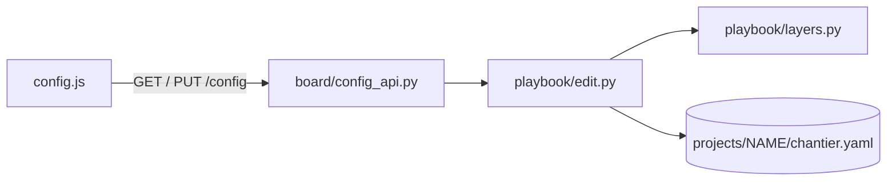

## Summary

Choosing which agent and which model runs each role meant editing a YAML file by hand. The web board now has a Configuration page: for each host (Claude Code, Copilot) and each role it shows the agent, the model, the layer each value comes from and how the role starts, and it lets the user change a role's agent or model for one project. The page writes only the project's `chantier.yaml` in the planning surface (the surface's autosync commits it); a change applies at the next batch.

This PR changes a project rule: `AGENTS.md` now says chantier also writes a project's `chantier.yaml` in an external planning surface, and that the board edits each role's agent and model through the CLI. Please read that diff.

## Deliverables

- The page, one table per host, one row per role: inherited value with its layer, editable value, effective value, and the start (`plugin`, `named`, `generic`, or the refusal's text). A value that the code repository's own `chantier.yaml` overrides is still written and shown "overridden by <path>" with the effective value. The Copilot table and a "Copilot models" list show each model's plans from GitHub's tables, refusing nothing.
- Screenshots of the page from the demo surface, after at `61a421b` (before: the page did not exist at `a92113f`). PC, with the Copilot table (a `generic` start, a row "overridden by" the code repository's file) and the open "Copilot models" list with each model's plans:

  

  Phone:

  

- One save and its answer, on the demo surface (`PUT /api/projects/shop-api/config`, `{"host": "copilot", "role": "inspector", "key": "model", "value": "gpt-6.1-terra"}`): the answer holds `"ok": true`, the lines `wrote projects/shop-api/chantier.yaml` and `applies at the next batch`, and one journal line `config`: `inspector.model = gpt-6.1-terra (copilot)`. The written file's diff (comment and other keys kept):

  ```diff
  --- a/chantier.yaml
  +++ b/chantier.yaml
  @@ -4,3 +4,5 @@
       roles:
         coder:
           model: gpt-6.1-terra
  +      inspector:
  +        model: gpt-6.1-terra
  ```

- One read (`GET /api/projects/shop-api/config`): the Copilot `coder` row, whose model the code repository's file overrides, and a Copilot catalog entry with its `plans`:

  ```json
  {"role": "coder", "model": {"layers": {"defaults": "gpt-6.1-sol", "surface project": "gpt-6.1-terra", "repository": "gpt-6.1-sol"},
    "effective": {"id": "gpt-6.1-sol", "name": "GPT-6.1 Sol"}, "layer": "repository"},
   "overridden_by": "projects/shop-api/.repo/chantier.yaml", "start": "plugin"}
  {"id": "claude-fable-5", "name": "Claude Fable 5", "plans": {"pro": false, "pro_plus": true, "max": true, "business": true, "enterprise": true}}
  ```

- Choices: no "all hosts" section; only `agent` and `model` are editable, the other keys are shown read-only; "inherited" removes the key from the project's file; each edit is checked by a dry run before saving.



## Blast radius

Grade: **2**. A new board route that writes one file in the planning surface and a refactor of the layers module that the playbook also uses; `git revert` restores the previous behaviour, a written `chantier.yaml` stays as the user's own configuration.

## Autonomous decisions

- New tests live in `test_board_config.py` and `test_playbook_edit.py` rather than in `test_board.py` and `test_playbook_config.py`, to keep those files under 400 lines.
- The text editing helpers are split into `playbook/edit_text.py` for the same line limit.

## Known gaps

- No screenshot of the pane applies: the CR board pane is untouched.
- Release notes are left to the version PR.
- The text editor of the project file keeps CRLF line endings when the existing file is mostly CRLF (a Windows checkout with `autocrlf`), where the specification asks for LF; a new file is written with LF. Left as is, with no data loss.
- The phone screenshot cuts the "Starts as" column at the right edge (the table scrolls sideways); it stays legible.
- The PC screenshot lists the first 15 Copilot models only and its Copilot heading sits under the top bar; the page itself lists them all.

<details>
<summary>Details</summary>

## Changes

- `playbook/edit.py`: `config_view` and `edit_surface_file` (hash guard, dry run, round trip that keeps comments); `playbook/layers.py` exposes the defaults read and a judge of in-memory layers.
- `board/config_api.py`: `GET` and `PUT /api/projects/<id>/config`, journal line `config`.
- Web: `views/config.js`, `api/config.js`, `css/views/config.css`, registry entry, icon, English and French words.
- Texts that say what chantier writes: `AGENTS.md`, `CONTRIBUTING.md`, `README.md`, `SKILL.md`, `session-start.md`; `docs/web-board.md` "Configuration", demo `shop-api/chantier.yaml`, screenshots.
- Tests and a scenario step (`surface_config_page`) with a fake autosync commit.

## Human decisions

- The page writes the surface project's file even when the code repository's file overrides the value, and says so.
- No setting for all hosts; only each role's agent and model are editable.
- A Copilot user's own agent with a model is refused as it is entered.
- Plans are shown for each Copilot model and refuse nothing.

## Impacts

A new "Configuration" page in the web board; no change to the CR board pane.

## Test plan

- [x] New or changed tests (they fail on the previous code): `test_board_config.py`, `test_playbook_edit.py`, the scenario step `surface_config_page`
- [x] Local gates at `61a421b`: `just check` pass (311 tests); `just scenario --unit surface-board` 167/167 at `0198fd5`, carried from `0198fd5` (the later commit changes only the screenshot script and one image); the long gate is the pipeline's `just scenario (ubuntu-latest)`
- [x] Evidence: before at `a92113f` (no page), after at `61a421b`
- [x] Review: approved at `61a421b`
- [x] Verified at `61a421b` (the claims on behaviour carried from `0198fd5`, the screenshot claim judged again at `61a421b`)
- [x] CI green at `61a421b`: `gh pr checks 256`: `just check` on three systems, `just eval-dry-run` and `just scenario (ubuntu-latest)` pass

## Internal references

- CR-301 board-config-page; stack CR-297 to CR-301.

</details>
