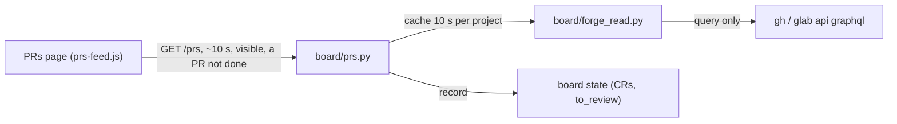

## Summary

After several PRs are ready at once, the web board gave no live answer to "which PR is merged, which one can I merge now". This adds a **PRs** page to `chantier board`: one row per PR of the running batch, with its state on the forge (open, draft, merged, closed, conflicting, checks running, green or failing) and whether it is ready to merge now. The page refreshes by itself about every 10 s, stops once every PR is done (merged, or closed without a merge) and starts again by itself when a new PR joins the batch. It only reads.

## Deliverables

- A new **PRs** view in the board's sidebar (after Batch), fed by a new read route `GET /api/projects/<id>/prs` that answers all of the batch's PRs from one GraphQL request (`gh api graphql` or `glab api graphql`), at most once every 10 s per project whatever the number of open pages.
- "Ready to merge now" needs both the record (the CR is ready to merge) and the forge (open, not a draft, not conflicting, checks green or none). The forge alone never makes a PR ready.
- While the forge has not computed a PR's mergeability or its checks, the row says "being checked by the forge" and the PR is not ready.
- A PR the forge shows merged that the record does not hold reads "merged on the forge, not recorded yet: tell the Chief of Staff".
- A merged PR names the branch it went into (the CR whose branch it is, or the branch).
- When the forge cannot be read, the page shows the forge's own one-line message and keeps the last good read with its time.

The page, drawn by a real board against a fake forge (five PRs: merged, open, conflicting, draft, being checked by the forge), carried from `0141856` (the page is unchanged by the restack):

## Blast radius

Grade: 1. A new route, a new view and a read-only forge query; nothing else in the CLI changes, and a `git revert` restores the previous behaviour.

## Autonomous decisions

- Word prefix `pv.` for the page's texts, because `prs.` already belongs to the Batch view.
- The "not all in one repository" refusal text is now a shared constant used by `forge-stack` and by the page, instead of being copied.
- The 10 s cache uses the monotonic clock, so the board's `--clock` option does not freeze it.
- A CR cancelled in the record whose PR is still open on the forge keeps its row (the forge is the truth), so the refresh does not stop until that PR is closed.
- When the read cannot tell whether a repository has checks, the row says "being checked", never "no checks".

## Known gaps

- The three real-forge reads are not tried: a PR merged into another PR's branch, a PR of a native GitHub stack, and a real GitLab project (`glab api graphql` is proved against the fakes only, not against the real fields).
- On GitLab, a project with no CI configuration reads "being checked by the forge" instead of "no checks", because the read cannot tell the two apart.
- No screenshot of the page from a real browser and a real forge; the page was checked by the linter and by the scenario's route steps only.
- The pictures in `docs/web-board` predate the new sidebar entry and are not retaken.
- `just test` takes about 50 s on this machine, as the base does; the AGENTS.md budget (48.5 s) was measured on another machine.

Details

## Changes

- `board/prs.py` (route, rows, judgement), `board/forge_read.py` (query, runners, cache), wired in `board/routes.py` and `board/context.py`.
- Front end: `js/views/prs.js`, `prs-row.js`, `prs-feed.js`, words in `en-prs.js`/`fr-prs.js`, `css/views/prs.css`, registry entry, `api.js`, store, router, icon.
- `scenario/fake_gh.py` answers the batch's GraphQL query; new steps in the `surface-board` unit; `tests/test_board_prs.py`.
- `AGENTS.md`, `CONTRIBUTING.md`, `docs/web-board.md`, `scenario/README.md` and two lines of `skills/chantier/references/chief-of-staff.md` name the page and its forge read.

## Human decisions

- A page of the web board, not the terminal pane; one forge request for all PRs per refresh, about every 10 s.
- A PR closed without a merge counts as done; after "all done" the page stops reading the forge and starts again by itself when a PR joins.
- Ready to merge needs the record and the forge; "being checked by the forge" is never ready.
- No picture of the page in the docs for now.
- The merge signal (the board leaving a line for the Chief of Staff) is a separate, later change.

## Impacts

A new sidebar entry and page; the board needs the user's own `gh` or `glab` login and the network for that page only.

## Test plan

- [ ] New or changed tests (`tests/test_board_prs.py`)
- [x] Local gates carried from `0c1180c`; at `edf4642` (rebased onto main with conflicts resolved) `just check` pass (349 tests), `just scenario --unit surface-board` 178/178; earlier: `just check` (ruff, mypy, biome, uv lock, 296 tests, release notes: pass), `just scenario --unit surface-board` (165/165 checks at the first round's tree; run again at the head)
- [x] Evidence: after, carried from `0141856`, a fake-forge screenshot of the page (no before: the page is new)
- [x] Review: approved at `0c1180c`, carried from `0c1180c`; the restack move `0141856`..`edf4642` approved at `edf4642`
- [x] Verified at `edf4642`
- [x] CI green at `edf4642`

## Internal references

CR-302 pr-monitor (batch-22). Work notes: `work/investigation.md`, `work/r1.md`.

