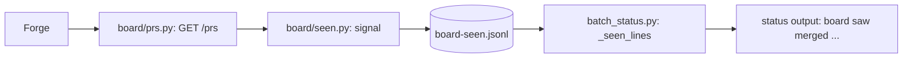

## Summary

The web board's PRs page shows which pull requests are merged on the forge, but nothing told the session that records merges. Now, when that page's forge read finds a PR merged that the batch record does not hold, the board appends one line to a local file, and `chantier status` prints it for the Chief of Staff (the session that steers the batch), who records the merge at its next `status`. The board itself records nothing and messages no agent.

## Deliverables

The signal, end to end:

What `status` prints, for a merge into the default branch and for a merge into another CR's branch (a stacked batch):

| Case | Line |
| --- | --- |
| merged, record not updated | `board saw merged: <cr> <pr> into <branch> at <time>; for the Chief of Staff: order merged <cr>` |
| merged into another CR's branch | `board saw merged: <cr> <pr> into <other>'s branch at <time>; for the Chief of Staff: not landed, tell the user, record nothing until <other> lands` |

Choices: the file is local and ignored by git, written under the lifecycle lock, once per batch and CR; a cached read writes nothing; the line stops printing once the merge is recorded, so nothing clears the file.

## Blast radius

Grade: **1**. A new local file and a read-only status line, plus card and doc text; `git revert` restores the previous behaviour. A stray `board-seen.jsonl` is harmless.

## Autonomous decisions

- A cached forge read writes no line (the first version wrote one on every read of a not-yet-recorded merge; the dedup file made it idempotent, but only fresh reads now signal).
- The forge-read parsing tests moved unchanged to their own test file, to stay under the repository's file-size limit.

## Known gaps

None.

Details

## Changes

- `board/seen.py` (new): reads and appends `board-seen.jsonl`; `board/prs.py` and `board/routes.py` call it after a fresh forge read.
- `commands/batch_status.py`: `_seen_lines` prints the line in every `status` form; unreadable lines are named, other batches, merged and cancelled CRs print nothing.
- `core/files.py` and `board/fingerprint.py`: the file is ignored by git and part of the board's fingerprint.
- Cards: the Chief of Staff records the merge (or, for a merge into another CR's branch, tells the user and records nothing); the Foreman ignores the line.
- `AGENTS.md`, `CONTRIBUTING.md`, `docs/web-board.md`: the second named exception for the board, and the docs' account of the signal, including that it is read only when a `status` runs.
- Tests and the `surface-board` scenario unit extended.

## Human decisions

- A merge the view sees is signalled, not recorded: only the Chief of Staff records it.
- In Foreman mode the Chief of Staff still records it, at its own next `status`; the Foreman does nothing with it.
- With nothing running, the page's row tells the user to tell the Chief of Staff, and the docs say so.
- A PR merged into another CR's PR is signalled with its branch and is not recorded until the PR under it lands.

## Impacts

No visual change. `chantier status` gains one line per unrecorded merge the board saw.

## Test plan

- [x] New or changed tests (they fail on the previous code)
- [x] Local gates carried from `0d14ae5`: `just check` pass; `just scenario` pass
- [x] Evidence: none, no visual change
- [x] Review: carried from `0d14ae5`
- [x] Verified: carried from `0d14ae5`
- [x] CI green at `849ac8c`

## Internal references

- CR-303 board-merge-signal, split from CR-302 (PRs page); stacked on its branch.

