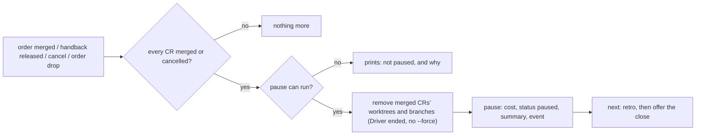

## Summary

When the last CR of a batch ended, nothing paused the batch: the steering session had to remember to pause it, clean up and offer the close. In a real run it skipped all three, and the user's "close" was refused as "running, not paused". Now the command that records the last CR's end pauses the batch itself, removes the merged CRs' worktrees and branches, and the cards make the steering session offer the close at once, after the retro.

## Deliverables

The end of a batch's last CR now runs one shared sequence (`commands/endpause.py`):

- A merged CR whose agent is still recorded keeps its worktree and branch (`cleanup: <cr> kept: agent <id> still held`); a refusal by git (changes, lock, an open file on Windows) keeps them too (`cleanup: ... not removed: <git's message>`); the batch is paused in both cases.
- Pending orders the CLI fully applied are marked done by the pause; a pending note, a QA order or the drop of a live CR blocks it, and the command then prints `every CR is merged or cancelled, not paused: <causes>`.
- `close` now also names, in its line of worktrees and branches to remove, every merged CR whose worktree or branch still exists, beside the dropped CRs.
- `status` flags a running batch whose CRs are all merged or cancelled: `every CR is merged or cancelled, not paused: ...`.
- No automatic close: `close --yes` stays the user's yes.

## Blast radius

Grade: 2. The CLI gains its first git writes (`git worktree remove`, `git branch -D`) at a batch's end, and the order and cancel commands change their last step; a revert restores the earlier behaviour, and a removed worktree of a merged CR holds nothing the forge does not.

## Autonomous decisions

None.

## Known gaps

- `docs/tutorial-claude-code.md` line 187: the sentence after the updated one still says the batch stays paused until the user says "close the batch".
- The local gates ran on Windows only; Linux and macOS are covered by CI alone (`just check` on all three, `just scenario` and `just eval-dry-run` on Ubuntu), and the open-handle test runs on Windows only.
- The PR stays a draft: its base is CR-316's branch.

Details

## Changes

- New `commands/endpause.py` holds the cleanup and the shared pause body; `closing.py`'s `pause` uses the same body, so every pause is recorded in one place. `order merged` (both forms), a release's `handback released`, `cancel` and `order drop` of a CR that is not live call it.
- `close` reads the record and git to name merged CRs' leftovers; `status` prints the not-paused line.
- `AGENTS.md` names this git exception of the CLI (two named exceptions beside the board's server).
- `evals/kit/dry_run.py` no longer pauses again after the last merge (the CLI already paused the batch).
- Cards (`foreman.md`, `chief-of-staff.md`, `driver.md`, `concepts.md`, `status-layout.md`, the Claude Code and Copilot host references) and docs (tutorial, planning folder, planning modes, use cases, the batch and CR lifecycle texts and diagrams) tell the new story: pause and cleanup by the CLI, then the retro with its critic, then the close offered unprompted.
- New tests in `test_batch_end.py` (the four triggers, a kept agent, not-the-last, blocked, an uncommitted worktree, a Windows open file, `status`, `close`) and updated scenario steps.

## Human decisions

- The pause and the cleanup are the CLI's, at once, when the last CR ends; the steering session only writes the retro and offers the close.
- The close is offered, never automatic: `close --yes` runs only on the user's yes.
- A leftover worktree is never forced: git's refusal keeps it, a line says why, the batch is paused anyway, and the user decides at the close; a worktree whose Driver may still run is skipped.
- Releases, cancels and drops of the last CR pause and clean too.
- This gives the CLI a named git exception, written into the project's instructions.

## Impacts

No visual change. Users see the batch paused and cleaned at its last CR's end, and are asked whether to close.

## Test plan

- [x] New or changed tests (`test_batch_end.py`; they fail on the previous code)
- [x] Local gates at `0bd9d9c`: `just check` passed; the long gate is the pipeline's `just scenario (ubuntu-latest)`, green at `0bd9d9c` (restacked; patch carried)
- [ ] Evidence: none, no visible change
- [x] Review: approved at `0bd9d9c` (round 6 committed as `0bd9d9c`; earlier rounds re-reviewed at `ed0b33d` after a rebase with resolved conflicts) (restacked; patch carried)
- [ ] Verified at `<sha7>`
- [x] CI green at `0bd9d9c` (`just check` x3, `just eval-dry-run`, `just scenario` on ubuntu-latest) (restacked; patch carried)

## Internal references

CR-317 auto-pause-last-merge; specification `03-change-spec.md` in its CR folder; round files `work/coder/r1.md`, `r2.md`, `r3.md`, `r4.md`, `r5.md`.

