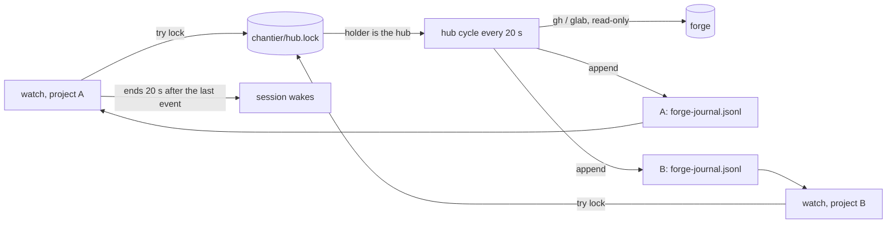

# PR 323 feat(watch): one forge hub per surface and machine, and watchers that wake each session
## Summary

When a PR of a running batch is merged on the forge, the Chief of Staff (chantier's session that plans and records the batch for the user) today learns it only when the user says so ("I merged #42"): one round trip per merge. This PR adds `chantier watch`, a background command that wakes the Chief of Staff on its own when a PR merges (or when CI turns red on a PR that is ready to merge), so it can check the merge on the forge and record it with no user message.

## Deliverables

One forge reader per planning surface and machine, however many projects and sessions run:

- The watcher that holds an OS file lock in the git folder is the hub: the only process that reads the forge, for every project of the surface, at most once every 20 s, one query per project whose running batch has an open PR the record does not hold merged.
- The hub appends `merged` and `checks-red` lines to each project's local `forge-journal.jsonl` (ignored by git). It replaces `board-seen.jsonl`: the board's PRs page writes its merge lines there too, once per merge whoever saw it first.
- Each watcher reads only its project's journal and ends 20 s after the last new event, so a stack merged in one go gives one wake. If the hub's process ends or dies, another watcher takes the lock within about a second.
- `status` prints `forge saw merged:` lines (was `board saw merged:`), plus `forge hub:` and `watch:` lines; the start line and `status` name the hub's version when it differs.
- The forge query now also carries the PR head commit (`headRefOid` on GitHub, `diffHeadSha` on GitLab), to name the head a red check belongs to. Documentation: GitHub GraphQL `PullRequest.headRefOid`, GitLab GraphQL `MergeRequest.diffHeadSha`.

## Blast radius

Grade: 2. New CLI command and package; the board's PRs page now shares its row logic with the hub and writes `forge-journal.jsonl` instead of `board-seen.jsonl`, and `status` changes a prefix. Revert restores the previous behaviour; an old `board-seen.jsonl` is left untouched.

## Autonomous decisions

- The scenario's "batch paused" step ends the batch with `order merged` and `order drop`, because `pause` is refused while a CR is open.
- The `surface-board` scenario budget is 300 s, from the measured 60 s of the new case on top of the unit's earlier run.

## Known gaps

- **UNVERIFIED:** the main session's wake by a background watcher's end is unproved on Claude Code and Copilot; the host rows say so and name the trial.
- The `surface-board` budget leaves about 1% margin over one machine's measure; a slower CI run may need it raised.
- The long gate ran on Windows locally; Linux is covered by CI (`just scenario (ubuntu-latest)`) alone, and macOS by the `just check` job alone.

Details

## Changes

- `chantier/hub/` (journal, lock, cycle, watch), `declare/watch.py`, `board/prs.py` (shared row function, journal writes), `board/forge_read.py` (head field), `commands/batch_status.py`, `core/files.py`, `board/fingerprint.py`; `board/seen.py` removed.
- Cards: `concepts.md` rule 8, `foreman.md`, `routing.md`, `session-start.md`, `chief-of-staff.md`, `hosts/claude-code.md`, `hosts/copilot.md`.
- `AGENTS.md` (third named exception for the hub, no-network bullet, board file name), `CONTRIBUTING.md`, `docs/web-board.md`, `docs/planning-folder.md`, `scenario/README.md`.
- Tests: new `test_forge_hub.py`, updated board tests; scenario case `forge_hub` in `surface-board`.

## Human decisions

- Merges and CI turning red on a ready PR are followed; review comments are not.
- After checking it on the forge, a merge that landed on the default branch is recorded with no word from the user.
- The watcher runs only while the project has a running batch, and starts once the user agrees for the session.
- The hub reads every 20 s; the board's PRs page keeps its 10 s.
- The hub is a new named exception in the project rules, next to the board's.
- On a red check of a ready PR, the Foreman records nothing and starts no Driver; a live Driver of that CR gets the line as a note, and the user is told.
- `status` and the watcher's start line name the hub's version only when it differs from the running CLI's; the session goes on.

## Impacts

No visual change. Users with a Chief of Staff session get merges recorded without a message; developers see a new `watch` command and `forge-journal.jsonl`.

## Test plan

- [x] New or changed tests (they fail on the previous code): `test_forge_hub.py`, updated board tests
- [x] Local gates at f497519: `just check` (601 passed), `just eval-dry-run` (17 of 17), `just scenario` (pass, Windows)
- [x] Evidence: no visual change, none to capture
- [x] Review: approved at f497519
- [x] Verified at f497519
- [x] CI green at f497519: `just check` x3, `just eval-dry-run`, `just scenario` (ubuntu-latest) pass

## Internal references

- CR-358 hub; specification `03-change-spec.md` in the CR folder; rebased on CR-354 (merged).

