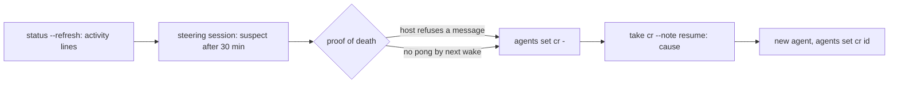

## Summary

A background agent that drives a change request can die (the desktop app is cut, the host crashes, its context runs out) and nothing flagged it: in a recent run four of them died with the app and only a person noticing that no file had changed for 40 minutes revealed it. This change makes the steering session see a dead agent within one or two heartbeats and restart it from the recorded state, without counting it as a new attempt and without an extra slot, and gives "my context is ending" a named hand-back instead of a silent end.

## Deliverables

`status --refresh` now prints one measured line per working change, in place of the single "longest silent agent" line. The CLI states ages and facts only; it never says "dead" or "suspect".

Identifiers below are the change ids the tool shows.

```text
activity CR-104 12 min
activity CR-105 gate running
activity CR-106 not measured
activity CR-107 31 min (session-level)
activity stack 4 min
activity O-2 qa 9 min
```



Choices made:

- A restart keeps its slot and is not counted as a new attempt; the budget still applies (exit 5).
- `take` is refused (exit 2) on a working change without `--note`, and on any change whose agent id is still recorded; the message names `agents set <cr> -`.
- `handback <cr> blocked context: ...` is restarted by the steering session with no question to the user; a second one with no progress is a question.

## Blast radius

The change touches CLI status, `take` and `handback` output and rules, and the steering session's instructions. A misjudged refusal would stall a restart, not lose data. Roll back with a plain revert.

Grade: 2

## Autonomous decisions

- Activity of helper agents is attributed to a change through the `parentAgentId` chain, as the cost grouping already does, so no new record format is needed.
- The `take` event carries a `restart` marker for a working change.

<details>
<summary>Details</summary>

## Changes

- CLI: activity lines (events, session records, a running long gate), a flag in status rows for a working change with no agent recorded, the `take` refusals and the restart note, the `context:` hand-back text, help texts.
- Instructions: the steering session's rules for a lost agent, the list of blocked reasons an agent may hand back, the exit codes, the resume sentence of the recovery text.
- Scenario: restart path updated, new liveness step.

## Human decisions

- The tool states measured facts only (ages, "gate running", "not measured") and never decides that an agent is dead.
- An agent is suspect after one full heartbeat (30 minutes) of no activity; death is proved by a host refusal or a missed `pong`.
- After an app restart or when the steering session is replaced, every earlier agent is restarted at once.
- `take` is refused while an agent id is recorded, and on a working change without a note.
- Running out of context is a named hand-back (`context:`), restarted without a question and without counting a new attempt.

## Impacts

Users see per-change activity in `status --refresh` and a new refusal on `take` of a recorded change.

## Test plan

- [x] New or changed tests (the scenario's liveness step fails on the previous code), at 8279206
- [x] Local gates at 8279206: `just check` (45 passed, release notes ok), `just scenario` (548/548 on GitHub and GitLab)
- [x] Evidence: before at 51503c6, after at 8279206: scenario output of the liveness step
- [ ] Review: approved at 8279206
- [ ] Verified at 8279206
- [ ] CI green at 8279206

## Internal references

CR-183 driver-liveness (batch-11).

</details>


