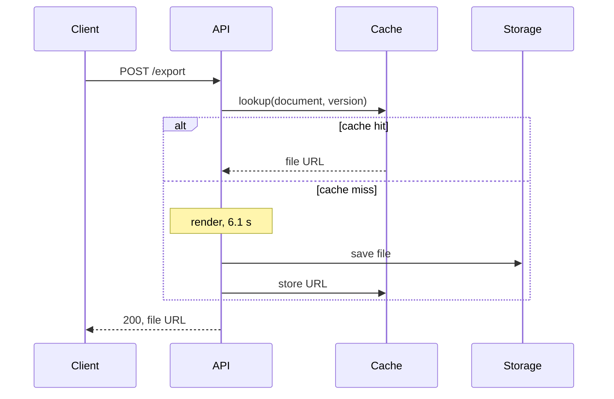

# Short video S1, vertical (1080x1920): "Your agent's analysis, as a real page"

Status: scenario v2, 2026-10-29 (after take 2). Common rules: [00-common.md](00-common.md).
Horizontal version: [../10-short-videos-horizontal/01-s1.md](../10-short-videos-horizontal/01-s1.md).

## User feedback on take 2 (2026-10-29)

- Not good enough: the scenario is weak and too slow.
- It must go **faster**, show **more complex Markdown**, and **edit a block in one click**: a slash
  command that inserts an emoji, or a table cell changed in place.

## Idea

Hook in one second, then three fast beats: *this is what your agent wrote* (dense raw source),
*this is how you read it* (a rich page flying past), *and you can fix it right here* (one click,
one edit). Every beat is under 4 s.

## Demo document: `perf-analysis.md` (richer than take 2)

Same fictional analysis, denser so the page looks impressive on a phone:

1. Front matter with five fields (`type`, `status`, `owner`, `tags`, `review_by`) → properties
   table.
2. `{important}` admonition with the TL;DR, containing inline maths (`$p_{95}$`) and a footnote.
3. `::::{grid}` of three cards with key figures, each with an emoji icon in the title.
4. `::::{tab-set}` with two tabs: "Measured" and "Projected", each holding a small table.
5. Mermaid **sequence diagram** (Client, API, Cache, Storage) with an `alt` block.
6. **Vega-Lite** layered chart: measured p95 bars plus a dashed projected line.
7. A GFM task list for the plan (`- [x]`, `- [ ]`).
8. A wide projection table at the end.

### Verbatim (proposal for take 3, to review)

Take 2 used a shorter file:
`markdown-okf-schema-studio-wt-170s/demo-video/s1-v2/workspace/perf-analysis.md`. Take 2 had no
tabs, task list, maths, footnote or emoji, and its sequence diagram had no `alt` block. The figures
below are the take 2 figures, kept consistent: p95 goes 8.2 s → 4.6 s → 2.1 s → 0.9 s across the
three steps.

````markdown
---
type: analysis
status: proposed
owner: Platform team
tags: [export, latency, performance]
review_by: 2026-11-12
---

# Export service: latency analysis and optimisation plan

:::{important}
**TL;DR** The $p_{95}$ export latency is 8.2 s[^traces]. Three steps bring it under 1 s,
with no change to the public API.
:::

[^traces]: Measured on 14 days of production traces, 2.3 million exports.

:::::{grid} 3
:gutter: 2

::::{grid-item-card} ⏱️ p50
**3.1 s** → 0.4 s
::::

::::{grid-item-card} 🐢 p95
**8.2 s** → 0.9 s
::::

::::{grid-item-card} ⚠️ Errors
**2.4 %** → 0.5 %
::::
:::::

## Numbers

::::{tab-set}

:::{tab-item} Measured
| Metric | Value |
| --- | --- |
| p50 | 3.1 s |
| p95 | 8.2 s |
| p99 | 14.6 s |
| Error rate | 2.4 % |
:::

:::{tab-item} Projected
| Step | p95 |
| --- | --- |
| Today | 8.2 s |
| 1. Cache | 4.6 s |
| 2. Worker pool | 2.1 s |
| 3. Streaming | 0.9 s |
:::

::::

## Where the time goes



## Measured and projected p95

```vega-lite
{
  "width": 400,
  "height": 220,
  "data": { "values": [
    { "week": 1, "p95": 7.1, "kind": "Measured" },
    { "week": 2, "p95": 7.6, "kind": "Measured" },
    { "week": 3, "p95": 8.0, "kind": "Measured" },
    { "week": 4, "p95": 8.2, "kind": "Measured" },
    { "week": 4, "p95": 8.2, "kind": "Projected" },
    { "week": 5, "p95": 4.6, "kind": "Projected" },
    { "week": 6, "p95": 2.1, "kind": "Projected" },
    { "week": 7, "p95": 0.9, "kind": "Projected" }
  ] },
  "encoding": {
    "x": { "field": "week", "type": "ordinal", "title": "Week" },
    "y": { "field": "p95", "type": "quantitative", "title": "p95 (s)" }
  },
  "layer": [
    { "transform": [{ "filter": "datum.kind == 'Measured'" }],
      "mark": { "type": "bar", "opacity": 0.8 } },
    { "transform": [{ "filter": "datum.kind == 'Projected'" }],
      "mark": { "type": "line", "point": true, "strokeDash": [6, 4] } }
  ]
}
```

## Plan

- [x] Profile 14 days of production traces.
- [ ] Step 1: cache rendered files by document and version (p95 → 4.6 s).
- [ ] Step 2: render in a worker pool, off the request path (→ 2.1 s).
- [ ] Step 3: stream the file while saving it (→ 0.9 s).

## Projection per endpoint

| Endpoint | Calls/day | p50 | p95 | Step 1 | Step 2 | Step 3 | Gain |
| --- | --- | --- | --- | --- | --- | --- | --- |
| /export/pdf | 41,000 | 3.4 s | 8.2 s | 4.6 s | 2.1 s | 0.9 s | 89 % |
| /export/html | 28,500 | 2.2 s | 5.9 s | 3.1 s | 1.4 s | 0.7 s | 88 % |
| /export/docx | 9,300 | 4.8 s | 11.4 s | 6.3 s | 3.0 s | 1.3 s | 89 % |
| /export/csv | 17,800 | 0.9 s | 2.6 s | 1.2 s | 0.7 s | 0.4 s | 85 % |
| /export/zip | 3,100 | 6.7 s | 15.0 s | 9.8 s | 4.2 s | 1.8 s | 88 % |
````

Points to check for credibility:

- **The edit beat leaves one inconsistency.** Changing "3. Streaming" from `0.9 s` to `0.7 s` in
  the Projected tab makes it disagree with the grid card, the chart and the wide table, which all
  still say 0.9 s. Nobody sees it on screen. To avoid it, the file could start with `0.7 s` in that
  cell as the agent's mistake, and the edit would fix it to `0.9 s`. **Chief of Staff decision
  (autonomy given by the user, 2026-10-29): take 3 does this.** The Projected cell starts at
  `0.7 s`, the edit changes it to `0.9 s`, and the subtitle becomes *Fix the agent's number in
  place.*
- **The overall p50 does not appear in the wide table.** The card's p50 (3.1 s) is the
  traffic-weighted mean of the per-endpoint p50 values (≈ 2.9 s), not their median. That is close
  enough for a demo.
- **The 🚀 lands at the end of the TL;DR**, after "with no change to the public API.".

## Beats (capture time; the ×1.21 speed-up of 00-common.md applies)

| Time | Frame | Subtitle (upper third) |
| --- | --- | --- |
| cover 1.5 s | Portrait cover: "Your agent wrote this." | — |
| 0–1.5 s | Raw source, fast scroll (motion blur allowed): fences, YAML, maths, the Mermaid `alt` block. | *Your agent wrote this.* |
| 1.5–2 s | Wipe to the preview. | — |
| 2–5.5 s | Fast scroll through the page, a beat on each: properties → TL;DR with maths → cards → tabs (one tab click) → sequence diagram → chart. | *You read this.* |
| 5.5–9.5 s | **Edit in one click:** click a cell of the "Projected" table, change `0.9 s` to `0.7 s`, Tab, the cell saves. | *Fix a number in place.* |
| 9.5–13 s | **Slash command:** click the end of the TL;DR paragraph, type `/emoji`, pick 🚀, Done. The emoji appears in the rendered note. | *Type / to add anything.* |
| 13–16 s | Portrait end card: logo, "Markdown OKF-Schema Studio", "Free on the VS Code Marketplace". | |

About 13 s of capture before the end card, so about 11 s on screen after the ×1.21 speed-up,
plus the cover and the end card: about 15.5 s in all.

Zoom: one, 1.2x on the edited cell and the emoji, 5.5–13 s, so the edits read on a phone.

Notes:

- Preview zoom 160 %, Full width (as in take 2).
- The two edits are the point of the video: hold each result 0.8 s before moving on.
- If the emoji picker needs more than two keystrokes to reach 🚀, filter by typing `rock`.
- Same capture rules as take 2: real VS Code, portrait viewport through CDP emulation, safe zones.
