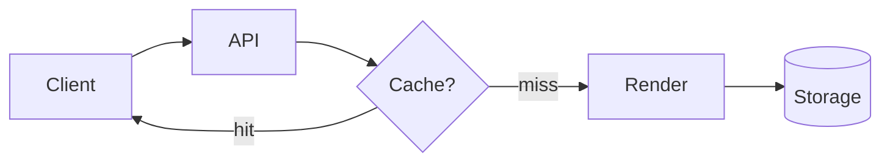

# Chapter showcase: demo document `launch-review.md`

Status: draft, 2026-10-31. Common rules: [00-common.md](00-common.md).

Small on purpose: it fits in one preview screen at 130 % so every change stays in view. Each
chapter touches one part of it.

````markdown
---
type: plan
status: in-review
owner: Platform team
review_by: 2026-11-12
---

# Export service: launch review

:::{important}
We ship the faster export on **Friday**. The p95 drops from 8.2 s to 0.9 s.
:::

::::{grid} 3
:::{grid-item-card} p50
**3.1 s** → 0.4 s
:::
:::{grid-item-card} p95
**8.2 s** → 0.9 s
:::
:::{grid-item-card} Errors
**2.4 %** → 0.5 %
:::
::::

## Steps

| Step | p95 |
| --- | --- |
| Today | 8.2 s |
| 1. Cache | 4.6 s |
| 2. Worker pool | 2.1 s |
| 3. Streaming | 0.7 s |



## Checklist

- [x] Profile 14 days of production traces
- [x] Cache rendered files
- [ ] Move rendering to a worker pool
- [ ] Stream the file while saving it
````

Planted for the edits: the `0.7 s` in the Steps table is the agent's mistake (the card says
0.9 s); chapter 2 fixes it in place.
