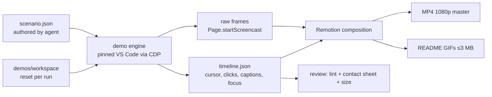

# Specification: record-demo-video

## Summary

Add a `record-demo-video` agent skill and a nested demo toolchain to produce polished,
reproducible demo videos of the extension's editing features. The agent authors scenario files;
a deterministic engine replays them against a pinned VS Code, captures clean frames and a
`timeline.json` over CDP, and Remotion composes the final video with a cursor, click ripples,
captions, and explicit zoom. Outputs are a 1080p MP4 master and short README GIFs.

## Goals

- Reproducible demos: re-running a scenario yields the same video.
- Human-scale pacing, readable captions, and smooth zoom on points of interest.
- Zero impact on the extension's dependencies and VSIX contents.

## Non-goals

- Voice-over or audio tracks.
- OS-level screen capture or OS-level input.
- Recording inside `just preflight`.
- A generic Compendium skill (deferred until a second extension needs it).

## Architecture

### Isolation

- All demo tooling lives in a nested `demos/` package with its own `package.json` and lockfile.
- `demos/**` is excluded through `.vscodeignore`; the root `package.json` is unchanged.
- Dependencies install only through `just demo-install`.
- AGENTS.md gets a concise section describing `demos/` and its targets.

### Recording runtime

- VS Code pinned via `@vscode/test-electron`, isolated profile, no other extensions.
- Window 1920×1080, fixed theme and font; per-scenario `theme` override allowed.
- Notifications muted; telemetry off.

### Demo engine (separate from the QA engine)

- Own scenario schema with presentation steps: actions (open, click, type, key, palette, drag,
  wheel, waitFor), `caption`, `focus` (selector or region zoom), `pause`.
- Optional per-scenario `autoZoomOnClick`.
- Input is driven through CDP; the engine records the intended cursor path and click positions
  into `timeline.json` instead of rendering an overlay in the workbench DOM.
- Capture with `Page.startScreencast`; frames are timestamped and re-timed during composition.

### Composition (Remotion)

- Plays the captured frames as the base layer.
- Draws a macOS-style cursor along eased paths, click ripples, a bottom-centre caption pill, and
  smooth zoom/pan with a light vignette.
- Pacing defaults, applied at composition time and overridable per step:
  - cursor moves 600–900 ms (eased Bézier);
  - typing ~60 ms per character with jitter;
  - 400 ms pause before clicks;
  - captions ≥2.5 s or ~15 characters per second;
  - zoom in/out over 600 ms, at most 2×.
- Renders the MP4 master and palette-based GIFs.
- Remotion is used under an individual license.

### Review loop

- Timeline lint: overlapping captions, off-screen focus targets, too-short captions.
- Keyframe contact sheet (one per step plus mid-zoom) for agent visual inspection.
- GIF size check against the 3 MB budget.
- Human approval before GIFs are committed.

### Storage

- GIFs: `images/demos/` (committed, ≤3 MB each).
- MP4: `out/demos/` (gitignored), copied into the generated site.

### Build gates

- Recording and rendering stay outside `just preflight`.
- Scenario-schema validation is added to `just check` only if cheap.

## Delivery sequence

1. **Spike (go/no-go):** record ~10 s of preview interaction with `Page.startScreencast` against
   pinned VS Code. Pass criteria: the webview preview content is visible, the frame rate is at
   least 30 fps after re-timing, and frames align with timeline events. If it fails, try a CDP
   `Page.captureScreenshot` loop; if that also fails, stop and report. No OS-capture fallback.
2. Nested `demos/` package, `.vscodeignore` entry, AGENTS.md section, just targets.
3. Demo engine, scenario schema, and curated `demos/workspace/`.
4. Remotion composition and render pipeline (MP4 + GIF).
5. Review tooling (lint, contact sheet, size check).
6. `record-demo-video` skill in `.agents/skills/record-demo-video/`.
7. First demos focused on editing features (see UNRESOLVED Q13).

## Resolved decisions

| # | Topic | Resolution |
|---|---|---|
| Q1 | Outputs | MP4 master (1080p) + short README GIFs |
| Q3 | Agent role | Authors scenarios and reviews output; deterministic replay |
| Q4 | Narration | Captions only |
| Q5 | Engine | Fully separate demo engine |
| Q7 | Zoom | Explicit `focus` steps + optional `autoZoomOnClick` |
| Q8 | Location | Studio repo first; promote to Compendium later |
| Q11 | Compositor | Remotion, without touching extension dependencies |
| Q12 | Runtime | Pinned `@vscode/test-electron`, 1920×1080, fixed theme + override |
| Q14 | Style | Neutral VS Code-like; caption pill, macOS cursor, click ripple |
| Q15 | Storage | GIFs in `images/demos/` (≤3 MB); MP4 gitignored, published to site |
| Q17 | Isolation | Nested `demos/` package; concise AGENTS.md section |
| Q18 | License | Remotion individual license |
| Q19 | Pacing | Proposed defaults at composition time |
| Q20 | Review | Lint + contact sheet + size check + human approval |
| Q21 | Gates | Outside preflight; schema validation in `just check` |
| Q23/Q27 | Spike | Go/no-go; CDP screenshot loop as only retry; no OS fallback |
| Q24 | Workspace | Curated public `demos/workspace/`, reset per run |
| Q28 | Focus | Demos focus on the extension's editing features |

## UNRESOLVED

- **Q13:** first demo list after the Q28 refocus. Evidence links are not an editing feature;
  likely candidates are the properties table, inline block/table editing, and editable checkboxes,
  plus an overview MP4.
- **Q25:** skill entry points (proposed author / record / render / review / publish, with the chain
  stopping before publish) were not confirmed.
