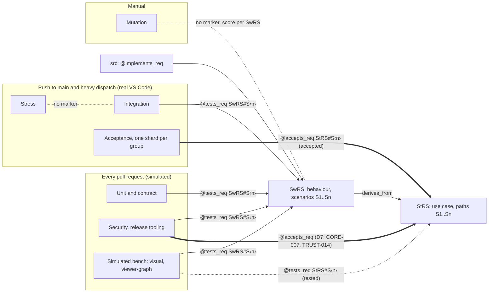

# How we test: a docs page linking test levels to requirements

A new page, `docs/how-we-test.md`, published on the site as `docs/how-we-test.html` and linked
from the site header. It explains every level of test the Studio runs (unit, contract, security,
release tooling, the simulated bench, real VS Code integration, acceptance, stress, mutation) and
how each one is tied to a level of requirement (StRS paths, SwRS scenarios, the `@tests_req` and
`@accepts_req` markers with their `#S<n>` fragments, the okfreq coverage reports and the viewer
cards). It has one diagram of the levels and one table that maps each test level to the
requirement level it proves. A drift test keeps the checkable facts of the page in step with the
repository.

For the owner: one page answers "what proves that this use case works, and where does that proof
run", in the words the requirements viewer and the CI use.

Short name: `how-we-test`.

## Sources

- This CR folder: `intake/request.md`, `01-intent.md`, `02-answers.md` (Q1).
- The model the page describes, as CR-504 and CR-505 deliver it:
  - CR-504 (`strs-path-validation`), `changes/4-batch/2-actives/504-strs-path-validation/03-change-spec.md`:
    `scenarios:` on StRS and SwRS, `#S<n>` fragments, `@accepts_req`, the `check-markers` rules
    (D10), the bench convention (Q28, D7), the viewer cards (Q33, D12);
  - CR-505 (`strs-acceptance`), `changes/4-batch/1-pending/505-strs-acceptance-tests-and-okfreq-mode-sw/03-change-spec.md`:
    the acceptance files and windows (B3, B5), `just ci-acceptance [GROUP]` (B4), the `acceptance`
    job and its consumers (B7, B8), the D11 gate (B9), the mode switch to
    `linked-swrs-and-acceptance-paths` (B10), the "Benches" section (B11).
- The Studio repository as it stands on `main` at `80d482fd`: `test/`, `tests/fixtures/`,
  `sphinx/tests/`, `justfile`, `package.json`, `.github/workflows/ci.yml`, `CONTRIBUTING.md`
  ("Checks", "Mutation testing of src/core"), `.agents/guidelines/ci.guidelines.md`,
  `requirements/guidelines/project.guidelines.md`, `test/shared/e2eGroups.ts`,
  `test/shared/stressPlan.ts`, `test/site/buildSite.ts`, `test/site/siteHeader.ts`,
  `docs/how-we-ship.md`.

The project rules apply as written and this spec does not restate them: the constitution
(`.agents/constitution.md`), `AGENTS.md`, `requirements/guidelines/requirements.guidelines.md`,
`requirements/guidelines/project.guidelines.md`, `.agents/guidelines/ci.guidelines.md` and
`.agents/guidelines/pull-request.guidelines.md`.

## Decisions

### From the answers

- **Q1:** a docs page, written in English, with a diagram of the levels and a table linking each
  test level to the requirement level it proves. It follows CR-505 in the stack (`depends.json`:
  after `strs-acceptance-tests-and-okfreq-mode-sw`). The existing docs and the contributor guide
  link to it.

### Taken by this spec

- **H1. Place and name.** The page is `docs/how-we-test.md`, next to `docs/how-we-ship.md`. The
  site build already renders every Markdown file under `docs/` (`walkMarkdown` in
  `test/site/buildSite.ts`), so it is published as `out/site/docs/how-we-test.html` with no
  change to the walk. The title is "How we test".
- **H2. Site navigation.** The site header (`siteHeader` in `test/site/siteHeader.ts`) gains a
  sixth link, "How we test", between "How we ship" and "Gallery":
  Home, Contributing, How we ship, How we test, Gallery, Requirements. Every page of the site,
  the requirements viewer included, carries it, because they all use `siteHeader`.
- **H3. Social card.** `SIMPLE_CARDS` in `test/site/buildSite.ts` gains an entry for
  `docs/how-we-test.md`: page `docs/how-we-test.html`, image `og/how-we-test.png`, eyebrow
  "How we test", headline "From a use case to its proof", line "Every test level and the
  requirement it proves", title "How we test: Markdown OKF-Schema Studio", description "How
  Markdown OKF-Schema Studio is tested, from unit tests to acceptance tests in a real VS Code
  window, and how each test is tied to a requirement."
- **H4. The diagram is a hand-written SVG**, `images/how-we-test/test-levels.svg`, like
  `images/how-we-ship/release-1-6-1.svg`. Reason: the site renders Markdown through `renderMyst`,
  which leaves a Mermaid fence as its source text (`normalizeDiagram` in
  `src/core/render/mystNormalize.ts`); the site pages load no Mermaid script. A committed SVG shows
  the same on GitHub, in Studio and on the site. Its content is given in "The diagram" below.
- **H5. The page states no counts.** It gives no number of requirements, paths, tests or files,
  since every such number drifts with each change. It points to the live counts instead: the
  requirements viewer home cards and the generated reports.
- **H6. The page describes the parent as it is.** The coder writes every row from the stack parent
  (CR-505's head, or the last CR of CR-505's split if it was split), not from this spec. A fact of
  this spec that differs on the parent is written as the parent has it, and listed in the PR body.
- **H7. Prerequisite.** The CR starts only when its parent carries CR-505's switch: the
  `strs_test_coverage_mode: linked-swrs-and-acceptance-paths` line in `requirements/config.yml`,
  the `acceptance` job in `.github/workflows/ci.yml` and `test/integration/acceptance/`. When
  one is missing (a CR-505 partial delivery whose switch has not landed), the coder stops and
  reports to the Foreman; the page is never written for a half-state.
- **H8. A drift test guards the checkable facts.** A new unit test,
  `test/site/howWeTest.test.ts`, reads the shipped page and the repository and fails when they part
  (see "The drift test"). It runs in `just unit`, so in `just check` and in the `static` and
  `static-windows` jobs.
- **H9. Who keeps it current.** The agent whose change adds, removes or renames a test folder
  under `test/`, a job of `ci.yml`, an e2e group, a marker verb or the coverage mode updates the
  page in the same pull request; the drift test fails until it does. Two rules say it for what the
  test cannot see (a command, when a level runs, the wording of the covered rule): a new rule 16 in
  `.agents/guidelines/ci.guidelines.md`, and a bullet in "Requirements traceability" of
  `requirements/guidelines/project.guidelines.md` (see "Keeping it current"). The Inspector checks
  them like any other rule.
- **H10. No new requirement.** The page is documentation; the drift test is a doc-consistency
  test, like `test/build/test_guideline_isolation.py` and `test/build/marketplaceReadme.test.ts`,
  which carry no marker. The only behaviour that changes is the site header (H2) and the set of
  pages with a social card (H3): that is SwRS-MDOKFSTUDIO-CORE-086 (proposed, derived from
  StRS-MDOKFSTUDIO-CORE-008), updated here.
- **H11. One commit.** `docs: add a How we test page linking test levels to requirements`
  (no scope: scopes are for `feat` and `fix` only). No CHANGELOG line: it is not a `feat` or a
  `fix`, and no user of the extension sees it.
- **H12. Who links to it.** `CONTRIBUTING.md` ("Checks"), `docs/how-we-ship.md` ("The rules that
  keep it honest"), `requirements/guidelines/project.guidelines.md` ("Benches", added by CR-504
  and completed by CR-505) and the site header (H2). The requirements viewer home is reached from
  the page, not changed by it.
- **H13. Links inside the page.** Repository files are linked by relative path (`../test/...`,
  `../CONTRIBUTING.md`); the site build rewrites them (`rewriteLinkTarget`). The requirements
  viewer, which exists only on the published site, is linked by its absolute URL,
  `https://gsemet.github.io/markdown-okf-schema-studio/requirements/`, as `docs/how-we-ship.md`
  already does.

## The page

`docs/how-we-test.md`, plain GFM plus the one image (the site renders it through `renderMyst`,
and a rendering error fails the build). Its outline, with what each section says:

1. **`# How we test`.** Two short paragraphs: every behaviour of the Studio is a requirement, and
   every requirement is proved by tests that name it with a marker; okfreq counts those markers
   and the CI jobs prove that the tests pass. The page follows one use case from its paths to the
   tests that prove them.
2. **`## Two levels of requirements`.**
   - A **StRS** (stakeholder requirement) is a use case. Its `### Main paths` are declared in its
     `scenarios:` frontmatter as `S1`, `S2`, … and headed `#### Path S<n>: <title>`.
   - A **SwRS** (software requirement) is one behaviour, derived from a StRS (`derives_from`). Its
     transition scenarios are declared the same way and headed `### Scenario S<n> (<kind>): <title>`.
   - Code that implements a SwRS carries `@implements_req <SwRS-ID>`.
   - A short example with one real StRS path and one real SwRS scenario (the coder picks one pair
     from the parent, and links both files under `requirements/tiers/`).
3. **`## The levels at a glance`.** The diagram (H4), with an alt text that says what it shows,
   then one sentence per lane: every pull request, every push to `main` and heavy dispatch,
   manual.
4. **`## Which test proves which requirement`.** The table (see "The table"), then three rules in
   a list:
   - a SwRS scenario is **tested** by `@tests_req <SwRS-ID>#S<n>` on any bench;
   - a StRS path is **tested** by `@tests_req <StRS-ID>#S<n>` where a simulated walk of the path
     exists, and **accepted** by `@accepts_req <StRS-ID>#S<n>` on an acceptance test in a real
     VS Code window (`test/integration/`), except the three StRS accepted on the test closest to
     their product (CORE-007, CORE-008, TRUST-014: `test/build`, `test/security`, `test/site` or
     `test/core`);
   - `@accepts_req` never targets a SwRS, and `test/integration/` never carries
     `@tests_req <StRS-ID>`.
5. **`## The test levels`.** One `###` section per level, each with: what it runs, its folder, its
   local command, its CI job, when it runs, the marker it carries. Levels, in this order:
   - **Unit tests**: `test/core`, `test/page`, `test/session`, `test/node-services`, `test/host`
     (the fake VS Code host harness, with its `*.requirements.test.ts` files), `test/host-memory`,
     `test/host-vscode`, `test/site`, `test/build` (TypeScript); `just unit`; in `just check`,
     jobs `static` and `static-windows`; every pull request.
   - **Contract tests**: `test/core/render/*.contract.ts` (`just contracts`) and the Python Sphinx
     source-mapping contract (`just sphinx-check`, fixtures in `tests/fixtures/`, tests in
     `sphinx/tests/`); job `static`; every pull request.
   - **Security tests**: `test/security` (`just security`, the npm audit of `test/release`);
     job `static`; every pull request; also the D7 bench of TRUST-014.
   - **Release and tooling tests**: the Python tests of `test/build/` (`just release-tests`: the
     workflow, release, selection, marker and scenario coverage checks); job `static`; every pull
     request; also the D7 bench of CORE-007.
   - **Simulated bench**: `test/visual` (Playwright Chromium against a mock host, with the
     screenshots of the gallery), `just ci-visual`, job `visual`; the use case map tests,
     `just ci-viewer-graph`, job `viewer-graph`; every pull request. A simulated walk of a StRS
     path carries `@tests_req <StRS-ID>#S<n>`.
   - **Real VS Code integration**: `test/integration` (one window per suite, real keys through
     `realInput/`), `just ci-integration`, job `integration`; every push to `main` and every heavy
     dispatch (`gh workflow run ci.yml --ref <branch> -f heavy=true`), never a pull request.
     It proves SwRS scenarios.
   - **Acceptance**: `test/integration/acceptance/<group>*.acceptance.ts`, one file = one launch =
     one window, one test = one nominal path of a StRS; `just ci-acceptance [GROUP]`; job
     `acceptance`, one shard per e2e group; same trigger as `integration`. A human step is a
     simulated input: the test checks the gate, never a judgment.
   - **Stress**: the flake-prone real-window scenarios of `test/shared/stressPlan.ts` repeated
     `REPEAT` times, `just ci-stress [REPEAT]`, job `stress`; same trigger. It proves no new
     requirement: it proves that a passing test passes every time.
   - **Mutation**: `just mutation-core [SAMPLE]` on `src/core` against `test/core`, manual, never
     in CI; its report scores each SwRS (`out/reports/mutation/summary.md`). It measures how well
     the SwRS tests catch a broken implementation.
   - **Repro tools and probes**: the `toc-loop` job (`just ci-toc-loop`, a repro tool that never
     gates a merge) and the probes of `test/probe` (performance, frames, chart shots). No marker.
   - The folders that hold shared code only, `test/shared` and the helpers, are named in one line.
6. **`## The e2e groups`.** The 16 groups of `test/shared/e2eGroups.ts` (linked) are the okfreq
   scopes, the areas of the requirements viewer, the folders of the visual scenarios and the
   shards of the `acceptance` job. The 16 ids in a compact list, in `GROUPS` order.
7. **`## From markers to coverage`.**
   - `just check-markers` (part of `just check`): the placement rules (a declared fragment on a
     target with `scenarios:`, none without; `@accepts_req` only where allowed; at most 3 IDs per
     marker block).
   - `just requirements-update` runs `okfreq update-coverage`, which writes `implemented_in_files`,
     `tested_in_files` and `accepted_in_files` into the requirement files.
   - The coverage mode, `linked-swrs-and-acceptance-paths` (`requirements/config.yml`): a StRS is
     **covered** when each linked SwRS is covered or exempt **and** every path is accepted (or the
     StRS carries a justified `acceptance_exemption`; none does today). "Tested" is reported, not
     required.
   - The scenario coverage gate, `scripts/check_scenario_coverage.py`, the last line of
     `just requirements-lint`: it fails on an untested SwRS scenario, a path not accepted or a
     StRS without `scenarios:`.
   - The reports: `just requirements-report` (`out/reports/requirements/`, with
     `requirements-trace.json`), `okfreq trace requirements --json` (`scenario_markers`).
   - The viewer cards on the requirements viewer home (H13 link): "StRS paths tested", "StRS paths
     accepted", "StRS covered", "SwRS scenarios tested", and the area table columns; a use case
     page lists each path with the files that test and accept it.
8. **`## What a count does not prove`.** okfreq counts markers, it never reads test results. The
   proof that a marked test passes is the green CI job of its bench: `static` and `visual` on the
   pull request, `integration`, `acceptance` and `stress` on the heavy run that gates a release
   (ci.guidelines rule 14).
9. **`## Keeping this page current`.** Two sentences: what the drift test checks, and that the
   rules of H9 make the author of the change update the page.

Writing: plain, short sentences, the words of `.agents/glossary/common.md` (StRS, SwRS, area,
path, scenario, acceptance test, acceptance file, bench, heavy job). No emojis.

### The table

Under "Which test proves which requirement". One row per test level, in the order of section 5.
The cells below are the target; the coder checks each one on the parent (H6).

| Test level | Where | Command | CI job, when | Proves | Marker |
| --- | --- | --- | --- | --- | --- |
| Unit | `test/core`, `test/page`, `test/session`, `test/node-services`, `test/host`, `test/host-memory`, `test/host-vscode`, `test/site`, `test/build` | `just unit` | `static`, `static-windows`; every PR | SwRS scenario | `@tests_req <SwRS-ID>#S<n>` |
| Contract | `test/core/render/*.contract.ts`, `sphinx/tests`, `tests/fixtures` | `just contracts`, `just sphinx-check` | `static`; every PR | SwRS scenario | `@tests_req <SwRS-ID>#S<n>` |
| Security | `test/security`, `test/release` | `just security`, `just audit` | `static`; every PR | SwRS scenario; TRUST-014 path (D7) | `@tests_req`; `@accepts_req <StRS-ID>#S<n>` for TRUST-014 |
| Release and tooling | `test/build/*.py` | `just release-tests` | `static`; every PR | SwRS scenario; CORE-007 path (D7) | `@tests_req`; `@accepts_req` for CORE-007 |
| Simulated bench | `test/visual`, `test/site/requirementsViewer/*.browser.test.ts` | `just ci-visual`, `just ci-viewer-graph` | `visual`, `viewer-graph`; every PR | SwRS scenario; StRS path **tested** | `@tests_req <SwRS-ID>#S<n>`, `@tests_req <StRS-ID>#S<n>` |
| Real VS Code integration | `test/integration` | `just ci-integration` | `integration`; push to `main`, heavy dispatch | SwRS scenario | `@tests_req <SwRS-ID>#S<n>` |
| Acceptance | `test/integration/acceptance` | `just ci-acceptance [GROUP]` | `acceptance` (one shard per group); push to `main`, heavy dispatch | StRS path **accepted** | `@accepts_req <StRS-ID>#S<n>` |
| Stress | `test/shared/stressPlan.ts` | `just ci-stress [REPEAT]` | `stress`; push to `main`, heavy dispatch | that a passing test passes every time | none |
| Mutation | `src/core` against `test/core` | `just mutation-core [SAMPLE]` | none; manual | strength of the SwRS tests (score per SwRS) | none |

CORE-008's D7 bench (`test/site`) is in the Unit row; the page says so in the row's "Proves" cell
when CORE-008 is accepted there on the parent.

### The diagram

`images/how-we-test/test-levels.svg`, embedded under "The levels at a glance" as
``. Its content, as a sketch (the SVG is drawn
by hand, not generated from this sketch):

The SVG holds:

- three lanes, left to right by cost: "Every pull request (simulated)", "Push to main and heavy
  dispatch (real VS Code)", "Manual", each with its levels and their CI job names in a smaller
  line;
- on the right, the requirement stack: StRS (paths `S<n>`) above SwRS (scenarios `S<n>`) above
  `src/` (`@implements_req`), with the `derives_from` arrow;
- the arrows labelled with the marker verb: solid for `@tests_req` to SwRS, dashed for
  `@tests_req` to a StRS path (tested), bold for `@accepts_req` to a StRS path (accepted); stress
  and mutation drawn grey with "no marker";
- under the stack, one box "okfreq counts markers → coverage report → viewer cards".

Form: `role="img"`, `aria-labelledby` pointing to a `<title>` ("How we test: test levels and the
requirements they prove") and a `<desc>` that says in full sentences what the picture shows (the
lanes, the levels, the arrows and their verbs); a `viewBox` no wider than 1240, the font family of
`release-1-6-1.svg`; the cream colours of the site (background `#f5f1e8`, text `#2b2a27`, accent
`#a14e32`, borders `#d6cdbd`); no script, no external reference, no embedded raster. Every text
fits its box at 100 % zoom; the PR body has a capture of the rendered page.

## What changes, area by area

### 1. The page and its picture

- `docs/how-we-test.md` (new), per "The page".
- `images/how-we-test/test-levels.svg` (new), per "The diagram". The site build copies `images/`
  as it is.

### 2. Site

- `test/site/siteHeader.ts`: the sixth link (H2); its JSDoc lists the six links.
- `test/site/buildSite.ts`: the `SIMPLE_CARDS` entry (H3). `og/how-we-test.png` is drawn by
  `writeCardPictures` and listed in `site-manifest.json` `cards` with no other change.
- `test/site/siteLinks.test.ts`:
  - the header test covers both docs pages: from `index.html`, `docs/guide.html` and
    `reports/e2e/index.html`, the header links "How we ship" and "How we test" with the right
    relative paths, in that order; it carries `// @tests_req SwRS-MDOKFSTUDIO-CORE-086#S<n>` for
    the main page scenario;
  - the viewer page test lists the six links in order, with its existing marker given the
    requirements page scenario's fragment.
- `test/site/socialCard.test.ts`: `SIMPLE_CARDS` covers the home, Contributing, How we ship and
  How we test pages (four keys).
- `test/site/requirementsViewer/pages.test.ts`: its `site` set of pages gains
  `docs/how-we-test.html` if a test there checks header links against it.

### 3. The drift test

`test/site/howWeTest.test.ts` (new). It reads every file from the repository as it ships, at the
head under test (`EXTENSION_ROOT` of `test/reportPaths.ts`), never a copy:

1. **Links resolve.** Every Markdown link and image target of `docs/how-we-test.md` that is not an
   absolute URL (`isAbsoluteUrl` of `test/site/siteLinks.ts`) resolves, from `docs/`, to an
   existing file or folder once its `?query` and `#fragment` are stripped. A failure names the
   line and the target.
2. **Every test folder is named.** Every directory directly under `test/` appears in the page as
   `` `test/<name>` `` (with or without a trailing `/`), and so do `tests/fixtures` and
   `sphinx/tests`.
3. **Every CI job is named.** Every key under `jobs:` of `.github/workflows/ci.yml` (read with a
   line scan of the two-space-indented keys under `jobs:`, or the `yaml` parser if a dev
   dependency already provides it) appears in the page in backticks.
4. **Every e2e group is named.** Every id of `GROUPS` (`test/shared/e2eGroups.ts`) appears in the
   page in backticks.
5. **The marker verbs and the mode are the shipped ones.** The page names, in backticks, each
   value of `markers` in `requirements/config.yml` (`@implements_req`, `@tests_req`,
   `@accepts_req`) and the value of `strs_test_coverage_mode`.
6. **The picture is accessible.** `images/how-we-test/test-levels.svg` exists, has a non-empty
   `<title>` and `<desc>`, and its image link in the page has a non-empty alt text.

The link check is a small function of the test file. Besides the shipped-page case, it has one
case on a prepared text with a broken relative link and one with an absolute URL: refusals the
shipped page cannot hold, paired with the check on the shipped page above. Each check fails on the
parent, where the page and the picture do not exist.

The file stays under the `test/` size limit of `scripts/check-file-sizes.mjs` and exports nothing
(`check:exports`).

### 4. Links to the page (H12)

- `CONTRIBUTING.md`, "Checks": a first sentence, "[How we test](docs/how-we-test.md) explains each
  test level and the requirement it proves."
- `docs/how-we-ship.md`, "The rules that keep it honest":
  - "Requirements are traced." ends with "; [How we test](how-we-test.md) shows which test proves
    which requirement.";
  - "The heavy CI is the gate." names the real VS Code jobs as integration, acceptance and stress
    (CR-505 added `acceptance`; this bullet still says "integration, stress").
- `requirements/guidelines/project.guidelines.md`, "Benches": one closing line linking
  `../../docs/how-we-test.md` for the full picture.

### 5. Keeping it current (H9)

- `.agents/guidelines/ci.guidelines.md`, new rule 16, in the form of the others: **"A change to
  the test levels updates How we test."** A change that adds, removes or renames a CI job, a test
  folder, an e2e group, a marker verb or the coverage mode, or changes when a level runs, updates
  `docs/how-we-test.md` (its table, its sections and its diagram) in the same pull request;
  `test/site/howWeTest.test.ts` fails on the names it can see.
- `requirements/guidelines/project.guidelines.md`, "Requirements traceability": one bullet, "A
  change to a marker verb, to the bench convention or to `strs_test_coverage_mode` updates
  `docs/how-we-test.md` in the same change."
- `.agents/glossary/common.md`: "**Test level**: one kind of test, by what it runs and where (unit,
  contract, security, release tooling, simulated bench, real VS Code integration, acceptance,
  stress, mutation); `docs/how-we-test.md` lists them with the requirement level each proves." Add
  "**Bench**" too if CR-504 or CR-505 did not: "where a test runs: the simulated bench (every pull
  request) or a real VS Code window (heavy jobs)".

### 6. Requirements

- **SwRS-MDOKFSTUDIO-CORE-086** (proposed): the normative statement and the `description` name the
  six links "Home, Contributing, How we ship, How we test, Gallery and Requirements"; the main page
  scenario lists the Markdown pages "(home, Contributing, How we ship, How we test)" and "the six
  links … in that order"; the requirements page scenario says "the same logo and six links".
  The `scenarios:` titles do not change, so the ids stay; only the body text changes (a normative
  change, allowed on a proposed SwRS).
- `requirements/tiers/log.md`: an entry under the day's `## 2026-11-<day>` heading, `### How we test
  page`, naming the CORE-086 change.
- `just requirements-update`, and the generated files committed.
- No new requirement (H10). No change to the writing skill `skills/writing-for-markdown-okf-schema-studio/`:
  no rendered syntax changes.

## Out of scope

- Any change to `src/`, to a test level, to a CI job or to `justfile` targets: the page describes
  them, it does not change them.
- The requirements viewer: its home and pages are linked, not changed.
- A Mermaid renderer for the site's Markdown pages (H4).
- Counts or figures on the page (H5).
- The older docs pages `docs/unit-test-audit.md`, `docs/release-evidence.md` and
  `docs/interaction-parity-evidence.md`: historical records, left as they are.
- The README: it lists user docs; the page is for contributors and reviewers, reached from the
  site header.
- A CHANGELOG line (H11).

## CI environment

No CI job or workflow changes. The drift test runs in `just unit`, in the existing `static`
(Linux) and `static-windows` jobs; the site build runs as today in `gallery` and `pages`. No host
or default matrix: nothing in this change depends on the host or on a configured value. The drift
test uses `node:path` and `node:fs` only, so it passes on Windows and Linux alike.

## Evidence

Every check on a shipped file (the page, the picture, `ci.yml`, `config.yml`, `e2eGroups.ts`, the
header) reads it from the repository at the head under test.

### Checks

1. `just check` passes, with `test/site/howWeTest.test.ts`, the updated `siteLinks.test.ts` and
   `socialCard.test.ts`. On the parent, the drift test and the new header and card assertions
   fail; the PR body names the failing assertions on the parent.
2. `just requirements-lint` passes (CORE-086 change, markers with their fragments, the D11 gate
   still green).
3. `just site-assemble` builds the site without error, and on its output:
   - `out/site/docs/how-we-test.html` exists, holds the page's headings and the table, and its
     image points to `../images/how-we-test/test-levels.svg`, which exists in `out/site/`;
   - every relative `href` and `src` of that page resolves inside `out/site/` (checked by a short
     scan, its result quoted in the PR body);
   - `out/site/index.html`, `out/site/docs/how-we-ship.html` and one requirements viewer page carry
     the six header links in order;
   - `out/site/site-manifest.json` lists `docs/how-we-test.html` in `pages` and
     `og/how-we-test.png` in `cards`, and that picture exists.
4. A drift probe on the head, then restored: remove every mention of the `stress` job from the
   page and run `just unit`; the drift test fails and names `stress`. Restore the page.
5. `just preflight` passes (on Windows, the static stage; CI runs the rest).
6. The PR body has captures of the rendered page (top with the diagram, and the table) from
   `out/site/docs/how-we-test.html`, and lists any fact written differently from this spec (H6).

### Scenario steps (owner's view)

1. Build the site (`just site-assemble`) and open `out/site/index.html`. The header shows "How we
   test" between "How we ship" and "Gallery".
2. Click it. The page opens with the diagram: three lanes, the requirement stack on the right, and
   the arrows labelled `@tests_req` and `@accepts_req`.
3. Read the table: the "Acceptance" row says it proves a StRS path as accepted with
   `@accepts_req <StRS-ID>#S<n>`, in the `acceptance` job on pushes to `main` and heavy
   dispatches.
4. Follow the link to the requirements viewer from "From markers to coverage": the home shows the
   cards the page names.
5. Open `CONTRIBUTING.md` "Checks" and `docs/how-we-ship.md`: both link the page.

## Commit order

One commit (H11): the page, the picture, the site header and card, the drift test, the test
updates, the links, the guideline and glossary lines, CORE-086, the log entry and the files of
`just requirements-update`.

## Self-containment

The coder needs this spec, the CR-504 and CR-505 specs named in "Sources" (for the model the page
describes), the parent head and the repository's own rules.

## The coder stops and reports to the Foreman when

- The parent lacks CR-505's switch, the `acceptance` job or `test/integration/acceptance/` (H7).
- SwRS-MDOKFSTUDIO-CORE-086 is approved on the parent: its change then goes to the owner.
- A level of the parent cannot be described truthfully in the table's columns (for example a job
  that runs on a trigger the table has no word for): the coder writes it as it is and reports it,
  rather than bending the table.

## Open questions

None. Every point the answers left open is decided above, as H1 to H13. The owner said "no
question".
