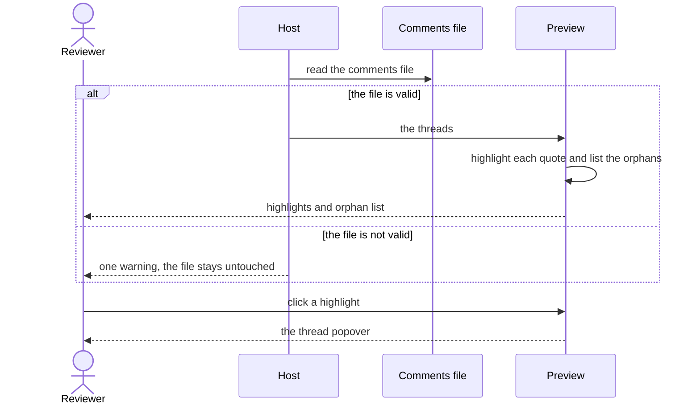
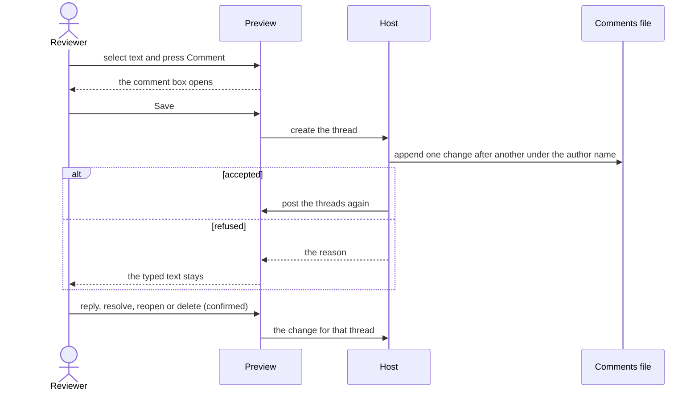
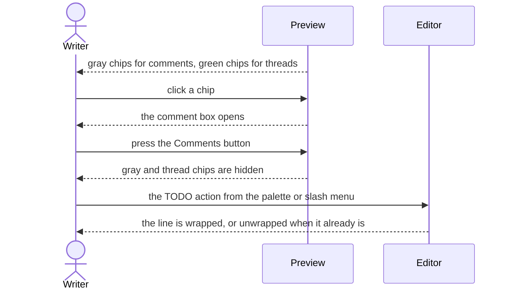
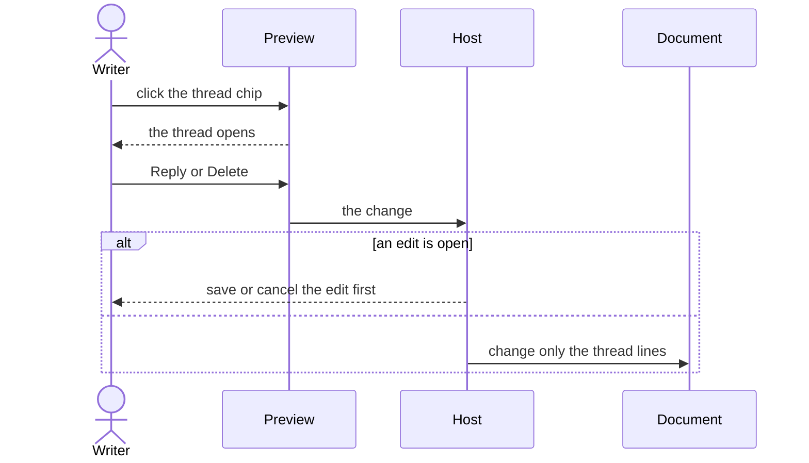

# CR-344 owner package: edits to the approved StRS REVIEW-001, 003, 012, 015

These four StRS are approved, so the Coder did not edit their authored text. The generated fields
(`derived_by`, Links) of the four changed only because titles of the merged SwRS changed and
because SwRS REVIEW-017/100/054/074/186/152/192 and TRUST-065 were merged or reparented; that is
information only. Apply the edits below on agreement, in the worktree
`requirements/tiers/strs/review-annotations/`, then run `just requirements-update`.

## REVIEW-001 (comments file shown in the page)

Add before `### Main paths` (no SwRS ID in the diagram):

## REVIEW-003 (create, reply, resolve, reopen, delete)

Add before `### Main paths`:

Main path 2, step 1: replace the citation `SwRS-MDOKFSTUDIO-REVIEW-081` by
`SwRS-MDOKFSTUDIO-REVIEW-044` (**applied on agreement**, see below: it needs the 081 to 044 fold,
which the Coder did not do).

## REVIEW-012 (gray and green chips, TODO action)

- Normative text: replace "from the palette, the slash menu or a shortcut" by "from the edition
  palette or the slash menu". Rationale line: "The TODO action has no shortcut; Ctrl+/ toggles a
  plain comment".
- Main paths:
  - Path 1 gains `Option SwRS-MDOKFSTUDIO-REVIEW-152 (nominal)`: the Comments button hides the
    gray and thread chips.
  - Path 2 "Mark a line as TODO" cites SwRS-MDOKFSTUDIO-REVIEW-160, with options for the unwrap
    and for a line that already holds `-->`.
  - The step citing SwRS-MDOKFSTUDIO-LIFE-170 is removed.
- Diagram:

## REVIEW-015 (thread chip, reply, delete)

- Diagram:

- Path 2: remove the line
  `Option SwRS-MDOKFSTUDIO-BLOCK-058 (nominal): the edit is one undo step`
  (the Coder already removed REVIEW-015 from SwRS BLOCK-058 `derives_from` in the round, see the
  list below).

## Applied on agreement (not done by the Coder)

1. REVIEW-081 is not folded into REVIEW-044 (REVIEW-003 Main path 2 waits for it).
2. SwRS BLOCK-058 still derives from StRS REVIEW-015: kept until REVIEW-015 loses its
   BLOCK-058 option. Same for SwRS LIFE-170 and StRS REVIEW-012, and SwRS TRUST-001 and
   StRS REVIEW-001, each kept in `derives_from` until the owner agrees.
