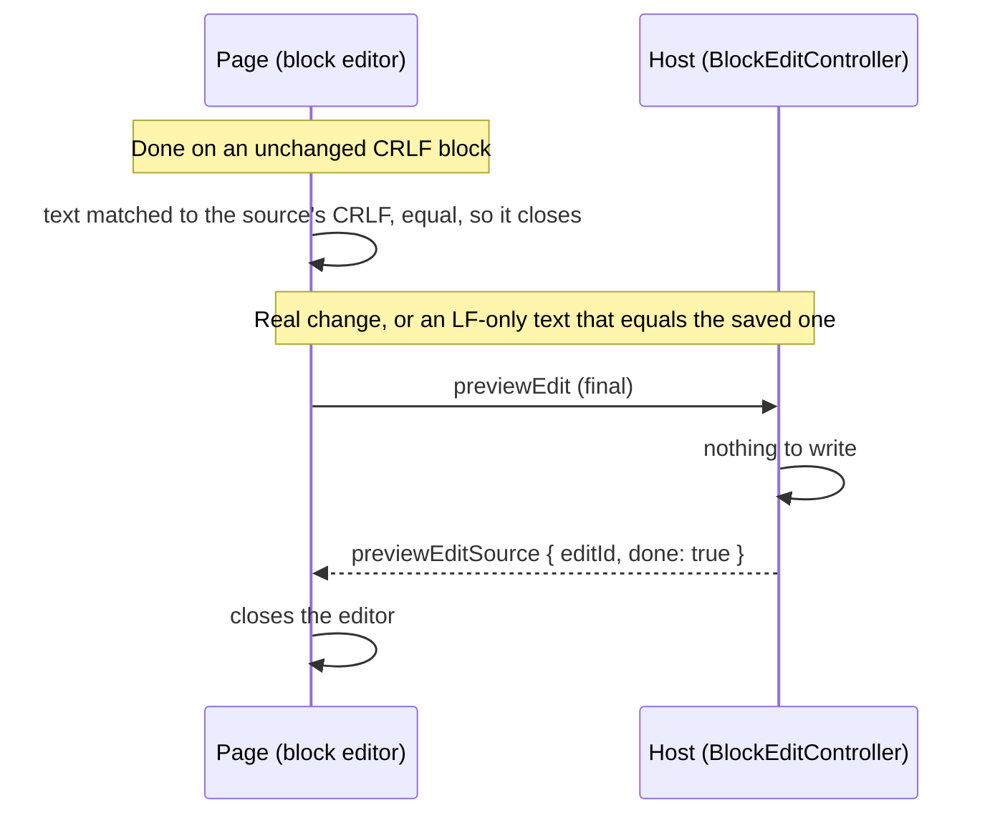

## Summary

In a Markdown file with CRLF line endings (common on Windows with `core.autocrlf`), opening the editor on a multi-line block (a wrapped paragraph, a list item with nested items, a list's last item) and leaving it without a real change left the editor stuck on "Saving Markdown..." until the preview was reloaded. The browser text box hands back LF-only text, so the editor believed the block had changed and asked the host to save it; the host found nothing to write and never answered.

The editor now compares and posts text in the file's own line endings, and the host always answers a final save, even when nothing is written. A CRLF file stays CRLF, an LF file stays LF, and every byte the user did not edit is kept.

## Deliverables

The page puts the text box content in the source's line endings before comparing or posting, and the host replies to every final save:



New wire field and helper:

```ts
// src/core/protocol/hostToPage.ts
interface PreviewEditSourceMessage { editId: string; error?: string; done?: true; /* ... */ }
// src/core/edits/lineEndings.ts
export function matchLineEndings(text, ...) // text in the line endings of the source
```

Choice: the host's `done` reply is a safety net for every path where a final save writes nothing, so no future mismatch can leave the editor stuck.

## Changes

- `src/core/edits/lineEndings.ts` (new): `matchLineEndings`, the single rule (it replaces `withLineEndingOf`) for putting text in the source's line endings (mixed blocks keep the endings of the lines the edit left alone).
- `src/page/features/blockEditor.ts`: the text box text goes through it before the unchanged check, the autosave and the final save.
- `src/session/features/blockEdits.ts`: a final save that ends with nothing written posts `previewEditSource` with `done: true`; `blockSourceEditor.ts` closes the editor on it and resumes a pending move to another block.
- New SwRS-MDOKFSTUDIO-BLOCK-263; markers on BLOCK-042, 130 and 234; BLOCK-234's mixed-endings row refined (see Autonomous decisions).

## Impacts

No visual change: the editor now closes where it used to stay stuck. Files keep their line endings on every edit path.

## Blast radius

Grade: **1**. Local to the block editor's save path and one optional message field; a plain `git revert` restores the previous behaviour.

## Test plan

- [ ] New or changed tests (they fail on the previous code): page, unit and host tests for CRLF, LF and mixed sources, plus a real VS Code window scenario that leaves CRLF and LF files unchanged in five ways and checks the bytes on disk
- [ ] Requirements: SwRS-MDOKFSTUDIO-BLOCK-263 added, markers in code and tests, `just requirements-update`
- [ ] Changelog: one user-facing line under `## Unreleased` in `CHANGELOG.md`
- [ ] Local gates:
- [ ] Review
- [ ] CI green

## Autonomous decisions

- The host's reply to a final save that writes nothing reuses `previewEditSource` with a new optional `done` flag, rather than a new message type; it is sent whenever a final save ends with nothing to render.
- Behaviour change for a block whose lines have mixed line endings: the lines the edit left alone keep their endings (the requirement said "written as it is"). Needs the owner's confirmation.

## Known gaps

None.

## Internal references

- CR-436 stuck-saving
