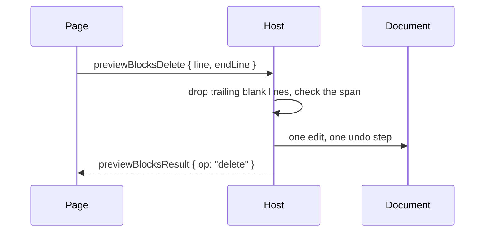

## Summary

A block left empty in edit mode could leave runs of blank lines in the file that the page never
shows, so the writer could neither reach them nor delete them. This change stops the editor from
writing those runs, and adds a way to delete any block: a "Delete block" button, and Delete or
Backspace on a block selection.

## Deliverables

Each body block's action bar gets a Delete block button right after the down arrow, so the bar
reads "+ ↑ ↓ ×". The move status now sits to the right of it. The visual captures of the bar,
with and without a move status, come from the shipped stylesheet in the visual run of CI.

- Erasing a block's text and pressing Done on a top-level block or a list item deletes it with its
  separator, in one edit: one undo brings it back (two if an autosave already ran).
- A new block no longer keeps the blank lines typed at its start, and a block inserted after a
  list gets exactly one blank line before it.
- Delete and Backspace act only on a block selection, never on a merely focused block, a focused
  control, a text box, an open editor, or one level below the top level.
- After a delete, the selection moves to the block that took its place, so the keyboard can keep
  deleting.
- Line endings and the final line break of the document are kept (LF, CR LF, lone CR).

## Blast radius

Grade: 2

The writer paths of the block editor (insertion text, a final save, a new page message) change, and
the bar and the key handling of the page change. Reverting the commit restores the previous
behaviour; no file format changes.

## Autonomous decisions

- The page marks the final save of an emptied top-level block or list item with `deleteWhenEmpty`,
  because the host only sees lines and cannot tell a top-level paragraph from one inside a list item.
- Only a whitespace-only text deletes: an item left as `- ` is written as it is.
- The new Delete block message drops a span's trailing blank lines first, so a selection ending on a
  list's blank separator can be deleted (cut and copy keep their current behaviour).

## Known gaps

- The real VS Code scenario (`test/integration/emptyBlocks.test.ts`) is written but not run locally; it
  runs in the heavy CI run on the branch.
- The lone-CR assertion on the frontmatter refusal of Delete block is skipped: a lone-CR document is
  not detected as having frontmatter, a limitation that predates this change.

Details

## Changes

- `src/core/mapping/insertion.ts`: leading blank lines dropped; one line ending after a blank anchor.
- `src/core/edits/sourceEdits.ts`: `planEmptiedBlockRemoval` and `planBlocksDelete`.
- `src/session/features/blockEdits.ts`, `src/session/features/sourceEdits.ts`: the emptied-block
  deletion on a final save, and the `previewBlocksDelete` handler.
- `src/core/protocol/*`, `src/session/pageMessages.ts`: `deleteWhenEmpty`, `previewBlocksDelete`, and
  `op: "delete"` of `previewBlocksResult`.
- `src/page/modules/deleteBlockButton.ts`, `src/page/features/blockMoves.ts`,
  `blockSelectionView.ts`, `structuralNavigationView.ts`, `blockEditor.ts`: the button, the keys,
  `isBelowTopLevel()` and the selection after a delete.
- Requirements: two new SwRS and updates of the existing ones; glossary terms.

## Impacts

Visible: a "×" button in each body block's bar. The captures show the bar and the move status next to it.

## Test plan

- [ ] New or changed tests (they fail on the previous code): core, session, page, visual and integration tests
- [ ] Requirements: SwRS updated or added, markers in code and tests, `just requirements-update`
- [ ] Changelog: one user-facing line under `## Unreleased` in `CHANGELOG.md`
- [ ] Local gates: <!-- filled at the closing -->
- [ ] Review
- [ ] CI green

## Internal references

- CR-439 empty-blocks-leave-no-blank-lines

