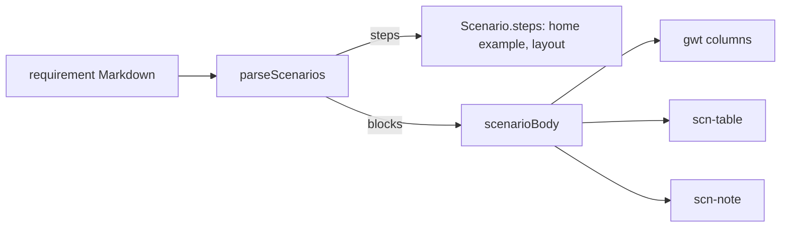

## Summary

On the published requirements site, each scenario of a behaviour page is a card you click to open. When the requirement wrote its scenario as a table (`| Input | Outcome |`), the card opened on three empty columns, Given, When and Then, because the site builder only read the Given / When / Then / And lines and dropped everything else. 421 requirement files hold at least one table scenario, so a large part of the site looked empty.

This change makes the site builder read tables, notes and mixed scenarios, so a card shows what the source says.

## Deliverables

- A table scenario shows its table with the headers the source uses, with no empty columns.
- A list scenario (Given / When / Then / And lines) shows the three columns, with the same markup as before.
- A scenario with both shows both in source order; a note line under the heading shows as a paragraph.
- A scenario heading with nothing under it shows "No text under this scenario in the source." rather than a blank card.

- Table cells and notes are plain escaped text; `&lt;`, `&gt;`, `&amp;` and `&quot;` are decoded once before escaping, so the page shows what GitHub shows and nothing in the source becomes markup.
- A wide table scrolls inside its card on a narrow screen.

Screenshots: to come at the verified head.

## Blast radius

The change is local to the requirements-site builder under `test/site/requirementsViewer/` and one requirement file; the extension itself is untouched. A plain `git revert` restores the previous behaviour.

Grade: 1

## Autonomous decisions

- None

## Known gaps

- None

Details

## Changes

- `model.ts`: `Scenario` gains `blocks` (steps, table, note, in source order); `steps` is kept for the home page example and the layout; the four basic entities are decoded in one pass.
- `pages.ts`: new exported `scenarioBody` renders the blocks; a list-only scenario renders the same HTML as before.
- `viewer.css`: styles for `.scn-table` and `.scn-note`, existing colours and variables only.
- `home.ts`: the "What the requirements are" hint now mentions that scenarios may be a table.
- Tests: new model, page and home assertions on a fixture with table and mixed scenarios; a new guard test renders every scenario card of the shipped requirements bundle and fails on an empty one.
- Requirement `SwRS-MDOKFSTUDIO-CORE-082` gains two scenarios; coverage regenerated, log entry added.

## Impacts

The published requirements site shows table scenarios; no extension behaviour changes. Screenshots show a table card and a mixed card.

## Test plan

- [ ] New or changed tests (they fail on the previous code: the model, page and bundle tests do not compile without `blocks` and `scenarioBody`; the home assertion compiles on the old code and fails on the old hint text)
- [ ] Requirements: `SwRS-MDOKFSTUDIO-CORE-082` updated with two scenarios, markers in code and tests, `just requirements-update` run
- [ ] Changelog: no user-facing change (site tooling)
- [ ] Local gates at `<sha7>`: `just check`, `just requirements-update`, okfreq validate
- [ ] Evidence: before at `<sha7>`, after at `<sha7>`
- [ ] Review: approved at `<sha7>`
- [ ] Verified at `<sha7>`
- [ ] CI green at `<sha7>`

Tests:

- `SwRS-MDOKFSTUDIO-CORE-082`: `test/site/requirementsViewer/pages.ts`, `model.ts`, and tests `model.test.ts`, `pages.test.ts`, `bundle.test.ts`.
- `SwRS-MDOKFSTUDIO-CORE-069`: `test/site/requirementsViewer/home.ts` and `home.test.ts`.

## Internal references

- CR-440 requirements-viewer-shows-table-scenario

