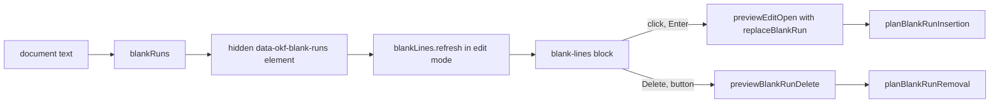

## Summary

Extra blank lines between blocks (hand edits, merges, older Studio versions) were invisible in edit mode, so a writer could not reach or remove them from Studio. In edit mode, every run of two or more blank lines between top-level blocks now shows as a small blank-lines block that the writer reaches with the arrows, clicks to type a block in its place, and removes with Delete, Backspace or its Delete block button, keeping one separator.

## Deliverables

The host finds the runs and appends one hidden list to the rendered content; the page, which has no source text, builds the blank-lines blocks from that list only.



```ts
// the new message of the page to the host
{ type: "previewBlankRunDelete", line, endLine }
// replaces the run when typing or pasting
replaceBlankRun?: { line: number; endLine: number }
```

Choices made: the blank-lines block exists in edit mode only (reading mode and the HTML export are unchanged); Delete and Backspace act only on a selected blank-lines block; removing a run keeps one separator and is one undo step.

## Blast radius

Grade: 2. The change touches the shared render pipeline, the page-to-host protocol and the block selection keys; a revert is possible but the new requirements and tests go with it.

## Autonomous decisions

- The runs are found by the host and placed by the page through one hidden element; the page trusts only that element.
- A run next to a folded section, and runs inside lists or containers, show nothing (runs inside lists are a follow-up).
- Delete and Backspace act only on a selected blank-lines block; a block only focused takes Enter and its button.
- A blank-lines block hosting an open editor stays in place until the editor closes.

## Known gaps

- No screenshots: three captures of the blank-lines block (edit, selected, reading) were made but are not attached; the push of the images to a side branch was refused by a safety check, left to the owner. They are kept with the change's evidence files.
- No before image: the blank run is invisible before this change, so there is nothing to compare.
- The kept-editor path (a blank-lines block hosting an open editor survives a content patch, in `contentPatch.ts`) is covered only by the page-level test in `runtimeBlankLines`; **UNVERIFIED:** it was not run in a real VS Code window at this head.
- The heavy CI run (real VS Code integration and stress jobs) did not run at `7635816` (after the restack onto the CR-443 branch; last restack carried from `5e42c5f`); it passed at `e293b92` (carried, before the restack), and none of its tests is known to target the kept-editor path above across a content patch.
- The long gate (`just preflight`) ran on Windows, so its static stage only; the other stages are covered by CI.

<details>
<summary>Details</summary>

## Changes

- `blankRuns` and `isCommonMarkBlank` find runs of spaces-and-tabs-only lines; a line holding a non-breaking space is a paragraph, not blank.
- The preview appends a hidden `data-okf-blank-runs` element; the page reads it only from the last child of the content, and the HTML export drops it.
- A blank-lines block is built by the page in edit mode only, skipped inside blocks and folded sections, kept across refreshes, and kept while its insertion editor is open.
- Arrows stop on it, Enter or a click opens an insertion editor in its place, Delete and Backspace on a selected one remove it, Ctrl/Cmd+V pastes in place of the run.
- The host checks the run again before every open, save, paste and removal (stale runs are refused), writes one edit (one undo step) and keeps line endings and the final line break.
- New and updated requirements, glossary terms, changelog line, unit, page, session and integration tests, and visual captures.

## Impacts

Edit mode only; reading mode and the HTML export are unchanged. No screenshots are attached (see Known gaps).

## Test plan

- [x] New or changed tests (they fail on the previous code)
- [x] Requirements: SwRS added and updated, markers in code and tests, `just requirements-update`
- [x] Changelog: one user-facing line under `## Unreleased` in `CHANGELOG.md`
- [x] Local gates at `7635816` (carried from `5e42c5f`, clean restack): `just preflight` passed (static stage on Windows)
- [ ] Evidence: none attached, see Known gaps
- [x] Review: approved at `7635816` (carried from `5e42c5f`; clean restack onto the CR-443 branch, code and tests unchanged from the round reviews)
- [x] Verified at `7635816` (carried from `5e42c5f`)
- [x] CI green at `7635816`: static, static-windows, viewer-graph, visual, report pass; the heavy run (integration, stress, gallery) was not run at this head (it passed at `e293b92`, before the restacks)

## Internal references

CR-444 "Show blank-line runs as a reachable blank-lines block in edit mode".

</details>
