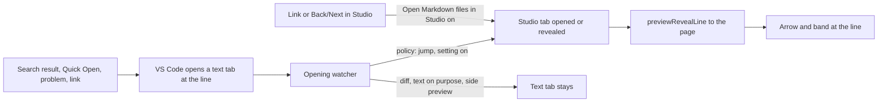

## Summary

Clicking a search result, a `file.md:42` Quick Open entry, a problem or a link that points into a Markdown file used to open the raw text editor at the right line, or Studio at the top (the editor association cannot carry a line). This PR makes Studio open at that line, with an arrow in the left margin and a light band on the line, and replaces the editor association by two Studio settings. Diffs, text editors asked for on purpose and the side preview workflow stay VS Code's text editors.

## Deliverables

Where the opening goes through (a text tab opens at the line for a moment, Studio takes its place at that line):

- Two settings: "Open search results in Studio" (on by default, jumps only) and "Open Markdown files in Studio" (off by default, turned on by the migration; every opening). A one-time migration moves a `*.md` entry of `workbench.editorAssociations` (user and workspace scopes) to the second setting, with a notice.
- Marker: an arrow pointing right in the left margin and a band across the line, drawn with the theme colours; exact line for a paragraph or a code block, a folded section or a closed dropdown is unfolded, otherwise the top of the enclosing block. It stays on scroll and goes on a click, an edit or another requested line.
- Commands: "Open as Text" (Studio tab to text editor) and "Show Feature Introductions Again". Activation is on `onLanguage:markdown`; the engine, watchers and diagnostics start only with the first Studio preview.
- Host API: `Navigation.showDocumentInStudio(documentId, line?)`; page message `previewRevealLine { line }`.
- Evidence captured at `f61ac3a`, carried to `207a550` (rebase; the visual job is green at `207a550`): before is "no marker" (the base has no `previewRevealLine`, so there is nothing to capture); after, from the visual job on Linux CI (made-up fixture text):

## Blast radius

Grade: 2. The opening path of every Markdown file changes (activation event, a tab watcher, a one-time settings migration). Rolling back means reverting the PR; a migrated user keeps the new setting turned on, which a revert leaves unused.

## Autonomous decisions

- The design decisions that went beyond the owner's first answers (migration reach, side preview, restored tabs, plain openings in another group, the two-setting split) were taken by an agent under the owner's autonomy rule, not by the owner; the owner may change any at review.
- "On by default" is read as: "Open search results in Studio" on by default, "Open Markdown files in Studio" off until the migration turns it on.
- The migration writes the new setting first, then removes the association (the planned design said the reverse), so a failure never leaves the user with neither.
- The tab-reading watcher lives in `src/host-vscode/openingWatcher.ts` and `src/host-vscode/studioPlacement.ts`, not in `openInStudio.ts` as the specification placed it.
- A real VS Code trial found a usable signal telling a jump from a plain reopening, so "Open search results in Studio" stays on by default.

## Known gaps

- A pinned or preview Studio tab already open on the file ignores a new line (known issue, `docs/known-limitations.md`).
- "Open as Text" on a dirty document shows a save dialog; "Open With > Text Editor" is replaced by Studio (known issues, same file).
- The text editor shows for a brief moment before Studio takes its place.
- The opening that triggered activation is never replaced.
- Not run in real VS Code: the migration with real settings files, the diff views staying text, the activation-time opening, the keyboard timing of the flash, and Back/Next navigation; the unattended campaign automation was cut.
- Small review leftovers: `docs/user/open-studio.md` does not mention the pinned-tab exception next to the "revealed at the line" sentence; an integration test waits a fixed 1.5 s to prove nothing opens; a map of recent jumps in the watcher is only pruned lazily. `test/integration/openAtLine.test.ts` ran in the real VS Code integration job on Linux CI at `f61ac3a`, before the rebase onto the CR-444 branch (heavy run 44860936230, step open-at-line, success); it was not re-run at `207a550`; its three cases cover only a jump, the search setting off and a plain opening, not the other trials. **UNVERIFIED:** diffs are never replaced in real VS Code (covered by unit tests of the policy only).
- In a very narrow pane in edit mode, the arrow can still overlap a list item handle; no visual scenario covers that width.
- Visual scenarios, the integration stage and the real VS Code jobs run on Linux CI only.

Details

## Changes

- `src/core/navigation/openingPolicy.ts`: pure opening policy and `studioTargetFor`; `src/host-vscode/openingWatcher.ts`, `studioPlacement.ts`: watcher and putting Studio in place; `activation.ts`: lazy start, migration before the watcher, new commands.
- `src/core/configuration/editorAssociationMigration.ts`, `src/session/associationMigration.ts`, `src/session/featureIntroductions.ts`, `src/host-api/settingScopes.ts`: migration, introductions, setting scopes port.
- `src/page/features/lineMarker.ts`, `src/core/preview/styles/lineMarkerStyles.ts`: the marker; `src/core/protocol/hostToPage.ts`: `previewRevealLine`; `scrollSync.ts`, `rendering.ts`: pending line.
- `links.ts`, `history.ts`: Studio's own navigation through `showDocumentInStudio`.
- Requirements (new SwRS), docs (`docs/user/open-studio.md`, settings, known limitations), glossary, changelog.

## Human decisions

- Studio decides itself to open Markdown files: the text editor opens first, then Studio takes its place at the line.
- The marker is an arrow in the left margin with a light band, kept until a click, an edit or another line.
- A file already open in Studio is shown by the same Studio tab, which scrolls to the new line; no new tab.
- A feature introduction notice is shown once, never again, and can be shown again by a command.
- A setting to open search results in Studio, on by default; diffs must not be pulled into Studio.

## Impacts

Users see Studio open at the searched line with the marker; Markdown opening settings appear in Settings; a notice announces the feature once. No other visual change.

## Test plan

- [x] New or changed tests (they fail on the previous code): policy, watcher, migration, introductions, protocol, page marker, session navigation, host placement
- [x] Local gates at `207a550`: `just check`, `just ci-static`, `just requirements-update`, `just requirements-lint`
- [x] Evidence: before none (no marker at the base), after captured at `f61ac3a`, carried to `207a550` (trial logs under the work folder)
- [x] Review: approved at `207a550` (move re-inspected)
- [x] Verified at `207a550`
- [x] CI green at `207a550` (pull request checks); the heavy run with integration and stress was green at `f61ac3a`, before the rebase

## Internal references

CR-445 "open-at-line-marker", batch-07; specification `03-change-spec.md` (decisions 12 to 33 by the Griller); notes `work/coder/r1.md` to `r5.md`.

🤖 Generated with [Claude Code](https://claude.com/claude-code)

