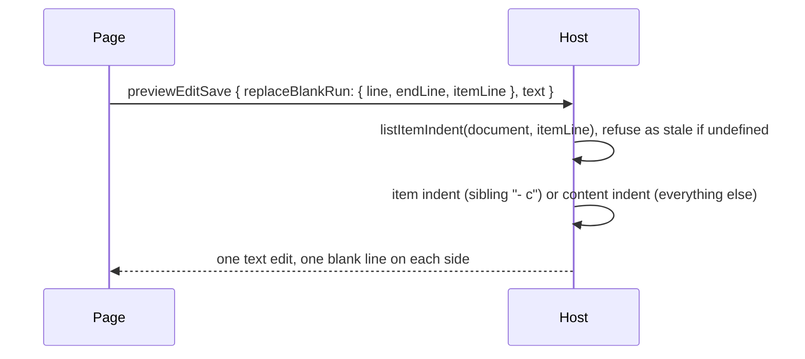

## Summary

In edit mode, two or more blank lines between two items of a list, or inside a list item, were
unreachable: the extra blank lines could not be seen or removed. They now show as the same
"Blank lines (N)" block that already appears between top-level blocks, inside the item that holds
them. The writer can select it, remove it, or type or paste in it.

## Deliverables

- A run between two items shows at the end of the item above; a run between two paragraphs of an
  item shows between them, indented with the item's content.
- Typing or pasting in such a block indents the text to the item's content column, so "More" stays
  in the item. A "- c" typed between two items adds a sibling item; a "- c" typed inside an item
  becomes a nested list.
- Removing the run keeps one blank line, so the list stays one list and nothing else changes.
- Down and Up reach the blank-lines blocks inside a selected list in line order; Shift+Up/Down from
  one starts the block selection on the list or on the block after it.
- Blank lines inside a fence, directive, HTML block or table in an item, and inside quotes and
  admonitions, are unchanged (not shown).

How a block typed in a run inside a list is written:

Before at `e0c7836`, after at `ea5c383` (carried from `8ecec6b`: the rebase left the patch unchanged).

Before: nothing shows for the runs (base `e0c7836`).

After: one block at the end of item 1, one between the paragraphs of item 2, none in the fence.

A block selected by the arrows, with its Delete block button (dark theme).

Typing in a block keeps the editor open inside the item.

Reading mode is unchanged.

## Changes

- `src/page/features/blankLines.ts`: placement of a run inside a top-level list in its host item,
  refresh by document containment.
- `src/page/features/blockSelectionView.ts`: arrow stop order and selection after a removal.
- `src/core/mapping/listItemIndent.ts`, `insertion.ts`, `src/core/edits/sourceEdits.ts`: the item
  and content indent of a block written in place of a run.
- `pageToHost` protocol: optional `itemLine` on `replaceBlankRun`; the host checks it and refuses a
  stale one.
- Requirements BLOCK-266 to BLOCK-269, glossary, changelog, tests (core, page, session, visual,
  integration).

## Impacts

Visible in edit mode only: the new blank-lines blocks inside lists. Reading mode is unchanged.

## Blast radius

Grade: 2. The page placement code and the insertion plan are shared with the top-level blank-lines
block; a top-level run sends no `itemLine` and behaves as before. A `git revert` restores the
previous behaviour.

## Test plan

- [x] New or changed tests (they fail on the previous code, except the render test, which guards an
      existing contract)
- [x] Requirements: SwRS BLOCK-266 to BLOCK-269 updated, markers in code and tests,
      `just requirements-update`
- [x] Changelog: one user-facing line under `## Unreleased` in `CHANGELOG.md`
- [x] Local gates: `just check` pass at `ea5c383`; long gate `just preflight` pass at `8ecec6b` (carried: patch unchanged by `git range-diff`)
- [x] Evidence: before at `e0c7836`, after at `ea5c383` (carried from `8ecec6b`)
- [x] Review: approved at `15a0ef0` (carried: patch unchanged at `ea5c383`)
- [x] Verified at `ea5c383` (carried from `8ecec6b`)
- [x] CI green at `ea5c383`: all PR checks pass, and heavy run 44909893956 (integration, stress) pass

## Known gaps

- The integration steps for "More", "- c" between items and "- c" in an item press no undo after the
  save; the specification asks that one undo brings the run back, and only the delete steps press
  undo. Session tests cover the single-edit write.

