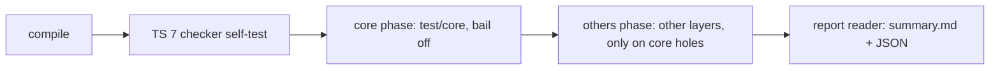

## Summary

Studio's `src/core` has about 4,400 unit tests, and nobody knew which of them prove nothing the others do not, or which code no test really checks. This PR adds a local mutation-testing campaign (StrykerJS 10.1.1, every mutant type-checked with the project's own TypeScript 7), runs it on a sample of `src/core`, and delivers its two results: a list of redundant tests for the owner to review (nothing is removed or merged here) and new tests for the holes that matter. A **hole** is a mutant (a small automatic change to the code) that no test of `test/core` catches.

## Deliverables

The campaign is one command, `just mutation-core`, with four stages:

- **TypeScript 7 stays the only compiler.** A checker plugin (`scripts/mutation/`) type-checks each mutant against the whole program through `typescript/unstable/sync`: about 2.1 s per check with 8 processes. The stock Stryker checker needs the classic compiler API, which TypeScript 7 does not export. A self-test at the start of the target fails it before Stryker starts; there is no way to run without the type check.
- **A `node:test` adapter** gives Stryker per-test coverage; load-time coverage counts for each test of the file, and with the bail off every killer of a mutant is recorded.
- **An ignorer** leaves out log calls and user-facing message strings.
- **A report reader** gives the score per `core` sub-folder and per requirement, zero-kill tests (a test that only runs at module load is not judged), a greedy redundant-test list, tests "not judged", and the holes (labelled "no test kills it" or "killed only by another layer").

The campaign ran on a sample, because the full `src/core` run projects to about 23 h (over the 6 h limit set for it): 51 files, every one of the 19 `core` sub-folders, 6,007 mutants, 1,396 tests, 91 min 5 s end to end. Overall score 70.0%; 1,700 mutants (28%) do not compile (rejected by the TS 7 checker, no test run); 1,289 holes (1,254 no test kills it, 35 killed only by another layer, 2 equivalent found by reading, not proved).

| Result of the sampled run | Figure |
| --- | --- |
| Judged zero-kill tests | 118 (109 load-time only, 97 of them in `previewStyles.test`; the reader now leaves those out) |
| Judged redundant tests | 108 |
| Not judged | 27 (plus the load-time zero-kill ones) |
| Removal candidates after the keep marks (regression 20, boundary 5, last carrier of a requirement 17) | 75 |
| Holes in 25 test-worthy clusters | 416 |

The full list of redundant tests (one entry per test: the mutants it kills, who else kills them, the requirement it carries, keep or removal candidate or not judged) is for the owner's review and is not in the diff; see Internal references.

**New tests for the holes.** 19 new `test/core/**/*.holes.test.ts` files (no `src/` change, each with its `@tests_req`) target the 25 clusters. Re-run for real on the 19 concerned files (6,007 mutants, 33 min): of the 416 cluster holes, 319 are killed (77%) and 97 remain, listed under Changes. No sub-folder score dropped; the unit tests of `test/core` went from 1,396 to 1,475.

| Sub-folder score | Before | After |
| --- | --- | --- |
| comments | 80.0 | 91.1 |
| frontmatter | 52.1 | 73.8 |
| mapping | 62.3 | 93.4 |
| navigation | 72.1 | 95.0 |
| protocol | 77.5 | 98.9 |
| scroll | 67.8 | 78.2 |
| myst | 80.2 | 84.0 |
| paste | 54.6 | 58.5 |
| preview | 82.9 | 84.7 |
| state | 90.0 | 90.9 |

The other sub-folders were not touched: configuration 92.9, directives 86.2, edits 68.5, export 57.1, find 78.6, palette 3.3 (emoji and icon tables: 128 data-literal mutants), render 85.7, security 97.8, syntax 96.3. Holes after the re-run: 834 (806 no test kills it, 28 killed only by another layer), from 1,289.

## Blast radius

Grade: 1. Development tooling and tests only: new files under `scripts/` and `test/`, one `justfile` target outside `check`, `ci-static` and `preflight`, three docs lines, a dev dependency and generated requirement coverage lines. No `src/` change; `git revert` restores everything.

## Autonomous decisions

- The full `src/core` run projects to about 23 h, over the 6 h rule, so the campaign runs on a recorded sample of files (each sub-folder represented), and the new tests were checked by a re-run on the 19 files they target.
- StrykerJS with a small `node:test` adapter for per-test coverage; the score per sub-folder and per requirement, with log calls and user-facing message strings excluded from mutation; every requirement stays covered; the note for the campaign's process is written for later reuse.
- Accepted additions: the bail off in the `core` phase, a rule that keeps regression and boundary tests, the ignorer's rule list, a load-time zero-kill rule in the reader, unit tests of the tool, the just target with its docs lines, and no requirement change.
- Holes outside the 25 clusters were left without a test, in the categories of Known gaps below.
- The two long runs (the 91 min sampled run and the 33 min re-run) went in a background shell, polled by their logs, instead of a foreground command.

## Known gaps

- No test is removed or merged: the redundant-test list is for the owner's later review.
- **Known issue, not fixed (no `src/` change here):** the comment model accepts the date `2026-02-30T10:00:00Z`, because `Date.parse` rolls it over, while REVIEW-004 says a comment date is "a real instant". The new test does not include that case. To go to the backlog.
- 97 cluster holes remain, each listed under Changes with why it is left (5 equivalent or likely equivalent by reading, 92 not worth a test now; several are killable with a second navigation-root fixture or a document ending in a lone CR).
- One mutant newly appears as a hole in the re-run, `previewNavigation.ts:18:24` (Regex, survived); its cause is not investigated.
- The 872 holes outside the 25 clusters get no test, in six categories: catalogue and data-table literals (128), message and label texts (20), other string constants (137), empty `catch` blocks after a file-system error (3), regular-expression variants (112), and 472 conditions and operators that are an **unjudged residue**, not a verdict (single guards of validated input or redundant guards, to re-read if a file score stays low). The per-hole list with its category is in the evidence file named under Internal references.
- Equivalent mutants are found by reading, not proved.
- The symbolic-link test of the stem index is skipped where links cannot be made (no privilege), so that branch is covered only on machines that allow links.
- The campaign ran on a sample (51 of the `src/core` files): the other files are not measured, and the redundant-test counts are on the sample only.

Details

## Changes

- `scripts/stryker.config.mjs`, `scripts/stryker.others.config.mjs`, `scripts/mutation/*` (adapter, checker, ignorer, reader), `scripts/mutation-report.mjs`.
- `justfile` target `mutation-core`; `.gitignore` for the Stryker temporary folder; `@stryker-mutator/core` 10.1.1 as a dev dependency. `package-lock.json` shows a large raw diff (about 3,200 added and 1,200 removed lines) because npm re-ordered keys; the real change is 136 added entries (Stryker and its dependencies) and none removed.
- `test/build/mutationTools.test.ts`, `test/build/mutationReport.test.ts`: the tools' pure parts.
- 19 `test/core/**/*.holes.test.ts` files that kill the cluster holes; `git diff --stat origin/main -- test/` shows only additions.
- `CONTRIBUTING.md` paragraph, `AGENTS.md` target line, a dated entry in `requirements/tiers/log.md` and generated coverage lines in SwRS files.

### The 97 cluster holes left without a test

Each line is file:line:column, mutator, status in the re-run, and why. Equivalent or likely equivalent (read, not proved):

- `mapping/textDiff.ts:23:10` EqualityOperator (Survived): at `prefix == limit` one `charCodeAt` is NaN, so the loop stops the same way.
- `mapping/textDiff.ts:23:10` ConditionalExpression (Survived): at `prefix == limit` one `charCodeAt` is NaN, so the loop stops the same way.
- `mapping/textDiff.ts:25:10` EqualityOperator (Survived): guard redundant with `charCodeAt` returning NaN (read, not proven).
- `mapping/textDiff.ts:25:10` ConditionalExpression (Survived): guard redundant with `charCodeAt` returning NaN (read, not proven).
- `mapping/textDiff.ts:41:10` EqualityOperator (Survived): guard redundant with `charCodeAt` returning NaN (read, not proven).

Not worth a test now:

- `frontmatter/fileLinks.ts:176:72` MethodExpression (Survived): trailing backslash variant of a Windows path; platform-specific.
- `frontmatter/fileLinks.ts:199:8` EqualityOperator (Survived): needs two navigation roots with a link contained by one only; killable with a second-root fixture, left out.
- `frontmatter/fileLinks.ts:199:55` ArrayDeclaration (NoCoverage): needs two navigation roots with a link contained by one only; killable with a second-root fixture, left out.
- `frontmatter/fileLinks.ts:200:7` ArrayDeclaration (NoCoverage): needs two navigation roots with a link contained by one only; killable with a second-root fixture, left out.
- `frontmatter/fileLinks.ts:204:7` ConditionalExpression (Survived): needs two navigation roots with a link contained by one only; killable with a second-root fixture, left out.
- `frontmatter/fileLinks.ts:204:7` ConditionalExpression (Survived): needs two navigation roots with a link contained by one only; killable with a second-root fixture, left out.
- `frontmatter/fileLinks.ts:204:7` EqualityOperator (Survived): needs two navigation roots with a link contained by one only; killable with a second-root fixture, left out.
- `frontmatter/fileLinks.ts:206:9` MethodExpression (Survived): needs two navigation roots with a link contained by one only; killable with a second-root fixture, left out.
- `frontmatter/fileLinks.ts:206:91` BlockStatement (Survived): needs two navigation roots with a link contained by one only; killable with a second-root fixture, left out.
- `frontmatter/fileLinks.ts:212:9` ConditionalExpression (Survived): `realpath` fallback of a broken link; the disk cannot make one here without privileges.
- `frontmatter/fileLinks.ts:212:42` BlockStatement (NoCoverage): `realpath` fallback of a broken link; the disk cannot make one here without privileges.
- `frontmatter/fileLinks.ts:213:39` StringLiteral (NoCoverage): `realpath` fallback of a broken link; the disk cannot make one here without privileges.
- `frontmatter/fileLinks.ts:215:9` ConditionalExpression (Survived): `realpath` fallback of a broken link; the disk cannot make one here without privileges.
- `frontmatter/fileLinks.ts:215:78` BlockStatement (NoCoverage): `realpath` fallback of a broken link; the disk cannot make one here without privileges.
- `frontmatter/fileLinks.ts:216:39` StringLiteral (NoCoverage): `realpath` fallback of a broken link; the disk cannot make one here without privileges.
- `frontmatter/fileLinks.ts:218:9` ConditionalExpression (Survived): `realpath` fallback of a broken link; the disk cannot make one here without privileges.
- `frontmatter/fileLinks.ts:218:9` ConditionalExpression (Survived): `realpath` fallback of a broken link; the disk cannot make one here without privileges.
- `frontmatter/fileLinks.ts:218:9` EqualityOperator (Survived): `realpath` fallback of a broken link; the disk cannot make one here without privileges.
- `frontmatter/fileLinks.ts:220:11` MethodExpression (Survived): `realpath` fallback of a broken link; the disk cannot make one here without privileges.
- `frontmatter/fileLinks.ts:223:17` BlockStatement (NoCoverage): `realpath` fallback of a broken link; the disk cannot make one here without privileges.
- `frontmatter/fileLinks.ts:224:18` BooleanLiteral (NoCoverage): `realpath` fallback of a broken link; the disk cannot make one here without privileges.
- `mapping/pastedImage.ts:29:5` ConditionalExpression (Survived): boundary of the image-signature scan; needs a hand-built truncated header, no rule names it.
- `mapping/pastedImage.ts:29:21` ArithmeticOperator (Survived): boundary of the image-signature scan; needs a hand-built truncated header, no rule names it.
- `mapping/pastedImage.ts:44:5` ConditionalExpression (Survived): boundary of the image-signature scan; needs a hand-built truncated header, no rule names it.
- `navigation/previewNavigation.ts:123:34` ConditionalExpression (Survived): single guard redundant with another guard of the same function (read, not proven).
- `navigation/previewNavigation.ts:66:17` Regex (Survived): regular-expression variant of the heading id suffix; matches the same inputs except exotic whitespace.
- `navigation/previewNavigation.ts:68:60` StringLiteral (Survived): regular-expression variant of the heading id suffix; matches the same inputs except exotic whitespace.
- `navigation/previewNavigation.ts:68:66` MethodExpression (Survived): regular-expression variant of the heading id suffix; matches the same inputs except exotic whitespace.
- `navigation/previewNavigation.ts:69:39` Regex (Survived): regular-expression variant of the heading id suffix; matches the same inputs except exotic whitespace.
- `navigation/previewNavigation.ts:69:39` Regex (Survived): regular-expression variant of the heading id suffix; matches the same inputs except exotic whitespace.
- `navigation/previewNavigation.ts:70:42` Regex (Survived): regular-expression variant of the heading id suffix; matches the same inputs except exotic whitespace.
- `comments/commentModel.ts:147:7` ConditionalExpression (Survived): single guard redundant with another guard of the same function (read, not proven).
- `myst/confLocator.ts:101:19` EqualityOperator (Survived): boundary on the exact millisecond of the recheck delay; timing.
- `myst/confLocator.ts:117:28` ArrayDeclaration (NoCoverage): fallback after an unreadable `conf.py`; platform and disk dependent.
- `myst/confLocator.ts:117:48` ArrayDeclaration (NoCoverage): fallback after an unreadable `conf.py`; platform and disk dependent.
- `myst/confLocator.ts:117:61` BooleanLiteral (NoCoverage): fallback after an unreadable `conf.py`; platform and disk dependent.
- `mapping/labelRename.ts:46:9` ConditionalExpression (Survived): CR trimming of a line end; needs a document ending in a lone CR; killable, left out.
- `mapping/labelRename.ts:51:7` ConditionalExpression (Survived): CR trimming of a line end; needs a document ending in a lone CR; killable, left out.
- `mapping/labelRename.ts:51:7` ConditionalExpression (Survived): CR trimming of a line end; needs a document ending in a lone CR; killable, left out.
- `mapping/labelRename.ts:51:7` EqualityOperator (Survived): CR trimming of a line end; needs a document ending in a lone CR; killable, left out.
- `mapping/labelRename.ts:51:7` EqualityOperator (Survived): CR trimming of a line end; needs a document ending in a lone CR; killable, left out.
- `mapping/labelRename.ts:51:27` ArithmeticOperator (Survived): CR trimming of a line end; needs a document ending in a lone CR; killable, left out.
- `mapping/labelRename.ts:51:40` StringLiteral (Survived): CR trimming of a line end; needs a document ending in a lone CR; killable, left out.
- `mapping/labelRename.ts:51:46` AssignmentOperator (Survived): CR trimming of a line end; needs a document ending in a lone CR; killable, left out.
- `mapping/sourceMapping.ts:44:9` ConditionalExpression (Survived): single guard redundant with another guard of the same function (read, not proven).
- `frontmatter/stemIndex.ts:141:12` ConditionalExpression (Survived): symbolic-link branch; the link test is skipped where links cannot be made.
- `frontmatter/stemIndex.ts:141:31` BooleanLiteral (NoCoverage): symbolic-link branch; the link test is skipped where links cannot be made.
- `frontmatter/stemIndex.ts:143:12` ConditionalExpression (Survived): symbolic-link branch; the link test is skipped where links cannot be made.
- `frontmatter/stemIndex.ts:161:61` StringLiteral (Survived): fallback value after a file-system error; platform and disk dependent.
- `frontmatter/stemIndex.ts:169:13` BlockStatement (NoCoverage): fallback value after a file-system error; platform and disk dependent.
- `frontmatter/stemIndex.ts:170:14` StringLiteral (NoCoverage): fallback value after a file-system error; platform and disk dependent.
- `frontmatter/stemIndex.ts:172:11` StringLiteral (Survived): fallback value after a file-system error; platform and disk dependent.
- `frontmatter/sameData.ts:37:21` MethodExpression (Survived): fast path of Set/Map/byte-array comparison; the slow path reaches the same verdict for primitive members (read, not proven).
- `frontmatter/sameData.ts:37:46` ConditionalExpression (Survived): fast path of Set/Map/byte-array comparison; the slow path reaches the same verdict for primitive members (read, not proven).
- `frontmatter/sameData.ts:37:46` LogicalOperator (Survived): fast path of Set/Map/byte-array comparison; the slow path reaches the same verdict for primitive members (read, not proven).
- `frontmatter/sameData.ts:37:46` ConditionalExpression (Survived): fast path of Set/Map/byte-array comparison; the slow path reaches the same verdict for primitive members (read, not proven).
- `frontmatter/sameData.ts:37:46` LogicalOperator (Survived): fast path of Set/Map/byte-array comparison; the slow path reaches the same verdict for primitive members (read, not proven).
- `frontmatter/sameData.ts:37:46` ConditionalExpression (Survived): fast path of Set/Map/byte-array comparison; the slow path reaches the same verdict for primitive members (read, not proven).
- `frontmatter/sameData.ts:37:75` ConditionalExpression (Survived): fast path of Set/Map/byte-array comparison; the slow path reaches the same verdict for primitive members (read, not proven).
- `frontmatter/sameData.ts:40:9` ConditionalExpression (Survived): fast path of Set/Map/byte-array comparison; the slow path reaches the same verdict for primitive members (read, not proven).
- `frontmatter/sameData.ts:40:9` LogicalOperator (Survived): fast path of Set/Map/byte-array comparison; the slow path reaches the same verdict for primitive members (read, not proven).
- `frontmatter/sameData.ts:40:9` ConditionalExpression (Survived): fast path of Set/Map/byte-array comparison; the slow path reaches the same verdict for primitive members (read, not proven).
- `frontmatter/sameData.ts:40:38` ConditionalExpression (Survived): fast path of Set/Map/byte-array comparison; the slow path reaches the same verdict for primitive members (read, not proven).
- `frontmatter/sameData.ts:50:21` MethodExpression (Survived): fast path of Set/Map/byte-array comparison; the slow path reaches the same verdict for primitive members (read, not proven).
- `frontmatter/sameData.ts:50:51` ConditionalExpression (Survived): fast path of Set/Map/byte-array comparison; the slow path reaches the same verdict for primitive members (read, not proven).
- `frontmatter/sameData.ts:50:51` LogicalOperator (Survived): fast path of Set/Map/byte-array comparison; the slow path reaches the same verdict for primitive members (read, not proven).
- `frontmatter/sameData.ts:50:51` ConditionalExpression (Survived): fast path of Set/Map/byte-array comparison; the slow path reaches the same verdict for primitive members (read, not proven).
- `frontmatter/sameData.ts:50:51` LogicalOperator (Survived): fast path of Set/Map/byte-array comparison; the slow path reaches the same verdict for primitive members (read, not proven).
- `frontmatter/sameData.ts:50:51` ConditionalExpression (Survived): fast path of Set/Map/byte-array comparison; the slow path reaches the same verdict for primitive members (read, not proven).
- `frontmatter/sameData.ts:50:78` ConditionalExpression (Survived): fast path of Set/Map/byte-array comparison; the slow path reaches the same verdict for primitive members (read, not proven).
- `frontmatter/sameData.ts:56:9` LogicalOperator (Survived): fast path of Set/Map/byte-array comparison; the slow path reaches the same verdict for primitive members (read, not proven).
- `frontmatter/sameData.ts:56:9` ConditionalExpression (Survived): fast path of Set/Map/byte-array comparison; the slow path reaches the same verdict for primitive members (read, not proven).
- `frontmatter/sameData.ts:56:9` ConditionalExpression (Survived): fast path of Set/Map/byte-array comparison; the slow path reaches the same verdict for primitive members (read, not proven).
- `frontmatter/sameData.ts:56:36` ConditionalExpression (Survived): fast path of Set/Map/byte-array comparison; the slow path reaches the same verdict for primitive members (read, not proven).
- `frontmatter/sameData.ts:68:25` EqualityOperator (Survived): fast path of Set/Map/byte-array comparison; the slow path reaches the same verdict for primitive members (read, not proven).
- `frontmatter/sameData.ts:68:55` BlockStatement (Survived): fast path of Set/Map/byte-array comparison; the slow path reaches the same verdict for primitive members (read, not proven).
- `frontmatter/sameData.ts:69:11` ConditionalExpression (Survived): fast path of Set/Map/byte-array comparison; the slow path reaches the same verdict for primitive members (read, not proven).
- `frontmatter/sameData.ts:70:11` ConditionalExpression (Survived): fast path of Set/Map/byte-array comparison; the slow path reaches the same verdict for primitive members (read, not proven).
- `frontmatter/sameData.ts:77:30` BlockStatement (Survived): fast path of Set/Map/byte-array comparison; the slow path reaches the same verdict for primitive members (read, not proven).
- `frontmatter/sameData.ts:81:9` ConditionalExpression (Survived): fast path of Set/Map/byte-array comparison; the slow path reaches the same verdict for primitive members (read, not proven).
- `frontmatter/sameData.ts:81:9` ConditionalExpression (Survived): fast path of Set/Map/byte-array comparison; the slow path reaches the same verdict for primitive members (read, not proven).
- `frontmatter/sameData.ts:81:9` LogicalOperator (Survived): fast path of Set/Map/byte-array comparison; the slow path reaches the same verdict for primitive members (read, not proven).
- `frontmatter/sameData.ts:81:41` MethodExpression (Survived): fast path of Set/Map/byte-array comparison; the slow path reaches the same verdict for primitive members (read, not proven).
- `frontmatter/sameData.ts:81:51` ArrowFunction (Survived): fast path of Set/Map/byte-array comparison; the slow path reaches the same verdict for primitive members (read, not proven).
- `frontmatter/sameData.ts:81:68` ConditionalExpression (Survived): fast path of Set/Map/byte-array comparison; the slow path reaches the same verdict for primitive members (read, not proven).
- `frontmatter/schemaValidator.ts:52:25` ConditionalExpression (Survived): single guard redundant with another guard of the same function (read, not proven).
- `frontmatter/schemaValidator.ts:62:7` ConditionalExpression (NoCoverage): single guard redundant with another guard of the same function (read, not proven).
- `frontmatter/schemaValidator.ts:62:18` BooleanLiteral (NoCoverage): single guard redundant with another guard of the same function (read, not proven).
- `scroll/anchorPolicy.ts:79:12` ConditionalExpression (Survived): single guard redundant with another guard of the same function (read, not proven).
- `state/navigationHistory.ts:25:9` EqualityOperator (Survived): single guard redundant with another guard of the same function (read, not proven).
- `preview/updatedRanges.ts:49:32` ConditionalExpression (Survived): single guard redundant with another guard of the same function (read, not proven).
- `preview/updatedRanges.ts:49:32` EqualityOperator (Survived): single guard redundant with another guard of the same function (read, not proven).

## Human decisions

- The campaign runs locally through `just mutation-core`, with no CI job (confirmed).
- Redundant tests are listed only: nothing is removed or merged until the owner reviews the list (changed from removing them).
- Stay on TypeScript 7, no compromise; whole-program type check of every mutant, with a self-test at the start of the target.
- Load-time coverage counts per file; only `test/core` decides redundancy, the other layers only label holes.
- Tests that reach only excluded, timeout or type-error mutants get a "not judged" mark.

## Impacts

No visual change and no product behaviour change; `just mutation-core` is a local, on-demand target, and the new tests only add checks.

## Test plan

- [x] New or changed tests: 19 hole-test files kill 319 of the 416 cluster mutants in the real re-run and pass on the code; tool tests in `test/build/`
- [x] Requirements: no requirement text changes; `just requirements-lint` pass at 1bc7734; coverage lines generated by `just requirements-update`
- [x] Changelog: no user-facing change
- [x] Local gates at 1bc7734: `just check` pass (unit tests: 4,536 run, 4,519 pass, 0 fail, 17 skipped; contract tests: 102 run, 100 pass, 2 skipped; the rest of `just check`: pass)
- [x] Review: approved at 1bc7734 (carried from 2f25a63; the rebase changed only `requirements/tiers/log.md`)
- [ ] Verified at 1bc7734
- [ ] CI green at 1bc7734

## Internal references

CR-450 mutation-testing (part 1 of 2). Planning folder `changes/4-batch/2-actives/450-mutation-testing/`: `evidence/redundant-tests-core.md` (the redundant-test list), `evidence/holes-core.md` (every hole, with its category), `evidence/r3-rerun.md` (the re-run), `evidence/r2-summary.md` (the sampled run), `evidence/mutation-campaign-note.md` (the campaign note for chantier).

