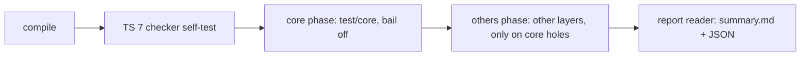

## Summary

Studio's `src/core` has about 4,400 unit tests, and nobody knows which of them prove nothing the others do not, or which code no test really checks. This PR adds a local mutation-testing campaign (StrykerJS 10.1.1, mutants type-checked with the project's own TypeScript 7) so the owner can review redundant tests and the few holes. Nothing is removed or merged here.

## Deliverables

The campaign is one command, `just mutation-core`, with four stages:

- **TypeScript 7 stays the only compiler.** A checker plugin (`scripts/mutation/`) type-checks each mutant against the whole program through `typescript/unstable/sync`: about 2.1 s per check with 8 processes. The stock Stryker checker needs the classic compiler API, which TypeScript 7 does not export. A self-test at the start of the target fails it before Stryker starts; there is no way to run without the type check.
- **A `node:test` adapter** gives Stryker per-test coverage; load-time coverage counts for each test of the file, and with the bail off every killer of a mutant is recorded.
- **An ignorer** leaves out log calls and user-facing message strings.
- **A report reader** gives the score per `core` sub-folder and per requirement, zero-kill tests, a greedy redundant-test list, tests "not judged", and the holes (labelled "no test kills it" or "killed only by another layer").
- Proof run on `find`, `syntax` and `scroll` (767 mutants): 366 killed, 77 timeout, 198 survived, 15 no coverage, 111 type errors; the other layers killed 17 of 213 holes.

## Blast radius

Grade: 1. Development tooling only: new files under `scripts/`, one `justfile` target outside `check`, `ci-static` and `preflight`, two docs lines and a dev dependency. `git revert` restores everything.

## Autonomous decisions

- The full `src/core` run projects to about 23 h, over the 6 h rule, so the campaign runs on a recorded sample of files (each sub-folder represented).

## Known gaps

- No test is removed or merged; the list of redundant tests is for the owner's later review.

Details

## Changes

- `scripts/stryker.config.mjs`, `scripts/stryker.others.config.mjs`, `scripts/mutation/*` (adapter, checker, ignorer), `scripts/mutation-report.mjs`.
- `justfile` target `mutation-core`; `.gitignore` for the Stryker temporary folder; `@stryker-mutator/core` 10.1.1 as a dev dependency.
- `test/build/mutationTools.test.ts`, `test/build/mutationReport.test.ts`: the tools' pure parts.
- `CONTRIBUTING.md` paragraph and `AGENTS.md` target line.

## Human decisions

- Stay on TypeScript 7, no compromise; whole-program type check of every mutant.
- Load-time coverage counts per file; only `test/core` decides redundancy, the other layers only label holes.
- Tests that reach only excluded, timeout or type-error mutants get a "not judged" mark.
- Redundant tests are listed, not removed.

## Impacts

No visual change and no product behaviour change; `just mutation-core` is a local, on-demand target.

## Test plan

- [ ] New or changed tests (they fail on the previous code)
- [ ] Requirements: No behaviour change
- [ ] Changelog: No user-facing change
- [ ] Local gates: `just compile`, `just check` (4400 unit tests) at the round's head
- [ ] Review
- [ ] CI green

## Internal references

CR-450 mutation-testing (part 1 of 2).

