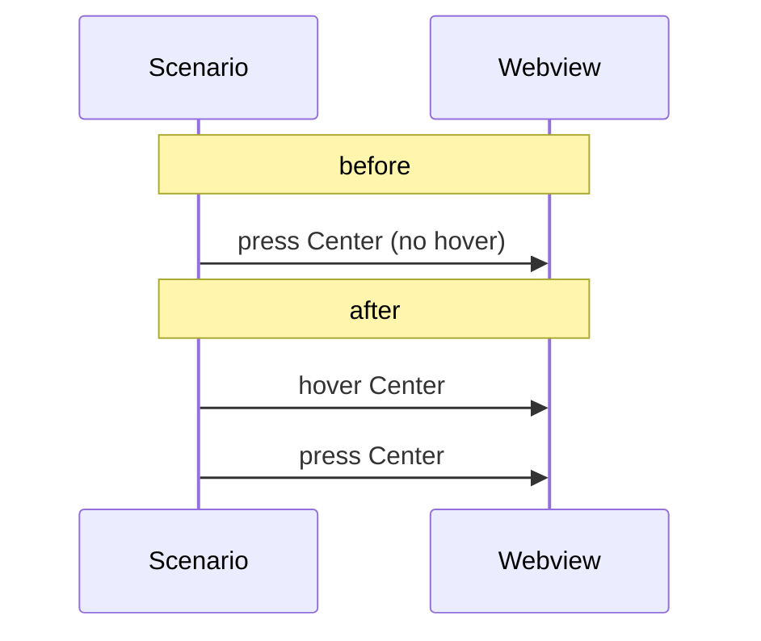

test(integration): trace and harden the real-window table-insert-slash scenario

## Summary

The real-window scenario that inserts a table from the slash menu and centres the first column
failed once in CI and passed on re-run. This change makes the next failure explain itself and
removes the most likely cause: the press on the just-opened Center option had no preceding hover,
so it could be routed to the workbench instead of the webview (the known failure that the CI
guidelines describe for list options). The cause of the original failure is not proved: 600
stress rounds since (below) never failed again.

## Deliverables

On a failure, the scenario now throws one message that holds everything needed to diagnose it
(shown from a deliberately forced failure in a real VS Code window, Windows, at `8071d21`):

```text
Timed out waiting for only the delimiter cell of the first column centred.
Editor state: {"value":"...| :---: | --- |...","start":30,"end":30}
Scenario: {"steps":[{"at":0,"step":"open preview"}, ... {"at":1981,"step":"Center pressed"}],
  "pageTraceStart":333,
  "host":{"requestId":2,"documentVersion":1,"phase":"ready"},
  "source":{"version":2,"dirty":true,"text":"# Smoke document ..."}}
landing workbench [none] host [none]
{ ...focus report: frames, window state, page editorTrace:
  "mousedown option=center prevented=true active=textarea pageFocus=true" ... }
```

The Center press now goes through the same helper as the other list options (hover, then press):



`table-insert-slash` is also registered as an on-demand stress scenario: it runs only when named,
never in the default plan (11 rounds).

## Blast radius

Grade: 1. Tests and the stress plan only; a plain `git revert` restores the previous state.

## Autonomous decisions

- The change adds traces and the hover-first press in one commit, so the stress runs below are not
  split into a before and an after phase.

## Known gaps

- The cause of the original failure is not proved. No round of the 600 stress rounds failed, so
  neither the missing hover nor any other cause is confirmed; the next failure will name it through
  the new message.
- There is no stress run of the code before the change: traces and the hover-first press are one
  commit, so the pre-fix failure rate was not measured.
- In the forced failure, the landing summary read `landing workbench [none] host [none]` although
  the editor trace showed the press reaching the page (`mousedown option=center`): the landing
  probe recorded nothing in that run. The summary is printed; do not rely on it alone.

<details>
<summary>Details</summary>

## Changes

- The scenario fails with one message that carries the passed steps with their times, the host's
  render request, the source document, the editor state, the focus report with the page's editor
  trace, and the landing summary of the press.
- The Center press uses `clickListOption` (hover first), like the other list options of the suite.
- `table-insert-slash` is registered in `STRESS_ON_DEMAND_SCENARIOS` (not in the default plan) and
  a unit test covers that.

## Impacts

No visual change; no change to the product.

## Test plan

- [x] New or changed tests: the stress plan unit test (9 pass at `8071d21`)
- [x] Local gates: `just check` passes at `8071d21`; `just preflight` (static stage on Windows)
  passed at `1d2c9a3`, carried over clean rebases (patch unchanged)
- [x] Evidence at `8071d21`: forced failure in the real VS Code window on Windows, message holds
  every expected part; 300 stress rounds of `table-insert-slash` green (3 heavy runs of 100
  rounds: 44912543237, 44912545451, 44912547780) plus the heavy integration job; the same 300
  rounds green at the previous head `1d2c9a3` (44909129414, 44909131656, 44909133730)
- [x] Review: approved at `845997b` (carried to `8071d21`, patch unchanged)
- [x] Verified at `8071d21`
- [x] CI green at `8071d21`: static, static-windows, visual, viewer-graph, report, checks

## Internal references

- CR-453 flaky real-window test realinput-t45.
- Part of a stack that ships together: this change follows the mutation-testing campaign change
  (PR #461) and precedes the later changes of the stack; its base stays `main` until the stack is
  placed and retargeted.
- Evidence: `work/verify.md`, `work/forced-failure.md` in the planning folder.

</details>
