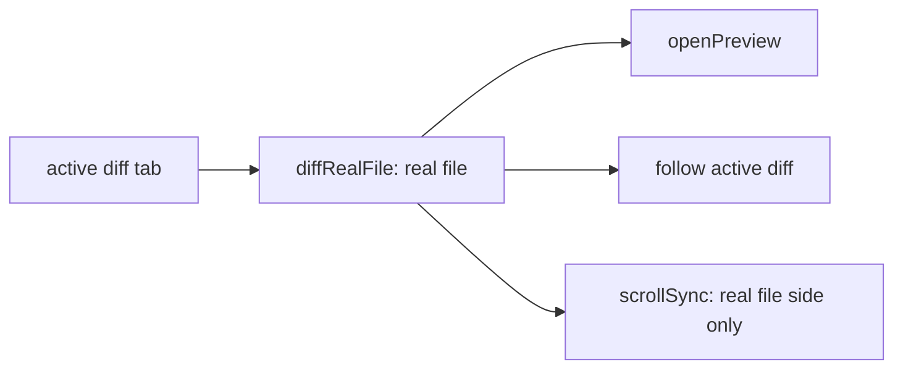

## Summary

Next to a VS Code text diff of a Markdown file (Git changes, Compare with Saved, a two-file compare, the search and replace preview), Studio's side preview was half-working: no title button on the diff, "Open Preview to Side" refused from the replace preview, the side preview did not switch to a diff of another file, and scrolling the diff did not move it. This PR treats the real file of a diff (the file on disk, never a `git:` or virtual side) as the file to preview.

## Deliverables

- The editor title button "Open Preview to Side" shows on a text diff of a `.md` file and opens the real file's preview beside the diff, without opening a text editor.
- From the replace preview, the command, the button and `Ctrl+K Shift+V` preview the real file (the original side) instead of refusing.
- The side preview switches to the real file when a text diff becomes the active editor.
- Scrolling the real file's side of a diff scrolls the side preview, and the preview's reveal targets only the real file's side.

Real-file rule (`src/host-vscode/diffRealFile.ts`): both sides `.md` files, the active side; one side only, that side; no `file:` side (staged, timeline), the working-tree file at that path, no scroll sync.

Real-window proof: heavy CI `integration` green at 61737fd (run 44925814982) with the `diff-preview` step (T1 scroll of the real original side, replace-like diff side by side; T2 command from the real side opens no text editor; T3 original virtual side; T5 preview switches to the diff that comes to the front; T4 manifest clause).

## Blast radius

Grade: 2. It touches the open-preview command, the active-editor following and the scroll sync, which are shared. Revert restores the previous behaviour.

## Autonomous decisions

- The button test (T4) lives with the new diff integration suite rather than the lifecycle suite.

## Known gaps

- The staged-like diff (no `file:` side) is covered by host unit tests only (`test/host/diffPreview.requirements.test.ts`): its real-window step was dropped (it never ran green in a real window; the first CI failures hid it behind other test bugs, cause unproven).
- The diff-to-preview scroll is asserted in a real window for a real file on the original side, side by side only; the inline layout (no editor of its own for the real side) is not asserted.
- The title button itself is checked by its manifest clause, not by clicking the real menu; the palette command is exercised, not `Ctrl+K Shift+V`.
- `onDidChangeTabs` also fires on dirty or label changes of the active diff tab; the follow is idempotent.
- Multi-file diff and merge editors are out of scope (no API input class).
- No screenshots or capture-registry entry for this change.

Details

## Changes

- `src/host-vscode/diffRealFile.ts`: new reading of the real file of the active diff.
- `src/host-vscode/activation.ts`: `openPreview` uses it for no URI or a diff side's URI; a tab-change listener follows the active diff.
- `src/session/hostEvents.ts`, `src/session/features/scrollSync.ts`: follow by document; reveal targets only `file:` documents.
- `package.json` `editor/title` clause, and its package contract test.
- Tests: host tests with a diff-capable fake host; real-window suite `test/integration/diffPreview.test.ts`.
- Requirements (four SwRS of lifecycle-sync), docs, changelog, glossary.

## Human decisions

- The file of a diff is its real file; in the replace preview this is the original side, not the virtual modified side.
- On a staged or timeline diff the button previews the working-tree file; there is no scroll following then.
- If the scroll cannot work because of VS Code, the button and command still ship and the scroll becomes a written limitation.
- A diff stays VS Code's text diff.

## Impacts

The button, command, following and scroll work next to text diffs of Markdown files. No other visual change.

## Test plan

- [x] New or changed tests: `test/host/diffPreview.requirements.test.ts`, `test/integration/diffPreview.test.ts`, package contract test, at 61737fd
- [x] Local gates at 61737fd: `just preflight` pass (Windows static stage; CI runs the rest)
- [ ] Evidence: before at `<sha7>`, after at `<sha7>`
- [x] Review: approved at 61737fd (rounds 1 to 4; r4 inspector approvals recorded)
- [ ] Verified at `<sha7>`
- [x] CI green at 61737fd: PR run 44925818134 and heavy run 44925814982 (visual, stress, integration, static, viewer-graph)

## Internal references

- CR-455 side-preview-diff-gaps.

